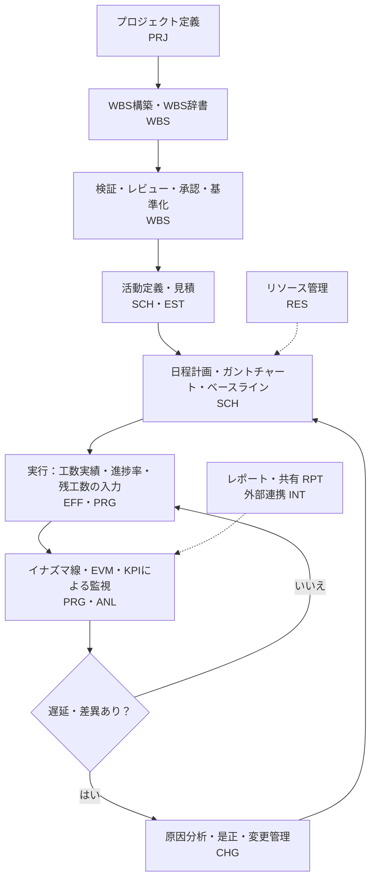

# WBS・工数・スケジュール・進捗管理システム 機能一覧

作成日：2026年11月10日　版：1.0（初版）

## 0. 本書について

### 0.1 目的

フォルダ「WBS関連調査」の資料で整理した管理手法（WBS、WBSによる工数管理、ガントチャート、イナズマ線）を、1つのシステムで実現するための機能を一覧にする。

あわせて、実現手段となるOSS・SaaSを調査し、その結果から機能の過不足を見直した。機能要件定義の叩き台として使うことを想定している。

### 0.2 要件の出所（入力資料）

| 略号 | ファイル | 主な内容 |
|---|---|---|
| W | WBS.md | WBSの構造、作成原則（100%ルール等）、作成手順、WBS辞書 |
| U | WBSユースケース.md | WBSを軸にした工数管理（見積手法、EAC、KPI、公開事例） |
| G | ガントチャート.md | ガントチャートの構成要素、作成手順、運用ポイント |
| L | 稲妻チャート.txt | イナズマ線の計算方法、描画ルール、運用ポイント |
| C | ガントチャート・WBS・稲妻チャートの使い分け.txt | 3手法の関係と実務フロー |

- 依頼の対象はMDファイル3件である。ただし、ガントチャート.mdがイナズマ線の併用に触れているため、同じフォルダのtxt 2件も要件の出所に含めた。
- WBSユースケース.mdが参照している「wbs_effort_usecases.md」はフォルダに無い。そのため、本文に書かれた範囲で要件化した。
- 根拠欄の「W§5.1」は「WBS.mdの5.1節」を表す。Uは節番号が無いため、見出し名（サマリ／調査レポート／ツール・KPI／公開事例）で示す。

### 0.3 凡例

**優先度（案）**

- 必須：資料に構成要素・作成手順として明記され、システムの中核となる機能
- 推奨：資料の「運用上の注意」「デメリット・限界」への対策、または資料が挙げる手法・KPIを支える機能
- 任意：導入規模や運用方針に応じて選ぶ機能

**区分**

- 資料：入力資料から導いた機能
- 追加：OSS・SaaSの調査で不足が分かり、追加した機能（根拠欄に参照した製品を記載）

## 1. システム概要

### 1.1 対象範囲

WBSで「何を作るか」を定義し、ガントチャートで「いつ実施するか」を計画し、イナズマ線とEVMで「計画に対してどこまで進んだか」を監視する。

WBS IDを共通キーにして、スコープ・日程・工数・コスト・変更を一貫して管理する。

### 1.2 機能の全体像

### 1.3 想定利用者

| ロール | 主な利用場面 |
|---|---|
| PM | WBS・計画の承認、ベースライン化、変更承認、KPIの確認 |
| 計画担当者 | WBS・WBS辞書の作成、見積、日程計画 |
| 実行担当者 | 実績工数・進捗率・残工数の入力 |
| 進捗管理担当者 | 報告日の設定、イナズマ線・レポートの作成、遅延分析 |
| 承認者（上長） | 工数実績・変更要求の承認 |
| 委託先 | 工数・進捗・成果物の報告 |

C§1の利用者（PM・計画担当者・実行担当者・進捗管理担当者）に、Uの契約形態と承認運用から承認者・委託先を加えた。

## 2. 機能一覧サマリ

| No | 大分類（ID接頭辞） | 主な内容 | 機能数 | 必須 | 推奨 | 任意 | うち追加 |
|---:|---|---|---:|---:|---:|---:|---:|
| 1 | プロジェクト基盤（PRJ） | 目的・スコープ、カレンダー、体制、テンプレート | 8 | 4 | 3 | 1 | 2 |
| 2 | WBS管理（WBS） | 階層構築、WBS ID、ワークパッケージ、WBS辞書、検証、レビュー・承認 | 23 | 14 | 7 | 2 | 1 |
| 3 | 見積管理（EST） | 見積手法、見積根拠、バッファ、所要期間 | 13 | 3 | 6 | 4 | 1 |
| 4 | スケジュール管理（SCH） | 活動定義、日程計算、クリティカルパス、ガント表示、ベースライン | 18 | 13 | 2 | 3 | 4 |
| 5 | 進捗管理・イナズマ線（PRG） | 進捗入力、進捗率算定、イナズマ線、履歴・遅延分析 | 20 | 13 | 6 | 1 | 3 |
| 6 | 工数・コスト管理（EFF） | 割当、実績、残工数・EAC、原価、契約 | 15 | 7 | 4 | 4 | 3 |
| 7 | 分析・KPI（ANL） | EVM、バーンダウン、見積精度、稼働率、ダッシュボード | 6 | 0 | 6 | 0 | 0 |
| 8 | リソース管理（RES） | 稼働能力、負荷、平準化 | 5 | 0 | 3 | 2 | 2 |
| 9 | 変更・課題・リスク管理（CHG） | 変更要求・影響分析・承認、是正、課題、リスク、履歴 | 9 | 6 | 3 | 0 | 0 |
| 10 | レポート・共有（RPT） | 会議資料、共有、出力 | 5 | 2 | 2 | 1 | 1 |
| 11 | 外部連携（INT） | Excel・MS Project、課題管理ツール、ERP、API、MCP | 7 | 1 | 3 | 3 | 3 |
| 12 | 共通（CMN） | 権限、シングルサインオン、通知、AI支援 | 5 | 1 | 2 | 2 | 3 |
| | **合計** | | **134** | **64** | **47** | **23** | **23** |

## 3. 機能一覧

### 3.1 プロジェクト基盤（PRJ）

| 機能ID | 中分類 | 機能名 | 機能概要 | 優先度 | 区分 | 根拠・参照 |
|---|---|---|---|---|---|---|
| PRJ-01 | プロジェクト定義 | プロジェクト基本情報の登録 | 目的・要求事項・主要成果物・期間・責任者を登録する | 必須 | 資料 | W§6 Step1 |
| PRJ-02 | プロジェクト定義 | スコープ定義（対象内・対象外） | 対象範囲と対象外範囲を明示して登録し、100%ルール判定の基準にする | 必須 | 資料 | W§5.1、§6 Step1 |
| PRJ-03 | プロジェクト定義 | プロジェクト属性の管理 | 分野（IT・建設・製造・研究開発・イベント等）、規模、契約形態（請負・準委任・内製）を管理し、テンプレート選択や分析の軸にする | 推奨 | 資料 | U（調査レポート） |
| PRJ-04 | カレンダー | 稼働カレンダーの設定 | 休日・非稼働日・1日の稼働時間を定義し、日程計算とイナズマ線の計算に使う | 必須 | 資料 | G§3 Step4、L§5 |
| PRJ-05 | カレンダー | 個人別カレンダー | 担当者ごとの休暇・非稼働日を設定し、期間と負荷の計算に反映する | 推奨 | 追加 | Wrike（ユーザー別の非稼働日）、DHTMLX Gantt PRO（リソース別カレンダー） |
| PRJ-06 | 体制 | メンバー・ロールの管理 | PM・計画担当・実行担当・進捗管理担当などのロールと所属を管理する | 必須 | 資料 | C§1 |
| PRJ-07 | テンプレート | プロジェクト・WBSテンプレート | 分野別の標準WBS（プロジェクト管理作業を含む）を登録し、新規作成時に流用する | 推奨 | 資料 | W§11、§12 |
| PRJ-08 | 複数プロジェクト | プロジェクト横断管理 | 複数プロジェクトの進捗・工数・要員を横断で一覧・比較する | 任意 | 追加 | OpenProject（ポートフォリオ、Enterprise版）、Project Server Subscription Edition |

### 3.2 WBS管理（WBS）

| 機能ID | 中分類 | 機能名 | 機能概要 | 優先度 | 区分 | 根拠・参照 |
|---|---|---|---|---|---|---|
| WBS-01 | WBS構築 | 階層構造の作成・編集 | プロジェクト全体→主要成果物・管理領域→構成要素→ワークパッケージの階層を作る。枝ごとに階層数が異なってよい | 必須 | 資料 | W§3 |
| WBS-02 | WBS構築 | 要素区分の設定 | 各要素に「成果物／管理領域／構成要素／ワークパッケージ」の区分を付ける | 必須 | 資料 | W§3 |
| WBS-03 | WBS構築 | 分解軸の設定 | 成果物別を原則とし、フェーズ別・機能別・契約別の分解を属性で併用できる | 推奨 | 資料 | W§5.2 |
| WBS-04 | WBS構築 | ツリー図・アウトライン表示 | WBSを階層ツリー図とアウトライン（表形式）で表示・編集する | 必須 | 資料 | W§4 |
| WBS-05 | WBS ID | WBS IDの自動採番 | 階層を表すID（1.0、1.1…）を自動で付ける。桁数・区切り文字・接頭辞などの採番規則を設定できる | 必須 | 資料 | W§6 Step5（採番規則の設定はMS ProjectのWBSコードを参考にした） |
| WBS-06 | WBS ID | WBS IDの維持・改番管理 | 要素の移動・追加・削除でIDが勝手に変わらないようにし、改番は明示的な操作で行う。改番時は新旧IDの対応を残す | 必須 | 資料 | W§12 |
| WBS-07 | WBS ID | WBS IDの共通キー化 | WBS IDを日程・工数・コスト・課題・報告の共通キーにし、相互に追跡できるようにする | 必須 | 資料 | W§12、G§9、U（サマリ） |
| WBS-08 | ワークパッケージ | ワークパッケージの定義 | 最下位要素をワークパッケージ（WP）に指定し、見積・責任割当・進捗管理の単位にする | 必須 | 資料 | W§3 |
| WBS-09 | ワークパッケージ | 管理作業の組込み | 進捗管理・品質管理・報告などのプロジェクト管理作業をWBSに含める | 推奨 | 資料 | W§12 |
| WBS-10 | ワークパッケージ | 責任者割当・責任分担表 | WPごとに責任者・担当チームを割り当て、WBS×担当の責任分担表を出力する | 必須 | 資料 | W§2、§7 |
| WBS-11 | WBS辞書 | WBS辞書の作成・編集 | WBS ID・名称・成果物・作業範囲・責任者・完了条件・見積工数・前提条件を要素ごとに記録する | 必須 | 資料 | W§7 |
| WBS-12 | WBS辞書 | 辞書項目のカスタマイズ | 受入条件・予算・マイルストーン・資源・契約形態などの項目を追加できる | 推奨 | 資料 | U（公開事例：PMI） |
| WBS-13 | WBS辞書 | 完了条件の必須化 | WPの成果物・完了条件（受入条件）を必須項目にし、未定義のWPを一覧にする | 必須 | 資料 | W§5.4、§5.5 |
| WBS-14 | WBS辞書 | 成果物ファイルの紐付け | WPに成果物ファイルや保管先へのリンクを紐付け、完了判定・検収の証跡にする | 任意 | 追加 | OpenProject（Nextcloudのプロジェクトフォルダ連携） |
| WBS-15 | WBS辞書 | WBS辞書の帳票出力 | WBS辞書をExcel・PDFで出力する | 推奨 | 資料 | W§6 Step6 |
| WBS-16 | 検証 | 100%ルールチェック | 子要素の工数・コストの合計と親要素を照合し、差異を警告する。対象外として登録した作業の混入を検出する | 必須 | 資料 | W§5.1 |
| WBS-17 | 検証 | 重複チェック | 名称・成果物・作業範囲が似ている要素を検出し、重複の可能性を示す | 推奨 | 資料 | W§5.3 |
| WBS-18 | 検証 | 粒度チェック | WPに担当者・見積工数・完了条件があるか、工数がプロジェクトで決めた上下限に収まるかを判定する | 推奨 | 資料 | W§5.4、§10 |
| WBS-19 | 検証 | 未記入・曖昧表現チェック | 成果物・完了条件の未記入や、「適宜」「等」などの曖昧な表現を検出する | 任意 | 資料 | W§6 Step7 |
| WBS-20 | レビュー・承認 | WBSレビュー | レビュー依頼、指摘（漏れ・重複・曖昧）の記録、対応状況の管理を行う | 必須 | 資料 | W§6 Step7 |
| WBS-21 | レビュー・承認 | WBS承認ワークフロー | WBSの承認申請・承認・差戻しを行い、承認記録を残す | 必須 | 資料 | W§6 Step8 |
| WBS-22 | レビュー・承認 | スコープベースライン化 | 承認済みのWBSを版として固定し、スコープ管理の基準にする | 必須 | 資料 | W§6 Step8 |
| WBS-23 | レビュー・承認 | WBSの版比較 | 基準版と現行版の差分（追加・削除・変更された要素）を表示する | 推奨 | 資料 | W§9、§12 |

### 3.3 見積管理（EST）

| 機能ID | 中分類 | 機能名 | 機能概要 | 優先度 | 区分 | 根拠・参照 |
|---|---|---|---|---|---|---|
| EST-01 | 見積入力 | WP・活動単位の工数見積 | WP・活動ごとに見積工数（人時・人日）を入力する | 必須 | 資料 | W§7、U（調査レポート） |
| EST-02 | 見積手法 | ボトムアップ集計 | 下位要素の見積を上位要素へ自動で積み上げる | 必須 | 資料 | U（調査レポート） |
| EST-03 | 見積手法 | トップダウン配分 | 上位要素の総工数・予算を、比率を指定して下位要素へ配分する | 推奨 | 資料 | U（調査レポート） |
| EST-04 | 見積手法 | 類推見積 | 過去プロジェクトの類似WPの実績を検索・参照し、見積の参考値を示す | 推奨 | 資料 | U（調査レポート） |
| EST-05 | 見積手法 | 三点見積（PERT） | 楽観値・最可能値・悲観値から期待値と標準偏差を計算する | 推奨 | 資料 | U（調査レポート） |
| EST-06 | 見積手法 | モンテカルロシミュレーション | 三点見積・範囲見積から完了日・総工数の確率分布を計算し、信頼度付きの完了見込みを示す | 任意 | 資料 | U（公開事例：製造）。製品例：LiquidPlanner（現 Tempo Portfolio Manager） |
| EST-07 | 見積手法 | 見積の相互検証 | 機能規模などによる見積とWBS積上げ見積を並べ、差異を示す | 任意 | 資料 | U（公開事例：IPA） |
| EST-08 | 見積根拠 | 見積根拠の記録 | 見積手法・前提・参照資料を要素ごとに記録する | 必須 | 資料 | W§2、§9 |
| EST-09 | 見積根拠 | 担当者参加型の見積 | 担当者が見積値を入力・提案し、PMが確定する | 任意 | 資料 | U（公開事例：製造） |
| EST-10 | バッファ | バッファの設定 | 活動・WP・プロジェクト単位に予備工数・予備期間を設定し、見積本体と分けて管理する | 推奨 | 資料 | U（調査レポート） |
| EST-11 | バッファ | CCPMバッファ管理 | プロジェクトバッファ・合流バッファを設定し、バッファ消費と進捗をフィーバーチャートで監視する | 任意 | 追加 | Lychee Redmine（CCPM、上位プラン） |
| EST-12 | 追加作業 | 追加作業の見積計上 | 仕様変更・欠陥対応などの追加作業を別区分で見積・計上する | 推奨 | 資料 | U（公開事例：IPA） |
| EST-13 | 期間見積 | 所要期間の算出 | 工数と担当者の稼働可能時間・カレンダーから所要期間を計算する | 推奨 | 資料 | G§3 Step3 |

### 3.4 スケジュール管理（SCH）

| 機能ID | 中分類 | 機能名 | 機能概要 | 優先度 | 区分 | 根拠・参照 |
|---|---|---|---|---|---|---|
| SCH-01 | 活動定義 | WPからの活動展開 | WPの配下に活動（実行作業）を作成し、WBS IDとの紐付けを保つ | 必須 | 資料 | W§4、§8、C§3 |
| SCH-02 | 活動定義 | タスクリストの表示・編集 | 活動を一覧形式で表示し、日付・依存関係・担当をまとめて編集する | 必須 | 資料 | W§8 |
| SCH-03 | 日程計画 | 開始日・終了日・期間の設定 | 活動ごとに予定開始日・予定終了日・期間を設定する | 必須 | 資料 | G§2 |
| SCH-04 | 日程計画 | 依存関係の設定 | 先行・後続の関係を設定し、並行して進められる作業を識別する | 必須 | 資料 | G§3 Step2 |
| SCH-05 | 日程計画 | 依存タイプとラグ・リード | 終了→開始（FS）、開始→開始（SS）、終了→終了（FF）、開始→終了（SF）の4種類と、ラグ（遅れ）・リード（前倒し）を設定する | 推奨 | 追加 | Smartsheet、Wrike、WBS Gantt-Chart for Jira、GanttProject |
| SCH-06 | 日程計画 | 自動スケジューリング | 依存関係とカレンダーから日程を計算し、先行作業の変更を後続作業へ自動で反映する | 必須 | 資料 | G§3 Step4、§5 |
| SCH-07 | 日程計画 | 手動・自動スケジュールの切替 | 活動ごとに自動計算と手動固定を切り替える | 任意 | 追加 | OpenProject |
| SCH-08 | 日程計画 | 日付制約・期限管理 | 「指定日以降に開始」などの制約や期限日を設定し、違反を警告する | 任意 | 追加 | ProjectLibre・GanttProject（制約）、WBS Gantt-Chart for Jira（期限線） |
| SCH-09 | 日程計画 | マイルストーンの設定 | 納期・承認・リリースなどの節目を期間0の要素として設定する | 必須 | 資料 | G§2、§5 |
| SCH-10 | 日程計画 | クリティカルパスの算出・表示 | 最長経路と余裕日数（フロート）を計算し、ガント上で強調する | 必須 | 資料 | G§7、L§11 |
| SCH-11 | ガント表示 | ガントチャート表示 | 縦軸に活動、横軸に時間を置いて予定バーを描く。日・週・月の表示単位を切り替えられる | 必須 | 資料 | G§1、§3 Step5 |
| SCH-12 | ガント表示 | 予定・実績・基準の重ね表示 | 予定バー・実績バー・ベースラインバーを並べて表示する | 必須 | 資料 | G§5、§9 |
| SCH-13 | ガント表示 | 依存線・担当・進捗率の表示 | 依存関係の矢印、担当者、進捗率をバー上に表示する | 必須 | 資料 | G§2、§5 |
| SCH-14 | ガント表示 | 大規模表示の支援 | 階層の折りたたみ、フィルタ、グループ化、WBS IDによる絞り込みを行う | 推奨 | 資料 | G§7 |
| SCH-15 | ガント表示 | ネットワーク図（PERT図）表示 | 活動の依存関係をネットワーク図で表示する | 任意 | 追加 | ProjectLibre、GanttProject |
| SCH-16 | ベースライン | ベースラインの保存 | 承認済みの日程・工数・コストをベースラインとして保存する | 必須 | 資料 | G§3 Step6、C§3 |
| SCH-17 | ベースライン | 複数ベースラインの保持 | 再計画しても当初計画を消さずに複数の版を保持し、比較対象を選べる | 必須 | 資料 | G§9、L§11 |
| SCH-18 | ベースライン | 基準計画と最新計画の差異表示 | ベースラインと最新計画の日程・工数の差異（バリアンス）を表示する | 必須 | 資料 | C§3、U（公開事例） |

### 3.5 進捗管理・イナズマ線（PRG）

| 機能ID | 中分類 | 機能名 | 機能概要 | 優先度 | 区分 | 根拠・参照 |
|---|---|---|---|---|---|---|
| PRG-01 | 進捗入力 | 報告日の設定 | 全活動に共通の報告日（ステータス日）を設定し、その時点の値で進捗を評価する | 必須 | 資料 | G§9、L§11 |
| PRG-02 | 進捗入力 | 進捗率・実績日付の入力 | 活動ごとに進捗率・実績開始日・実績終了日を入力する | 必須 | 資料 | G§2、§3 Step7 |
| PRG-03 | 進捗入力 | 遅延理由・完了見込みの入力 | 遅延理由と完了見込み日を記録する | 必須 | 資料 | G§3 Step7、C§3 |
| PRG-04 | 進捗入力 | 進捗更新のリマインド | 報告日の前に、未更新の活動の担当者へ通知する | 推奨 | 資料 | G§7、§9 |
| PRG-05 | 進捗率算定 | 進捗率の算定方式の設定 | 成果物完了割合・承認済み作業割合・検証項目完了割合・重み付きマイルストーンから方式を選ぶ。調査を受けて0/100法・50/50法も加えた | 必須 | 資料 | L§11。0/100法・50/50法はPrimavera P6の出来高計上方式 |
| PRG-06 | 進捗率算定 | 上位要素への進捗集計 | 下位の進捗を工数・期間で重み付けし、上位要素とプロジェクト全体の進捗率を計算する | 推奨 | 追加 | Smartsheet（親行への集計）、OpenProject（工数ベースの進捗）、WBS Gantt-Chart for Jira |
| PRG-07 | 進捗率算定 | 完了条件に基づく完了判定 | WBS辞書の完了条件を満たして承認された時点で完了とし、記録を残す | 推奨 | 資料 | W§5.5、U（公開事例） |
| PRG-08 | イナズマ線 | 報告日線の描画 | ガント上に報告日を示す縦線（報告日線）を描く | 必須 | 資料 | L§4 Step2 |
| PRG-09 | イナズマ線 | 進捗ポイントの計算 | 「開始予定日＋予定期間×進捗率」で各活動の進捗位置を計算する | 必須 | 資料 | L§5 |
| PRG-10 | イナズマ線 | 稼働日ベースの計算 | 休日・非稼働日を除いた稼働日で進捗位置を計算する | 必須 | 資料 | L§5 |
| PRG-11 | イナズマ線 | 特殊な描画ルール | 完了済みの活動と、報告日より後に開始予定の未着手の活動は、報告日線上に置く | 必須 | 資料 | L§7 |
| PRG-12 | イナズマ線 | イナズマ線の描画 | 進捗ポイントを上から順に折れ線で結ぶ | 必須 | 資料 | L§4 Step6 |
| PRG-13 | イナズマ線 | 遅れ・前倒しの判定 | 報告日線からのずれで「遅れ／予定どおり／前倒し」を判定し、色分け・一覧化する | 必須 | 資料 | L§3、§6 |
| PRG-14 | イナズマ線 | 比較基準の選択 | イナズマ線をベースライン基準と最新計画基準のどちらで描くかを選ぶ | 推奨 | 追加 | MS Project（進捗線）、Primavera P6（進捗線）。L§11（ベースラインの維持）にも対応 |
| PRG-15 | イナズマ線 | 計算モデルの選択 | 線形モデルのほか、活動ごとの計画出来高カーブに基づく位置計算を選べる | 任意 | 資料 | L§9（線形進捗の仮定） |
| PRG-16 | イナズマ線 | 重要活動の強調 | クリティカルパス上の活動・マイルストーンをイナズマ線上で強調する | 推奨 | 資料 | L§9、§11 |
| PRG-17 | 履歴・分析 | 進捗スナップショットの保存 | 報告日ごとに全活動の進捗率・実績日付・残工数を保存し、後で値を直しても過去の線を再現できるようにする | 必須 | 資料 | L§8、§11 |
| PRG-18 | 履歴・分析 | 過去のイナズマ線の重ね表示 | 複数の報告日のイナズマ線を重ねて表示し、遅延の拡大・改善の傾向を比べる | 必須 | 資料 | L§8、§11 |
| PRG-19 | 履歴・分析 | 遅延活動の抽出・影響確認 | 報告日線より大きく左にずれた活動を抽出し、後続の活動・クリティカルパス・マイルストーンへの影響を示す | 必須 | 資料 | L§4 Step7、C§3 |
| PRG-20 | 履歴・分析 | 期限・遅延のアラート | 期限超過や遅延の恐れがある活動を色・アイコンで警告し、担当者とPMに通知する | 推奨 | 追加 | WBS Gantt-Chart for Jira（遅延警告） |

### 3.6 工数・コスト管理（EFF）

| 機能ID | 中分類 | 機能名 | 機能概要 | 優先度 | 区分 | 根拠・参照 |
|---|---|---|---|---|---|---|
| EFF-01 | 割当 | 担当者・工数の割当 | WP・活動に担当者と割当工数を設定する | 必須 | 資料 | U（調査レポート） |
| EFF-02 | 実績 | 実績工数の入力 | 担当者が日別・活動別に実績工数を入力し、WBS ID単位で集計する | 必須 | 資料 | U（調査レポート） |
| EFF-03 | 実績 | 入力手段の拡充 | カレンダー（Outlook・Google）からの取込、スマートフォン入力、タイマー計測で入力の手間を減らす | 任意 | 追加 | クラウドログ、Wrike（タイムトラッカー） |
| EFF-04 | 実績 | 工数の提出・承認・締め | 期間ごとに工数を提出し、上長・PMが承認・差戻しする。締めた期間は編集できないようにする | 推奨 | 追加 | Tempo Timesheets（Jira用アプリ） |
| EFF-05 | 実績 | 勤怠データとの突合 | 勤怠システムの就業時間と工数実績を照合し、入力漏れや過大入力を見つける | 任意 | 追加 | クラウドログ（KING OF TIME、ジョブカン等との連携） |
| EFF-06 | 予測 | 残工数の入力・再見積 | 担当者が残工数（ETC）を入力して見積を更新する。未入力時は見積と実績から自動計算する | 必須 | 資料 | U（ツール・KPI、公開事例）。製品例：MS Project（残存作業時間）、Redmine 6.0（見積残時間） |
| EFF-07 | 予測 | 完了時総工数見込みの算出 | 実績工数＋残工数で、完了時の総工数見込み（EAC）を計算する | 必須 | 資料 | U（公開事例） |
| EFF-08 | 予測 | 計画値と予測値の分離 | ベースライン（計画値）と予測値（Forecast）を別の項目として保持する | 必須 | 資料 | U（公開事例） |
| EFF-09 | 集計 | 多軸集計 | 予定・実績・残・EACを、WBS階層・担当者・期間・組織別に集計する | 必須 | 資料 | U（サマリ）、W§2 |
| EFF-10 | 集計 | 予定対実績の差異分析 | 予定と実績・EACの差異を計算し、閾値を超えた要素を抽出する。差異理由と是正措置を記録する | 必須 | 資料 | U（調査レポート） |
| EFF-11 | 原価 | 単価設定・原価計算 | 担当者・ロール・委託先別の単価を設定し、工数×単価で原価を計算する | 推奨 | 資料 | U（サマリ）。製品例：OpenProject（人件費・単位コスト） |
| EFF-12 | 原価 | 予算管理 | WBS要素ごとに予算を設定し、実績原価・見込み原価と比較する | 推奨 | 資料 | U（公開事例：PMI）。製品例：OpenProject（予算） |
| EFF-13 | 原価 | CBSとの対応付け | WBS要素とコスト分解構造（CBS）を対応付け、日程とコストを同じ構造で集計する | 任意 | 資料 | U（公開事例：建設） |
| EFF-14 | 契約 | 契約形態・委託先別の管理 | WPごとに契約形態（請負・準委任・内製）と委託先を設定し、成果物検収・工数精算など形態に合った管理を行う | 推奨 | 資料 | U（調査レポート、公開事例：NASA） |
| EFF-15 | 契約 | 委託先報告の取込 | 委託先から工数・進捗・成果物の報告を受け取り、WBS IDで取り込む | 任意 | 資料 | U（公開事例：NASA） |

### 3.7 分析・KPI（ANL）

| 機能ID | 中分類 | 機能名 | 機能概要 | 優先度 | 区分 | 根拠・参照 |
|---|---|---|---|---|---|---|
| ANL-01 | EVM | EVM指標の算出 | 報告日時点のPV・EV・AC、SV・CV、SPI・CPIを計算する | 推奨 | 資料 | U（ツール・KPI）。製品例：MS Project、Lychee Redmine |
| ANL-02 | EVM | EVMによる完了予測 | CPI等を使って、完了時のコスト・工数（EAC）と差異（VAC）を予測する | 推奨 | 資料 | U（ツール・KPI） |
| ANL-03 | 推移 | ワークバーンダウン | ベースライン・実績・残作業量の推移をグラフで示す | 推奨 | 資料 | U（ツール・KPI）。製品例：MS Project、Backlog |
| ANL-04 | 見積精度 | 見積精度の分析 | 見積と実績の比率をWP種別・担当・プロジェクト横断で分析し、類推見積に生かす | 推奨 | 資料 | U（ツール・KPI） |
| ANL-05 | 稼働 | 稼働率の分析 | 担当者・チームごとの稼働率（実績工数÷稼働可能時間）を計算する | 推奨 | 資料 | U（ツール・KPI） |
| ANL-06 | ダッシュボード | KPIダッシュボード | EAC・差異・残工数・稼働率・見積精度・SPI/CPI・遅延件数を一画面で示す | 推奨 | 資料 | U（ツール・KPI） |

### 3.8 リソース管理（RES）

| 機能ID | 中分類 | 機能名 | 機能概要 | 優先度 | 区分 | 根拠・参照 |
|---|---|---|---|---|---|---|
| RES-01 | 稼働能力 | 稼働能力の設定 | 担当者ごとの稼働可能時間・兼務率を設定する | 推奨 | 資料 | G§3 Step3 |
| RES-02 | 負荷 | 負荷の可視化 | 担当者別・期間別に割当工数と上限を比べ、過負荷を色で示す（リソースヒストグラム） | 推奨 | 資料 | G§1、§7 |
| RES-03 | 負荷 | 過負荷の検出・通知 | 上限を超える割当を検出し、PMに通知する | 推奨 | 資料 | G§7 |
| RES-04 | 調整 | リソースの平準化 | 過負荷を解消するよう、作業の後ろ倒しや分割を自動で行う | 任意 | 追加 | MS Project（リソースの平準化） |
| RES-05 | 調整 | プロジェクト横断の要員計画 | 兼務者の負荷を全プロジェクト横断で集計し、要員計画を立てる | 任意 | 追加 | OpenProject（リソース管理、Enterprise版）、Project Server Subscription Edition（リソース・需要管理） |

### 3.9 変更・課題・リスク管理（CHG）

| 機能ID | 中分類 | 機能名 | 機能概要 | 優先度 | 区分 | 根拠・参照 |
|---|---|---|---|---|---|---|
| CHG-01 | 変更管理 | 変更要求の登録 | スコープ・日程・工数の変更要求を、対象のWBS IDと理由を付けて登録する | 必須 | 資料 | W§12、C§3 |
| CHG-02 | 変更管理 | 変更の影響分析 | 変更がWBS・日程（クリティカルパス）・工数・コストに与える影響を試算して示す | 必須 | 資料 | W§9、C§3 |
| CHG-03 | 変更管理 | 変更承認ワークフロー | 変更要求の承認・却下を行い、承認履歴を残す | 必須 | 資料 | C§3 |
| CHG-04 | 変更管理 | 再基準化 | 承認された変更をWBS・計画に反映し、新しいベースラインを作る（旧版は保持する） | 必須 | 資料 | W§12、C§3 |
| CHG-05 | 是正 | リカバリー計画の策定支援 | 計画を複製して対策案を試算・比較し、承認後に本計画へ反映する | 推奨 | 資料 | C§3 |
| CHG-06 | 是正 | 遅延原因・是正措置の管理 | 遅延原因・対策・担当・期限・効果を記録し、完了まで追跡する | 必須 | 資料 | C§2、§3 |
| CHG-07 | 課題・リスク | 課題管理 | 課題をWBS IDに紐付けて登録し、担当・期限・状態を管理する | 推奨 | 資料 | W§4 |
| CHG-08 | 課題・リスク | リスク管理 | リスク（発生確率・影響・対応策）をWBS IDに紐付けて管理する | 推奨 | 資料 | L§11 |
| CHG-09 | 履歴 | 変更履歴の記録 | WBS・計画・実績の変更者・日時・変更内容を記録し、検索できるようにする | 必須 | 資料 | G§9、L§11 |

### 3.10 レポート・共有（RPT）

| 機能ID | 中分類 | 機能名 | 機能概要 | 優先度 | 区分 | 根拠・参照 |
|---|---|---|---|---|---|---|
| RPT-01 | 会議資料 | 定例会議用の進捗レポート | 報告日時点のガント＋イナズマ線、遅延一覧、マイルストーンの状況、主要KPIを1枚にまとめる | 必須 | 資料 | L§8、C§4 |
| RPT-02 | 会議資料 | 定期レポートの自動作成 | 週次・月次のレポートを報告日ごとに自動で作成し、履歴として保存する | 推奨 | 資料 | L§11、G§9 |
| RPT-03 | 共有 | 計画の共有 | 関係者が最新の計画・進捗を閲覧できるようにする（閲覧専用の権限、共有リンク） | 必須 | 資料 | G§1 |
| RPT-04 | 出力 | PDF・画像・Excelへの出力 | ガント（イナズマ線・クリティカルパスを含む）、WBS図、一覧をPDF・画像・Excelに出力・印刷する | 推奨 | 追加 | Lychee Redmine（イナズマ線・クリティカルパスを含むPDF出力）、GanttProject、DHTMLX Gantt |
| RPT-05 | 出力 | Mermaid形式での出力 | WBS・ガント・業務フローをMermaid記法で出力し、Markdown文書に貼れるようにする | 任意 | 資料 | G§4、C§2 |

### 3.11 外部連携（INT）

| 機能ID | 中分類 | 機能名 | 機能概要 | 優先度 | 区分 | 根拠・参照 |
|---|---|---|---|---|---|---|
| INT-01 | データ入出力 | Excel・CSVの入出力 | WBS・計画・実績をExcel・CSVで取り込み・出力する | 必須 | 資料 | U（ツール・KPI） |
| INT-02 | データ入出力 | MS Project連携 | MS Projectのファイル（.mpp・XML）を取り込み・出力し、ベースライン作業時間・実績作業時間・残存作業時間などを受け渡す | 推奨 | 資料 | U（ツール・KPI） |
| INT-03 | システム連携 | 課題管理ツール連携 | Jira・Backlog・Redmineの見積工数・実績工数をWBS IDで取り込む | 推奨 | 資料 | U（ツール・KPI） |
| INT-04 | システム連携 | 会計・ERP連携 | 原価・支払のデータを会計システム・ERPと連携する | 任意 | 資料 | U（ツール・KPI） |
| INT-05 | システム連携 | カレンダー連携 | 休日カレンダー（ICS形式）の取込や、Outlook・Googleカレンダーとの連携を行う | 任意 | 追加 | GanttProject（ICS形式の休日取込）、クラウドログ |
| INT-06 | システム連携 | API・Webhook | REST APIとWebhookで、外部システムからの参照・更新・イベント通知を行う | 推奨 | 追加 | OpenProject（REST API v3、Webhook） |
| INT-07 | システム連携 | AIエージェント連携（MCP） | MCPサーバーを通じて、AIエージェントから活動の作成・更新・照会を行えるようにする | 任意 | 追加 | OpenProject（MCPサーバー、Enterprise版） |

### 3.12 共通（CMN）

| 機能ID | 中分類 | 機能名 | 機能概要 | 優先度 | 区分 | 根拠・参照 |
|---|---|---|---|---|---|---|
| CMN-01 | 権限 | ユーザー・権限の管理 | ロール別・プロジェクト別に、閲覧・編集・承認の権限を設定する | 必須 | 資料 | C§1 |
| CMN-02 | 認証 | シングルサインオン | SAML等で社内の認証基盤とシングルサインオンする | 推奨 | 追加 | Lychee Redmine（SAML） |
| CMN-03 | 通知 | 通知 | 承認依頼・遅延・更新依頼・過負荷を、メールやチャットツールに通知する | 推奨 | 資料 | G§7、C§3 |
| CMN-04 | AI支援 | タスク素案の生成 | 目的・成果物の記述や資料から、WBS要素・活動の素案をAIで作る | 任意 | 追加 | Microsoft Planner エージェント（目標からのタスク生成、プレミアムプラン） |
| CMN-05 | AI支援 | 状況報告の自動作成 | 進捗・マイルストーン・リスク・次の行動をまとめた状況報告をAIで作る | 任意 | 追加 | Microsoft Planner エージェント（ステータスレポートの自動作成） |

## 4. 過不足の確認結果

### 4.1 追加した機能（23件）

OSS・SaaSの機能と照らし合わせ、資料から導いた機能だけでは足りない23件を追加した（3章の区分「追加」）。

| 観点 | 追加した機能 | 資料に不足していた点 |
|---|---|---|
| 日程計算の精度 | SCH-05 依存タイプとラグ・リード、SCH-07 手動・自動スケジュールの切替、SCH-08 日付制約・期限管理、PRJ-05 個人別カレンダー、RES-04 リソースの平準化 | 資料は依存関係を「先行・後続」としか定義していない。製品は4種類の依存とラグ、日付制約、個人の休暇、平準化まで扱っており、実務の日程計算に必要である |
| 進捗の見える化 | PRG-06 上位要素への進捗集計、PRG-14 比較基準の選択、PRG-20 期限・遅延のアラート、SCH-15 ネットワーク図表示、RPT-04 PDF・画像・Excelへの出力 | 資料は活動単位の進捗とイナズマ線が中心である。製品は上位要素への集計、比較基準の切替、警告、会議用の出力を備える |
| 工数収集の負荷と正確さ | EFF-03 入力手段の拡充、EFF-04 工数の提出・承認・締め、EFF-05 勤怠データとの突合、INT-05 カレンダー連携 | 資料は実績工数が正しく集まることを前提にしている。製品は入力の手間を減らす仕組みと、承認・勤怠照合で正確さを担保する仕組みを持つ |
| 規模の拡大 | PRJ-08 プロジェクト横断管理、RES-05 プロジェクト横断の要員計画、EST-11 CCPMバッファ管理 | 資料は単一プロジェクトが前提である。兼務者の負荷やバッファ消費の監視は、複数案件を並行して運用する場合に必要になる |
| 連携・セキュリティ・AI | INT-06 API・Webhook、INT-07 AIエージェント連携（MCP）、CMN-02 シングルサインオン、CMN-04 タスク素案の生成、CMN-05 状況報告の自動作成、WBS-14 成果物ファイルの紐付け | 資料に記載がない。社内システムとの連携と認証は全社導入時に必要である。AIによるタスク生成・報告作成はMicrosoft Planner等で提供が始まっている |

また、既存のPRG-05（進捗率の算定方式の設定）には、Primavera P6の出来高計上方式を参考に0/100法・50/50法を加えた。

### 4.2 見直した機能（統合・格下げ・対象外）

| 対象 | 見直し内容 | 理由 |
|---|---|---|
| 確率的な完了予測 | EST-06（モンテカルロシミュレーション）に統合 | 同じ計算機能のため |
| What-ifシナリオ | CHG-05（リカバリー計画の策定支援）に統合 | リカバリー計画を試算する手段として整理した |
| 監査ログ | CHG-09（変更履歴の記録）に統合 | 変更履歴と内容が重なるため |
| Mermaid形式での出力（RPT-05） | 優先度を任意とした | 資料の図示に使われているが、調査した製品に標準の対応が見当たらない。出力スクリプトで代替できる |
| 未記入・曖昧表現チェック（WBS-19） | 優先度を任意とした | 製品の標準機能に見当たらない。AI支援（CMN-04）と組み合わせて実現する想定 |
| アジャイル機能（スプリント、バックログ、カンバン） | 対象外 | Planner（プレミアム）やLychee Redmine等にはあるが、資料はWBSを軸にした計画型の管理を対象としている。必要になった時点で追加する |
| Wiki・文書管理・チャット | 対象外 | 汎用の協働機能である。成果物との紐付け（WBS-14）だけを採用した |
| 非機能要件（提供形態、IP制限、性能、ライセンス等） | 対象外 | 機能一覧の範囲外である。製品選定時に別途評価する（5.2の提供形態を参照） |

### 4.3 製品の標準機能では実現しにくい機能

次の機能は、調査した製品の標準機能では確認できなかった。導入時はカスタマイズ、運用ルール、または独自開発で補う必要がある。

| 機能ID | 内容 | 調査結果 | 対応の方向性 |
|---|---|---|---|
| WBS-05、WBS-06 | WBS IDの自動採番・維持 | 採番規則を設定できるのはMS Projectで確認した（タスクを移動しても自動では改番されず、手動で再採番する）。他の製品では確認できなかった | 採番ルールを自前で実装するか、カスタム項目で管理する |
| WBS-11〜WBS-13 | WBS辞書・完了条件の必須化 | 専用の機能は確認できなかった | カスタム項目と必須設定、帳票の作り込みで対応する |
| WBS-16〜WBS-19 | 100%ルール・重複・粒度・曖昧表現のチェック | 確認できた製品はない（工数の自動積上げのみ） | 独自のチェック機能を作る。判定にAIを使うことも選択肢になる |
| PRG-10、PRG-11 | 稼働日ベースの計算、特殊な描画ルール | イナズマ線の描画ルールは製品ごとに異なる（例：Redmineは進行中の活動と、開始しているはずの活動を結ぶ方式） | 資料（国土交通省の教材の方式）と一致するかを実データで検証する |
| PRG-17、PRG-18 | 進捗スナップショット、過去の線の比較 | MS Projectは複数の日付の進捗線を表示できる。OpenProjectは過去時点との比較ができる（Community版は前日のみ）。過去の進捗値を報告日ごとに保存する方式は確認できなかった | 報告日ごとのスナップショット保存を独自に実装する |
| EST-07、EST-09 | 見積の相互検証、担当者参加型の見積 | 専用の機能は確認できなかった | 運用ルールと見積入力画面の作り込みで対応する |
| EFF-13〜EFF-15 | CBS、契約形態、委託先報告 | 専用の機能は確認できなかった | カスタム項目と集計レポートで対応する |
| INT-03 | 課題管理ツールからの工数取込 | 各製品にAPIはあるが、WBS IDでの突合は製品の機能にない | API連携を開発する |
| ANL-04 | 見積精度の分析 | 専用の機能は確認できなかった | BIツールで分析する |

## 5. OSS・SaaSの調査結果

### 5.1 調査の範囲

- 確認日：2026年11月10日。各製品の公式ヘルプ・製品ページ・公式資料を中心に確認した（一部は第三者の記事）。
- 選定の考え方：資料に登場する製品（MS Project、Jira、Backlog、Redmine、工数管理SaaS）に、イナズマ線・EVMを持つ国産製品と、主要なOSS・SaaSを加えた。

| 区分 | 製品 | 提供形態 |
|---|---|---|
| OSS | OpenProject、Redmine、ProjectLibre、GanttProject | セルフホスト、デスクトップ（一部はクラウド版あり） |
| Redmine拡張（商用） | Lychee Redmine（アジャイルウェア） | クラウド、オンプレミス |
| 商用ツール | Microsoft Project・Planner、Jira＋WBS Gantt-Chart for Jira（リックソフト）、Backlog（ヌーラボ）、Smartsheet、Wrike、Zoho Projects | SaaS、デスクトップ、Data Center |
| 特化型 | Primavera P6（EVM・進捗線）、LiquidPlanner（範囲見積）、クラウドログ・Tempo Timesheets（工数管理） | 製品により異なる |
| 開発部品 | Frappe Gantt、DHTMLX Gantt、Bryntum Gantt、SpreadJS（GanttSheet） | ライブラリ |

Asana、monday.com、ClickUpなどの汎用ワークマネジメントSaaSは、今回は詳細を確認していない。

### 5.2 主要機能の対応状況

凡例：◯＝公式情報等で対応を確認、△＝一部対応・上位プラン・別製品・代替機能、—＝今回参照した情報では確認できず（非対応とは限らない）、要確認＝情報源によって記載が異なる

**(1) OSS・国産製品**

| 機能（対応する機能ID） | OpenProject | Redmine | Lychee Redmine | ProjectLibre | GanttProject | Backlog |
|---|---|---|---|---|---|---|
| WBS階層（WBS-01） | ◯ | ◯ | ◯ 無制限の階層 | ◯ WBS図 | ◯ | △ 親子課題 |
| WBS IDの自動採番（WBS-05） | — | — | — | — | — | — |
| 依存4種・ラグ（SCH-05） | △ 先行・後続 | △ 先行・後続と遅延日数 | △ 先行・後続 | △ 種類は未確認 | ◯ 4種、正負のラグ | — |
| 自動スケジューリング（SCH-06） | ◯ 自動・手動を切替 | △ 後続を自動で後ろ倒し | ◯ | ◯ | ◯ | — |
| 稼働カレンダー（PRJ-04） | ◯ 非稼働日 | △ 非稼働の曜日のみ | — | ◯ | ◯ 休日、ICS取込 | — |
| クリティカルパス（SCH-10） | — | — | ◯ | ◯ | 要確認 | — |
| ベースライン（SCH-16〜18） | △ 過去時点との比較。Community版は前日のみ | — | ◯ | ◯ | ◯ | — |
| イナズマ線（PRG-08〜13） | — | ◯ 2.3.0以降 | ◯ | — | — | — |
| 工数の予定・実績（EFF-02） | ◯ | ◯ | ◯ | — | — | ◯ 予定時間・実績時間 |
| EVM（ANL-01） | — | — | ◯ 上位プラン | ◯ | — | — |
| リソース負荷（RES-02） | △ Enterprise版 | — | ◯ 上位プラン | △ | ◯ 負荷チャート | — |
| CCPM（EST-11） | — | — | ◯ 上位プラン | — | — | — |
| MS Project・Excel連携（INT-01、02） | △ XLS・CSV出力、CSV取込 | △ CSV入出力 | — | ◯ .mppの読み書き | ◯ MPP・XML取込、XML・CSV出力 | — |
| 提供形態 | セルフホスト、SaaS | セルフホスト | クラウド、オンプレミス | デスクトップ、有償クラウド版 | デスクトップ、クラウド版 | SaaS |

**(2) 商用ツール**

| 機能（対応する機能ID） | MS Project（デスクトップ） | Jira＋WBS Gantt-Chart for Jira | Smartsheet | Wrike | Zoho Projects |
|---|---|---|---|---|---|
| WBS階層（WBS-01） | ◯ | ◯ 無制限の階層 | ◯ 行の階層化 | ◯ | ◯ |
| WBS IDの自動採番（WBS-05） | ◯ WBSコード（移動時は手動で再採番） | — | — | — | — |
| 依存4種・ラグ（SCH-05） | ◯ | ◯ 4種 | ◯ 4種、ラグ | ◯ 4種、リード・ラグ | ◯ 4種、ラグ |
| 自動スケジューリング（SCH-06） | ◯ | ◯ | ◯ | ◯ | ◯ |
| 稼働カレンダー（PRJ-04） | ◯ | △ カレンダー設定あり、休日の扱いは未確認 | ◯ 稼働日・休日 | △ ユーザー別の非稼働日 | △ 休日・週末を表示 |
| クリティカルパス（SCH-10） | ◯ | ◯ | ◯ | ◯ | ◯ |
| ベースライン（SCH-16〜18） | ◯ | ◯ | △ 1シートに1件 | ◯ | ◯ 2件を同時に比較 |
| イナズマ線（PRG-08〜13） | ◯ 進捗線 | ◯ Progress line | — | — | △ ベースラインからのずれ線 |
| 工数の予定・実績（EFF-02） | ◯ | ◯ Jira標準の見積・作業時間 | — | ◯ タイムトラッカー | — |
| EVM（ANL-01） | ◯ PV・EV・AC等 | — | — | — | — |
| リソース負荷（RES-02） | ◯ 平準化あり | ◯ 上限線と超過表示 | △ 別製品 | ◯ ワークロード | — |
| CCPM（EST-11） | — | — | — | — | — |
| MS Project・Excel連携（INT-01、02） | ◯ | ◯ Excel・MS Projectの入出力 | — | — | — |
| 提供形態 | デスクトップ（Professional 2024等）、Project Server Subscription Edition（オンプレミス） | Cloud、Data Center | SaaS | SaaS | SaaS |

補足：

- 残工数（ETC）を項目として持つことを確認できたのは、OpenProject（残作業）、MS Project（残存作業時間）、Jira（残り見積）である。Redmineは6.0で「見積残時間」の列（見積と進捗率から自動計算）が追加された。
- WBS階層など基本機能の一部は、一般的な製品仕様に基づいて記載した。導入を検討する際は、最新の公式情報とトライアルで確認すること。
- Lychee Redmineのプラン区分（上位プラン＝Premium以上）は、製品カタログの読み取りによる。

**主な発見**

- イナズマ線・クリティカルパス・ベースラインの3つを標準でそろえるのは、MS Project（デスクトップ）、Lychee Redmine、WBS Gantt-Chart for Jiraの3製品である。EVMまで持つのはMS ProjectとLychee Redmine（上位プラン）に限られる。
- WBS IDの採番規則を設定できるのはMS Projectのみである。WBS辞書や100%ルール等の検証機能は、どの製品でも確認できなかった（4.3参照）。
- OSSでは、Redmineがイナズマ線を標準で持つ。OpenProjectはAPI・MCP・自動スケジュールが充実しているが、クリティカルパス・イナズマ線・EVMは確認できなかった。

### 5.3 製品別の所見

- **OpenProject（OSS）**：親子階層（WBSボード）、自動・手動スケジュール、稼働日の設定、工数ベース／ステータスベースの進捗管理、時間・コスト・予算、REST API・Webhookを備える。ベースライン比較はCommunity版では前日との比較のみで、任意の日付・期間はEnterprise版で使える。クリティカルパス・イナズマ線・EVMは確認できなかった。Enterprise版ではMCPサーバーを提供している（AIエージェントから作成・更新ができ、削除はできない）。
- **Redmine（OSS）**：標準のガントチャートに進捗線（イナズマ線）がある（2.3.0で追加。進行中の活動と、開始しているはずの活動を結ぶ方式）。6.0で見積残時間の列が追加された。クリティカルパス・ベースライン・EVMは標準機能になく、プラグインやLychee Redmineで補う。
- **Lychee Redmine（商用、Redmineベース）**：無制限の階層、先行・後続と自動調整、クリティカルパス、ベースライン比較、イナズマ線を備える。上位プランでEVM（PV・EV・AC、SPI・CPI、EAC）、CCPM（バッファ、フィーバーチャート）、リソース管理を使える。イナズマ線とクリティカルパスを含む画面をPDFに出力できる。クラウドとオンプレミスの両方がある。
- **ProjectLibre（OSS、デスクトップ）**：MS Project互換。WBS図、クリティカルパス、制約、カレンダー、ベースライン、ネットワーク図、アーンドバリューを備え、.mppの読み書きとPrimavera P6の取込に対応する。チームでの共同作業は有償のProjectLibre Cloudで行う。
- **GanttProject（OSS、デスクトップ、GPL-3.0）**：4種の依存関係と正負のラグ、ベースライン、PERT図、リソース負荷チャート、休日カレンダーを備える。MS Project形式（MPP・XML等）の取込と、XML・CSV・PDF等への出力に対応する。クリティカルパスは情報源によって記載が異なるため、要確認である。
- **Microsoft Project**：デスクトップ版は、進捗線（ステータス日・現在日、定期間隔・指定日、ベースライン計画／実績計画との比較）、EVM（PV・EV・AC。ベースラインとステータス日の設定が前提）、WBSコード（採番規則を設定でき、移動時は手動で再採番）、リソースの平準化を備える。今回の対応表で◯が最も多い。なお、Project Onlineは2026年9月30日に提供を終了した（移行先としてPlanner（プレミアム）、Project Server Subscription Edition、Dynamics 365 Project Operationsが挙げられている）。
- **Microsoft Planner（プレミアムプラン）**：タイムライン（ガント）、依存関係、クリティカルパス、スプリント、目標、カスタムカレンダー、タスク履歴はプレミアムのみで使える。Plannerエージェントで、目標からのタスク生成（プレミアムプラン）と状況報告の自動作成（Microsoft 365 Copilotのライセンスが必要）ができる。ベースライン・工数・EVM・進捗線は比較ページに記載がない。
- **Jira＋WBS Gantt-Chart for Jira（リックソフト）**：無制限の階層、4種の依存関係と自動調整、クリティカルパス、ベースライン、進捗線（Progress line）、リソース（上限線と超過表示）、遅延警告、Excel・MS Projectの入出力を備える。EVMは確認できなかった。工数はJira標準の項目を使う。工数の承認はTempo Timesheets（期間ごとの提出・承認・締め）で補える。
- **Backlog（ヌーラボ）**：予定時間・実績時間と、残作業時間に基づくバーンダウンチャートを備える。依存関係・ベースライン・クリティカルパスは今回確認できなかった。
- **Smartsheet**：4種の依存関係とラグ、クリティカルパス、稼働日・休日の設定、ベースライン（1シートに1件）、親行への進捗集計を備える。工数・リソース管理は別製品（Resource Management）となる。
- **Wrike**：4種の依存関係とリード・ラグ、クリティカルパス、ベースライン、自動調整、ワークロード、タイムトラッカーを備える。
- **Zoho Projects**：クリティカルパス、ベースライン（2件を同時に比較）、ラグ、ベースラインからのずれを示す線（イナズマ線とは別物）を備える。
- **Primavera P6（Oracle）**：進捗線（ベースラインと現行計画の日付差で描く）と、出来高の計上方式（活動の進捗率、WBSマイルストーン、0/100、50/50、カスタム）を選べる。建設などの大規模案件向けである。
- **LiquidPlanner（現 Tempo Portfolio Manager）**：最良・最悪ケースによる範囲見積と、完了日を範囲で示す予測スケジューリングを備える（ベンダーはモンテカルロ法による90%信頼度の予測と説明している）。
- **クラウドログ**：工数管理に特化したSaaSである。Google・Outlookカレンダーやスマートフォンからの入力、勤怠システム（KING OF TIME、ジョブカン、勤革時、HRMOS勤怠）との連携、プロジェクト損益の可視化を備える。

### 5.4 自社開発する場合の部品（ガントチャートライブラリ）

| ライブラリ | ライセンス | 主な機能（確認できた範囲） | イナズマ線 |
|---|---|---|---|
| Frappe Gantt | MIT | 日・週・月・年の表示切替、進捗と期待進捗の表示、休日・週末の除外 | 記載なし |
| DHTMLX Gantt | Community版はMIT（v10以降）、PRO版は商用 | Community版：PDF・PNG出力、Excel・MS Projectの入出力。PRO版：自動スケジューリング、クリティカルパス、ベースライン、リソース管理、WBSコード、カレンダー、元に戻す操作 | 公式デモあり（カスタムレイヤーで描画） |
| Bryntum Gantt | 商用（公式ストアの表記で開発者1人あたり年699ドルから）。MITのCommunity版もある | ベースライン、クリティカルパス、進捗線（v1.1.0以降） | ◯（Community版で使えるかは要確認） |
| SpreadJS GanttSheet（MESCIUS） | 商用 | ステータス日・基準日を指定した進捗線、線・点・日付ラベルの書式設定 | ◯ |

### 5.5 実現方式の候補（参考）

| 案 | 構成 | 標準でそろう範囲 | 主な不足と補い方 | 向いている状況 |
|---|---|---|---|---|
| A | Lychee Redmine（上位プラン） | 階層、依存と自動調整、クリティカルパス、ベースライン、イナズマ線、EVM、CCPM、リソース管理、工数入力 | WBS ID・WBS辞書・検証（カスタム項目と独自帳票）、工数承認、MS Project連携（確認できず） | 国産製品・日本語サポートを重視し、オンプレミスも選びたい |
| B | Jira＋WBS Gantt-Chart for Jira（＋Tempo Timesheets） | 階層、4種の依存と自動調整、クリティカルパス、ベースライン、進捗線、リソース、Excel・MS Projectの入出力、工数承認（Tempo） | EVM、WBS ID・WBS辞書・検証 | 開発部門で既にJiraを使っている |
| C | MS Project（デスクトップ）＋工数管理SaaS | WBSコード、4種の依存、クリティカルパス、ベースライン、進捗線、EVM、平準化 | 共同編集と工数収集には別の手段が必要（Project Onlineは提供終了）。WBS辞書・検証 | PMが計画を集中管理し、メンバーは工数入力だけを行う |
| D | OpenProject（セルフホスト）＋独自拡張 | 階層、自動スケジュール、稼働日、工数ベースの進捗、時間・コスト・予算、API・Webhook、MCP（Enterprise版） | クリティカルパス、イナズマ線、EVM（拡張開発やBIで補う）。柔軟なベースライン比較はEnterprise版 | OSS・社内設置・API連携を重視する |
| E | 自社開発（ガントチャートライブラリを利用） | 資料固有の要件（WBS辞書・検証、国交省方式のイナズマ線、スナップショット）を作り込める | 開発・保守の負担が大きい。進捗線を持つライブラリは商用（Bryntum、SpreadJS） | 社内標準ツールとして長く運用し、他システムやAI基盤と連携させたい |

最終的な選定は、利用規模、既存環境（Microsoft 365、Jira等）、オンプレミスの要否、予算で判断する。

## 6. 参考資料

### 6.1 入力資料（フォルダ「WBS関連調査」）

- WBS.md
- WBSユースケース.md
- ガントチャート.md
- 稲妻チャート.txt
- ガントチャート・WBS・稲妻チャートの使い分け.txt

### 6.2 調査で参照した情報（2026年11月10日確認）

**OpenProject**

- [Features](https://www.openproject.org/collaboration-software-features/)
- [Baseline comparison](https://www.openproject.org/docs/user-guide/work-packages/baseline-comparison/)
- [Progress tracking](https://openproject.org/docs/user-guide/time-and-costs/progress-tracking)
- [Gantt chart](https://www.openproject.org/docs/user-guide/gantt-chart/)
- [Pricing](https://www.openproject.org/pricing/)
- [AI（MCP server）](https://www.openproject.org/ai/)
- [API and webhooks](https://www.openproject.org/docs/system-admin-guide/api-and-webhooks/)
- [OpenProject 13.0 release（Nextcloud project folders）](https://www.openproject.org/blog/openproject-13-0-release/)

**Redmine・Lychee Redmine**

- [Redmine Feature #12122 Gantt progress lines](https://www.redmine.org/issues/12122)
- [Redmine Feature #37862 Estimated time remaining](https://www.redmine.org/issues/37862)
- [Lychee Redmine カタログ](https://lychee-redmine.jp/wp-content/themes/agileware/assets/pdf/lychee-catalog.pdf)
- [Lychee Redmine ガントチャートガイド](https://lychee-redmine.jp/wp-content/uploads/2023/06/GanttchartGuide_ver4.pdf)
- [Lychee Redmine CCPMガイド](https://lychee-redmine.jp/wp-content/uploads/2023/11/lycheeredmine_ccpm_guide2.pdf)

**ProjectLibre・GanttProject**

- [ProjectLibre](https://www.projectlibre.com/)
- [ProjectLibre（Wikipedia）](https://en.wikipedia.org/wiki/ProjectLibre)
- [GanttProject](https://www.ganttproject.biz/)
- [GanttProject for Beginners（ユーザーガイド）](https://help.ganttproject.biz/uploads/default/original/1X/ae5fa52935b40a26960ee3c350dbbb311822b542.pdf)

**Microsoft**

- [Progress Lines dialog box（Dates and Intervals）](https://support.microsoft.com/en-au/office/progress-lines-dialog-box-dates-and-intervals-tab-8aab0f63-47f9-41fa-9cf3-328155fe24e4)
- [Earned value analysis, for the rest of us](https://support.microsoft.com/en-us/project/earned-value-analysis-for-the-rest-of-us)
- [Create WBS codes in Project desktop](https://support.microsoft.com/en-us/project/create-wbs-codes-in-project-desktop)
- [Level resource assignments](https://support.microsoft.com/en-US/project/distribute-project-work-evenly-level-resource-assignments)
- [Compare Microsoft project management software](https://www.microsoft.com/en-ww/microsoft-365/project/compare-microsoft-project-management-software)
- [Comparing basic vs premium plans（Planner）](https://support.microsoft.com/en-us/office/comparing-basic-vs-premium-plans-5e351170-4ed5-43dc-bf30-d6762f5a6968)
- [Create a plan from scratch with Planner agent](https://support.microsoft.com/en-us/Planner/copilot/create-a-plan-from-scratch-with-planner-agent)
- [Generate automatic status reports with Planner Agent](https://support.microsoft.com/en-us/Planner/copilot/generate-automatic-status-reports-with-planner-agent)
- [Microsoft Project Online Retirement（第三者記事）](https://www.velosio.com/blog/microsoft-project-online-retirement-what-to-do-before-september-30-2026/)

**Jira関連**

- [WBS Gantt-Chart for Jira（製品ページ）](https://www.ricksoft-inc.com/products/wbs-gantt-chart-for-jira/)
- [WBS Gantt-Chart for Jira（Data Centerドキュメント）](https://docs.ricksoft-inc.com/wbs-gantt-chart-for-jira-data-center/information-on-analysis-tools-and-functions)
- [WBS Gantt-Chart for Jira（Atlassian Marketplace）](https://marketplace.atlassian.com/plugins/jp.ricksoft.plugins.wbsgantt-for-jira/overview)
- [Tempo Timesheets: Timesheet approvals](https://help.tempo.io/timesheets/latest/timesheet-approvals)

**Backlog**

- [Visualize work progress with story points and burndown charts（Nulab）](https://nulab.com/learn/project-management/visualize-your-work-progress-using-story-points-and-burndown-charts/)
- [Backlog トライアルマニュアル](https://backlog.com/ja/files/2025/08/backlog_trial_manual_for_user.pdf)

**Smartsheet・Wrike・Zoho Projects**

- [Smartsheet: Use baselines and critical path](https://help.smartsheet.com/learning-track/project-setup-and-configuration/use-baselines-and-critical-path)
- [Smartsheet: Dependencies and predecessors](https://help.smartsheet.com/articles/765727-enabling-dependencies-using-predecessors)
- [Smartsheet: Working, non-working days and holidays](https://help.smartsheet.com/articles/516392-defining-working-non-working-holidays-on-a-project-sheet)
- [Wrike: Gantt chart](https://www.wrike.com/features/gantt-chart/)
- [Wrike: Resource management](https://www.wrike.com/use-cases/resource-management/)
- [Zoho Projects: Critical path and baseline](https://www.zoho.com/projects/critical-path-and-baseline.html)
- [Zoho Projects: Gantt charts](https://www.zoho.com/projects/gantt-charts.html)

**特化型**

- [The progress line in Primavera P6 explained（第三者記事）](https://tensix.com/the-progress-line-in-primavera-p6-explained/)
- [Primavera P6: Earned Value page](https://docs.oracle.com/cd/G18294_01/p6help/en/17931.htm)
- [Tempo Portfolio Manager（旧 LiquidPlanner）: Ranged estimation](https://tempo.io/products/portfolio-manager/ranged-estimation)
- [クラウドログ](https://www.crowdlog.jp/)

**ガントチャートライブラリ**

- [Frappe Gantt（GitHub）](https://github.com/frappe/gantt)
- [DHTMLX Gantt: Editions comparison](https://docs.dhtmlx.com/gantt/guides/editions-comparison/)
- [DHTMLX Gantt 10.0](https://dhtmlx.com/blog/dhtmlx-gantt-10-0/)
- [DHTMLX Gantt: Progress line demo](https://docs.dhtmlx.com/gantt/demos/progress-line/)
- [Bryntum Gantt v1.1.0（Baselines, Critical Paths and Progress Line）](https://bryntum.com/blog/bryntum-gantt-v1-1-0-baselines-critical-paths-and-progress-line/)
- [Bryntum Gantt（購入ページ）](https://bryntum.com/store/gantt/)
- [SpreadJS GanttSheet: Progress Line](https://developer.mescius.com/spreadjs/docs/v19/features/ganttsheet/progress-line)
