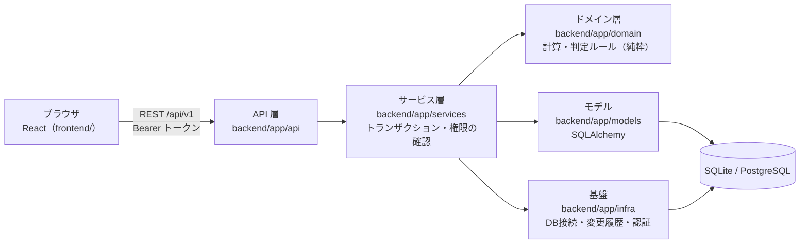
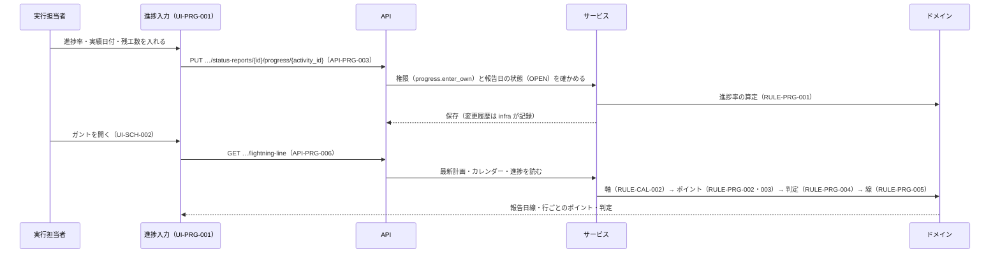
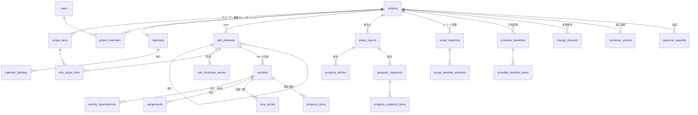
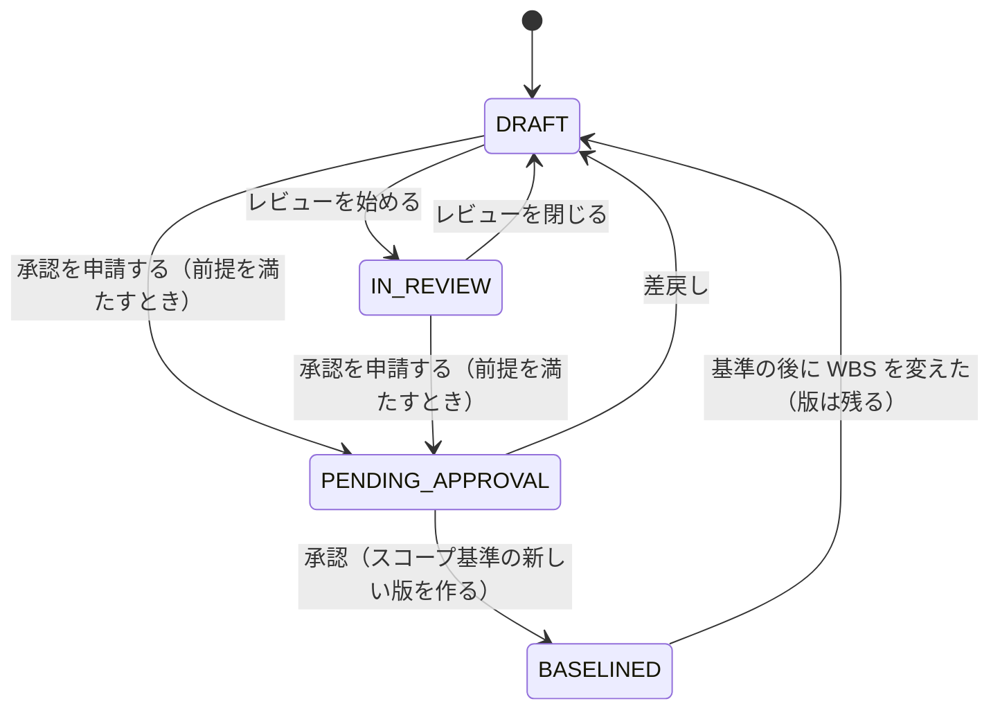
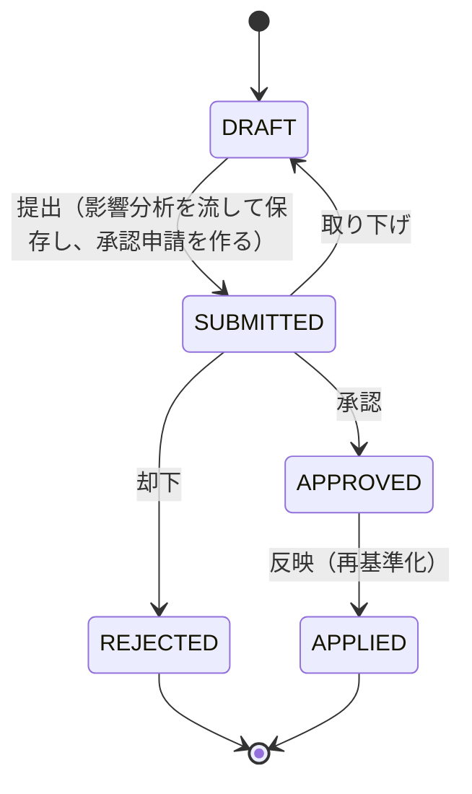
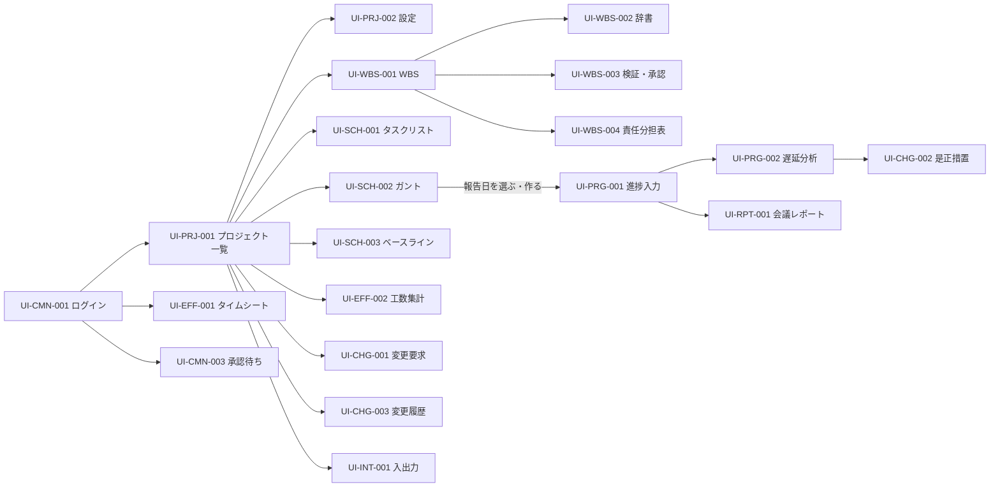

WBS・工数・進捗管理システム（PMT）設計書

作成日：2026年11月10日　改訂日：2026年11月14日　版：1.6　対象：リリース1（要求仕様書5章の64件）

# 0. 本書について

## 0.1 目的と位置づけ

要求仕様書（`docs/pmt-requirements.md`）のR1の要求を実現する設計を定める。本書は ksd-ls の kloop が設計ID↔実装を突合する設計層の正であり（`spec-ids.toml`）、ksdx が要求→設計の写像を検査する写像表（11章）を持つ（`trace.toml`）。

- 本書の記載を正とする。実装と食い違ったときは、本書を直すか実装を直すかを判断して記録する（14章）。
- R2・R3の機能は本書の対象外である。拡張点だけを15章に示す。

## 0.2 設計IDの体系

| 種別 | kloop の種別 | 形式 | 章 | 実装に現れるべき形 |
|---|---|---|---|---|
| テーブル | `db` | `DB-<群>-<3桁>` | 4.1 | SQLAlchemy のモデルの `__tablename__ = "<テーブル名>"` |
| 計算・判定ルール | `rule` | `RULE-<群>-<3桁>` | 5.1 | `backend/app/domain/` の関数・クラスの直前の行頭コメント `# RULE-…`、かつ試験に同じID |
| API | `api` | `API-<群>-<3桁>` | 6.2 | `backend/app/api/` のルート関数の docstring の先頭 `"""API-… …"""` |
| 画面 | `ui` | `UI-<群>-<3桁>` | 7.1 | `frontend/src/` の画面の部品に `data-screen-id="UI-…"`、かつルートの定義 |

群の記号：`PRJ` プロジェクト基盤、`WBS` WBS、`EST` 見積、`CAL` カレンダー、`SCH` スケジュール、`PRG` 進捗・イナズマ線、`EFF` 工数、`CHG` 変更・是正・履歴、`RPT` レポート・共有、`INT` 入出力、`CMN` 共通、`AUTH` 認証・権限。

- 設計IDは改番しない。設計から外したIDは欠番として残す。
- IDを書くのは**宣言**（その実体がそこにある）のときだけである。参照するだけのコメントにIDを書かない（kloop が実装済みと数え違えないため。2.3）。

## 0.3 読み方

| 知りたいこと | 章 |
|---|---|
| 技術・構成・依存の向き | 1、2 |
| データの形 | 3、4 |
| 計算の正確な定義（WBS ID、日程、イナズマ線、EAC） | 5 |
| APIと画面 | 6、7 |
| 要求からどの設計IDへ落ちたか | 11 |
| 実装ループでの進め方・検証器が見ていないもの | 13 |
| 版ごとの変更 | 0.4 |

## 0.4 改訂履歴

| 版 | 日付 | 変更の内容 | 根拠 |
|---|---|---|---|
| 1.0 | 2026-11-10 | 初版（設計ID 187 件） | — |
| 1.1 | 2026-11-12 | 下の CR-001〜009 を反映した（設計ID 193 件。API を 6 件足した） | `docs/instruction-change-requests.md` の CR-001〜009（2026-11-12 に推奨案で承認） |
| 1.2 | 2026-11-13 | 下の CR-010〜014 を反映した（設計ID 193 件。ID の増減なし） | `docs/instruction-change-requests.md` の CR-010〜014（2026-11-13 に推奨案で承認。未確定事項 OQ-08・09・10・42 を決め、その実装の独立レビューの指摘を直した） |
| 1.3 | 2026-11-13 | 下の CR-015〜020 を反映した（設計ID 193 件。ID の増減なし） | `docs/instruction-change-requests.md` の CR-015〜020（2026-11-13 に利用者が残りの未確定事項を推奨案で承認し、本番の配置先を Google Cloud に決めた） |
| 1.4 | 2026-11-14 | 下の CR-024 を反映した（設計ID 193 件。ID の増減なし） | `docs/instruction-change-requests.md` の CR-024（2026-11-14 に利用者が承認。ガントを入力の中心にする。A-55） |
| 1.5 | 2026-11-14 | 下の CR-025 を反映した（設計ID 193 件。ID の増減なし） | `docs/instruction-change-requests.md` の CR-025（2026-11-14 に利用者が依頼。ガントの編集を図の上の操作だけで行う。A-56） |
| 1.6 | 2026-11-14 | 下の CR-027 を反映した（設計ID 193 件。ID の増減なし） | `docs/instruction-change-requests.md` の CR-027（2026-11-14 に利用者が依頼。ガントを図の全面に出し、活動の詳細と進捗をダブルクリックで開く。A-58） |

1.1 の変更の内訳：

| CR | 変えた箇所 | 内容 |
|---|---|---|
| CR-001 | 1.1 | 画面の依存の下限を React Router 7・Vite 6・Vitest 4 にし、`npm audit` で high 以上の勧告が無い版を選ぶ注を足した |
| CR-002 | 4.2 | ベースライン・スナップショットの写しの表の、要素・活動を指す列に外部キー制約を張らない。要素・活動の内部キーを再利用しない |
| CR-003 | 4.1 DB-WBS-002・5.2 | 第 1 階層の順番を数える列 `top_last_child_seq` を足した |
| CR-004 | 5.10・6.2・11 | API-WBS-024〜026・API-PRG-010・API-CHG-011・API-RPT-005 を足した（取り下げ・レビューを閉じる・置き換えだけで読めなかった資源の読み出し・一覧） |
| CR-005 | 5.1 RULE-EFF-005 | 実績工数を締める境界を「確定した報告日以前」にした（5.8 の集計の範囲と合わせた） |
| CR-006 | 6.2 API-INT-002 | 取込の権限に、対象の書く権限（wbs.edit・schedule.edit・estimate.edit）を足した |
| CR-007 | 5.1 RULE-EFF-004・5.8 | 基準の値の数え方（WP は版の WORK_PACKAGE の項目、消した活動・WP は桶「基準にあって今は無い」）と、BR-11 の「追加された要素」の範囲を定めた |
| CR-008 | 6.2 API-SCH-010・7.1・7.2・7.3・7.4・11 | タスクリストで活動の見積を書く（EST-01）、ガントから報告日を作る（PRG-01）、ガントの非稼働日を表示範囲で返す |
| CR-009 | 4.1・5.6・5.7・7.3 | 進捗率の精度（小数 2 桁）と P は丸める前の値から求めること、完了見込み日を稼働日へ寄せること、完了・未着手（予定内）の頂点の印 |

- CR-009 の提案は「P は丸める前の進捗率から求める」を 5.4 に足すとしていたが、P を定める節は 5.6 なので 5.6 に書いた。
- CR-007 の提案の「消した活動の基準は桶に置く」は、どの軸でも基準の合計が版の合計に一致するよう（EFF-09）、消した WP にも同じ扱いを当て、子の無い WP 以外の要素の基準を 0 とした（「追加」から外す）。
- CR-008 の 7.2 の追加に合わせ、UI-SCH-002 の関連要求に PRG-01 を足した（11 章の PRG-01 の行も同じ）。

1.2 の変更の内訳：

| CR | 変えた箇所 | 内容 |
|---|---|---|
| CR-010 | 4.1 DB-CMN-001・6.2 API-CMN-001・005・007・008・8 NFR-04・05・10・9.1・9.2 | project.create の許可の列 `can_create_project`、パスワードの方針とログインの試行の制限（`failed_login_count`・`locked_until`）、変更履歴のハッシュの伏せ方とログインの変更者、システム管理者の `me`、permission.manage を持つロールを残すこと |
| CR-011 | 6.2 API-PRG-004・9.2 | 委託先に返す集計値・件数・依存の相手を見える範囲から求めること、見えないものは 404、算定項目の `approved` は progress.enter_all だけが変えること |
| CR-012 | 4.2・5.10 | 全てのテーブルの内部キーを再利用しないこと、閉じたレビューの指摘も更新できること |
| CR-013 | 7.4 | 会議レポートの計画の値は最新計画から、進捗の値は確定済みなら写しから求めること |
| CR-014 | 6.2 API-PRG-004・API-PRJ-001 | enter_own だけの人は承認済みの項目と作業項目を消せず種類を変えられないこと、システム管理者でない人が作ったプロジェクトでは作った人を PM のメンバーにすること |

1.3 の変更の内訳：

| CR | 変えた箇所 | 内容 |
|---|---|---|
| CR-015 | 6.2 API-INT-001 | 実績工数の出力（`target=time-entries`）には effort.view も要る |
| CR-016 | 9.2 | 委託先には変更要求の影響（`impact`）と操作（`operations`）を返さず、影響分析を流させない |
| CR-017 | 6.2 API-WBS-002・003 | WBS の API で自分の見積を置く・変えたときも見積の記録を残す（EST-08） |
| CR-018 | 5.5・6.2 API-PRJ-004・API-SCH-002〜004・API-CHG-006・6.3 | 希望開始日はプロジェクトの開始日以降に限る（422 `BEFORE_PROJECT_START`） |
| CR-019 | 1.3・6.1・6.2 API-PRJ-010・011・API-EFF-003・API-RPT-002・004・API-CMN-003・6.3・8 NFR-10 | API の説明の公開の切り替え、業務の時間帯、CSV の式の無害化、取込の上限、共有リンクの有効期限の上限と共有ビューの個人の情報、工数の入力で読めないプロジェクトの活動の 404、ロックの状態を返す相手、最後の PM の保護 |
| CR-020 | 1.1・1.2・2.1・8 NFR-06・10 | 本番の配置（Google Cloud の Cloud Run・Cloud SQL。Terraform。サーバが画面を配る 1 コンテナ）とバックアップ |

1.4 の変更の内訳：

| CR | 変えた箇所 | 内容 |
|---|---|---|
| CR-024 | 6.2 API-SCH-003・7.1・7.2・7.3・11 | ガント（UI-SCH-002）に WBS の要素の行と編集（行を足す・名前・インデント・まとめる・移す・消す・バーのドラッグ・依存）を足し、活動の置き場の WP・WP の中の位置・予定開始日から数えた終了日を API-SCH-003 で変えられるようにした |

1.5 の変更の内訳：

| CR | 変えた箇所 | 内容 |
|---|---|---|
| CR-025 | 7.3 | ガントの編集を図の上の操作だけで行う（Enter で行を足す・右クリックのメニュー・バーを別の行へ引いて依存・行の中の入力。図の外に入力欄と操作のボタンを置かない） |

1.6 の変更の内訳：

| CR | 変えた箇所 | 内容 |
|---|---|---|
| CR-027 | 7.1・7.2・7.3・11 | 編集の切り替えを無くす（編集できる人は開いたときから図の上で編集する）、表示の単位・基準・報告日・過去の線・報告日を作る・日程の再計算を「表示の設定」のダイアログへ移す、活動の行・バーのダブルクリックで詳細（名前・希望開始日・期間・担当と割当工数）と選んだ報告日の進捗を書くダイアログを開く |

# 1. 方式設計

## 1.1 実現方式と技術

要求仕様書1.3のとおり自社開発する。

| 層 | 採用 | 版（下限） | 理由 |
|---|---|---|---|
| 言語（サーバ） | Python | 3.12 | 計算ルールを素直に書け、試験が速い。ksd-ls と同じ |
| Web フレームワーク | FastAPI | 0.115 | 型付きの入出力（Pydantic v2）と OpenAPI の自動生成 |
| ORM・移行 | SQLAlchemy・Alembic | 2.0・1.13 | SQLite と PostgreSQL の両方で動く |
| DB | SQLite（開発・試験）・PostgreSQL（本番） | 3.40・16 | NFR-10 |
| Excel | openpyxl | 3.1 | INT-01 |
| 試験（サーバ） | pytest・httpx | 8 | FastAPI の TestClient |
| 言語（画面） | TypeScript | 5 | |
| 画面 | React・React Router・Vite | 18・7・6 以上（勧告の無い版） | |
| 試験（画面） | Vitest・Testing Library | 4 以上（勧告の無い版） | |
| ガント・イナズマ線 | 自前の SVG 描画 | — | イナズマ線を描ける部品は商用のみ（要求仕様書1.3） |
| 本番の配置 | Google Cloud：Cloud Run（1 コンテナ。サーバが画面のビルドも配る）・Cloud SQL for PostgreSQL・Secret Manager・Artifact Registry・Cloud Build | — | 利用者の決定（2026-11-13。OQ-01・CR-020） |
| 資源の作成 | Terraform（`deploy/terraform/`。資源の名前に接頭辞 `ksdp` を付ける） | 1.9 | 既存の資源と名前が衝突しない（CR-020） |

- 依存は版を固定する（サーバは `backend/requirements.lock`、画面は `frontend/package-lock.json`）。画面の依存は `npm audit` で high 以上の勧告が無い版を選ぶ。
- パスワードのハッシュは標準ライブラリの `hashlib.scrypt` を使い、依存を増やさない。

## 1.2 全体構成



- 本番（CR-020）：Cloud Run の 1 つのコンテナで、サーバが画面のビルド（`frontend/dist`）も同じオリジンで配る（`PMT_STATIC_DIR`。`/api` で始まらないパスで、ファイルが無ければ `index.html` を返す）。DB は Cloud SQL for PostgreSQL 16 へ Cloud Run の Cloud SQL 接続（Unix ソケット）でつなぐ。DB の移行（`alembic upgrade head`）は Cloud Run のジョブで、サービスを入れ替える前に流す。Cloud Run は IAM の呼出しの確認を切り、利用者の認証はアプリのログイン（API-CMN-001）と共有リンク（API-RPT-004）で行う。開発は今どおり Vite の proxy を使う（2.2）

## 1.3 層と依存の向き

| 層 | 置き場 | 責務 | 依存してよい先 |
|---|---|---|---|
| API | `backend/app/api/` | HTTP の入出力、Pydantic のスキーマとの変換 | サービス、スキーマ |
| スキーマ | `backend/app/schemas/` | 入出力の型 | なし |
| サービス | `backend/app/services/` | ユースケース。1つの操作を1つのトランザクションにする。権限の確認（RULE-AUTH-001 を呼ぶ） | ドメイン、モデル、基盤 |
| ドメイン | `backend/app/domain/` | 計算・判定ルール。**DB・HTTP・時刻・乱数に触れない純粋な関数とデータクラス** | 標準ライブラリのみ |
| モデル | `backend/app/models/` | テーブルの定義 | 基盤（Base） |
| 基盤 | `backend/app/infra/` | DB 接続、セッション、変更履歴の記録（SQLAlchemy のイベント）、トークン | モデル、ドメイン（RULE-CHG-006） |

- 「今日」はサービス層が引数で渡す（ドメインは `date.today()` を呼ばない。NFR-08）。「今日」と、日付で指定する期間（API-CHG-010 など）は、業務の時間帯（`PMT_BUSINESS_TIMEZONE`。既定 `Asia/Tokyo`）の暦の日付とする（CR-019）。
- 日程は、活動・依存・カレンダーを変える操作の最後に、サービス層が RULE-SCH-002・003 で再計算して保存する（SCH-06 の自動反映）。

## 1.4 代表の処理の流れ（進捗の入力からイナズマ線まで）



# 2. 実装の置き場と規約

## 2.1 ディレクトリ構成

```text
ksd-project/
├── docs/                         要求仕様書・設計書・ブランチの規則・判断の記録
├── backend/
│   ├── pyproject.toml            パッケージ・pytest の設定（pythonpath = ["."]）
│   ├── requirements.lock         依存の版の固定
│   ├── alembic.ini・alembic/     DB の移行（環境変数 PMT_DATABASE_URL）
│   ├── app/
│   │   ├── main.py               FastAPI の生成とルータの登録
│   │   ├── config.py             設定（PMT_DATABASE_URL・トークンの有効期間など）
│   │   ├── api/                  ルータ（群ごとに 1 ファイル：projects・wbs・estimates・schedule・progress・effort・changes・reports・io・auth・users）
│   │   ├── schemas/              Pydantic のスキーマ
│   │   ├── services/             ユースケース
│   │   ├── domain/               計算・判定ルール（5.1 の実装先）
│   │   ├── models/               SQLAlchemy のモデル（群ごとに 1 ファイル）
│   │   └── infra/                db.py・audit_listener.py・security.py
│   └── tests/                    domain/（ルールの試験）・api/（API の試験）・conftest.py
├── frontend/
│   ├── package.json・package-lock.json・vite.config.ts・tsconfig.json・index.html
│   └── src/
│       ├── main.tsx・App.tsx     ルートの定義（7.1 のルートを全てここに書く）
│       ├── api/                  API の呼び出し
│       ├── pages/<群>/           画面（7.1 の 1 行に 1 つの部品）
│       └── components/gantt/     ガント・イナズマ線の描画（7.3）
├── scripts/                      verify.sh（検証器のランチャ）・setup-dev.sh（開発環境）
├── Dockerfile・.dockerignore     本番のコンテナ（画面をビルドし、サーバと一緒に入れる。CR-020）
├── deploy/                       terraform/（Google Cloud の資源）・cloudbuild.yaml・deploy.sh・README.md（配置と運用の手順書。NFR-06）
├── kloop.toml・spec-ids.toml・trace.toml・ksdls.toml
└── （入力資料の Markdown・txt はリポジトリの根に置いたまま）
```

## 2.2 開発環境

- `bash scripts/setup-dev.sh` が `.venv`（リポジトリの根）を作り、`backend/requirements.lock` を入れ、`npm --prefix frontend ci` を流す。何度流しても同じ結果になる。
- サーバの試験：`.venv/bin/python -m pytest -q backend/tests`。画面の試験：`npm --prefix frontend test`、型検査：`npm --prefix frontend run typecheck`。
- 開発時の起動：`.venv/bin/uvicorn app.main:app --app-dir backend --reload` と `npm --prefix frontend run dev`（Vite の proxy で `/api` をサーバへ渡す）。

## 2.3 設計IDの宣言の仕方（kloop が数える形）

| 種別 | 書き方の例 | 置き場 |
|---|---|---|
| `db` | `__tablename__ = "wbs_elements"`（モデルのクラスの直前の行に `# DB-WBS-001` も書く） | `backend/app/models/` |
| `rule` | 関数・クラスの直前の行に `# RULE-PRG-002 進捗ポイントの計算`。試験の関数の docstring かコメントにも同じIDを書く | `backend/app/domain/`・`backend/tests/` |
| `api` | `def create_project(...):` の docstring の先頭を `"""API-PRJ-001 プロジェクトを作成する。"""` | `backend/app/api/` |
| `ui` | 画面の部品の最上位の要素に `data-screen-id="UI-PRJ-001"`。`App.tsx` に 7.1 のルート（例 `/projects/:projectId/settings`）を書く | `frontend/src/` |

- 1つのIDの宣言は1か所に置く。別の場所でそのIDに触れるときは、IDを行頭に書かない（例：`# 参照: RULE-PRG-002` ではなく `# 進捗ポイントは RULE-PRG-002 を参照`）。
- 画面の試験ファイル（`*.test.ts`・`*.test.tsx`）は実装の証拠に数えない（`spec-ids.toml` の `test_globs`）。

## 2.4 コーディング規約

- API のエラーは `{"error": {"code": "<大文字のコード>", "message": "<日本語>", "details": [...]}}` で返す（6.1）。
- 日付は ISO 8601 の日付（`YYYY-MM-DD`）、時刻は UTC で保存し、画面で日本時間に直す。
- 工数は人時の小数（`Numeric(10,2)`）で保存する。
- 金額は R1 では扱わない（EFF-11 は R2）。

# 3. ドメインモデル



- WBS要素の内部キーは整数の `id`、業務キーは `wbs_code`（WBS ID）である。**他のテーブルは内部キーで要素を指す**ため、改番しても紐付けは切れない（WBS-07、SCH-01）。
- WBS の状態（`DRAFT`・`IN_REVIEW`・`PENDING_APPROVAL`・`BASELINED`）は `projects.wbs_status` に持つ（5.10）。

# 4. データ設計

## 4.1 テーブル一覧

**この節の表の1行が、kloop の種別 `db` の1件である。**

| 設計ID | テーブル | 論理名 | 主な列 | 関連要求 |
|---|---|---|---|---|
| DB-PRJ-001 | `projects` | プロジェクト | id, code（一意）, name, purpose, requirements, key_deliverables, start_date, target_finish_date, owner_user_id, wbs_status, settings（JSON：4.2） | PRJ-01 |
| DB-PRJ-002 | `scope_items` | スコープ項目 | id, project_id, kind（IN/OUT）, title, description, sort_order | PRJ-02 |
| DB-PRJ-003 | `calendars` | 稼働カレンダー | id, project_id（一意）, working_weekdays（月〜日の7文字。既定 `1111100`）, hours_per_day（既定 8） | PRJ-04 |
| DB-PRJ-004 | `calendar_holidays` | 休日 | id, calendar_id, holiday_date, name（calendar_id＋holiday_date で一意） | PRJ-04 |
| DB-PRJ-005 | `project_members` | メンバー | id, project_id, user_id（組で一意）, roles（JSON 配列）, organization, team | PRJ-06 |
| DB-WBS-001 | `wbs_elements` | WBS要素 | id, project_id, parent_id, kind（DELIVERABLE/MANAGEMENT/COMPONENT/WORK_PACKAGE）, name, wbs_code, sibling_seq, last_child_seq, sort_order, own_estimate_hours, responsible_user_id, responsible_team, needs_renumber | WBS-01, WBS-02, WBS-04, WBS-08, WBS-10 |
| DB-WBS-002 | `wbs_numbering_rules` | 採番規則 | id, project_id（一意）, separator（既定 `.`）, min_digits（既定 1）, prefix（既定 空）, pad_first_level（既定 真）, top_last_child_seq（既定 0。第1階層で今まで使った最大の順番。5.2） | WBS-05 |
| DB-WBS-003 | `wbs_code_history` | WBS IDの新旧対応 | id, project_id, element_id, old_code, new_code, renumbered_at, renumbered_by | WBS-06, WBS-07 |
| DB-WBS-004 | `wbs_dictionary_entries` | WBS辞書 | id, element_id（一意）, deliverable, work_scope, completion_criteria, assumptions | WBS-11, WBS-13 |
| DB-WBS-005 | `wbs_scope_links` | 要素とスコープ項目の紐付け | id, element_id, scope_item_id（組で一意） | PRJ-02, WBS-16 |
| DB-WBS-006 | `wbs_reviews` | WBSレビュー | id, project_id, status（OPEN/CLOSED）, requested_by, requested_at, reviewer_ids（JSON）, closed_at | WBS-20 |
| DB-WBS-007 | `wbs_review_comments` | レビューの指摘 | id, review_id, element_id, category（OMISSION/DUPLICATION/AMBIGUITY/OTHER）, body, status（OPEN/RESOLVED/REJECTED）, author_id, resolution, updated_at | WBS-20 |
| DB-WBS-008 | `approval_requests` | 承認申請 | id, project_id, target_type（WBS/CHANGE_REQUEST）, target_id, status（PENDING/APPROVED/REJECTED）, requested_by, requested_at, decided_by, decided_at, comment | WBS-21, CHG-03 |
| DB-WBS-009 | `scope_baselines` | スコープベースライン | id, project_id, version（プロジェクト内の連番）, reason（INITIAL_APPROVAL/RE_APPROVAL/CHANGE_REQUEST）, approval_request_id, change_request_id, created_by, created_at | WBS-22, CHG-04 |
| DB-WBS-010 | `scope_baseline_elements` | スコープベースラインの要素 | id, scope_baseline_id, element_id, parent_element_id, wbs_code, kind, name, own_estimate_hours, dictionary（JSON） | WBS-22 |
| DB-EST-001 | `estimate_records` | 見積の記録 | id, project_id, target_type（ELEMENT/ACTIVITY）, target_id, hours, input_value, input_unit（HOUR/DAY）, method（BOTTOM_UP/ANALOGOUS/THREE_POINT/EXPERT/OTHER）, assumptions, references, entered_by, entered_at | EST-01, EST-08 |
| DB-SCH-001 | `activities` | 活動 | id, project_id, work_package_id, name, sort_order, requested_start, duration_days, is_milestone, estimate_hours, progress_method（NULL＝プロジェクトの既定）, start_date, finish_date, early_start, early_finish, late_start, late_finish, total_float, is_critical | SCH-01, SCH-03, SCH-06, SCH-09, SCH-10 |
| DB-SCH-002 | `activity_dependencies` | 依存関係 | id, project_id, predecessor_id, successor_id（組で一意）, dep_type（R1 は FS のみ）, lag_days（R1 は 0 のみ） | SCH-04 |
| DB-SCH-003 | `schedule_baselines` | スケジュールベースライン | id, project_id, version, name, reason（MANUAL/RE_APPROVAL/CHANGE_REQUEST）, change_request_id, created_by, created_at | SCH-16, SCH-17 |
| DB-SCH-004 | `schedule_baseline_items` | ベースラインの項目 | id, schedule_baseline_id, item_type（ACTIVITY/WORK_PACKAGE）, activity_id, element_id, wbs_code, name, start_date, finish_date, duration_days, is_milestone, estimate_hours | SCH-16, SCH-18, EFF-08 |
| DB-PRG-001 | `status_reports` | 報告日 | id, project_id, report_date（組で一意）, status（OPEN/FINALIZED）, created_by, created_at, finalized_by, finalized_at | PRG-01, PRG-17 |
| DB-PRG-002 | `progress_entries` | 進捗の入力 | id, status_report_id, activity_id（組で一意）, percent_complete（0〜100・小数 2 桁。NULL＝未算定）, actual_start, actual_finish, remaining_hours（NULL＝自動）, delay_reason, forecast_finish, entered_by, entered_at | PRG-02, PRG-03, EFF-06 |
| DB-PRG-003 | `progress_items` | 進捗の算定項目 | id, activity_id, item_type（DELIVERABLE/WORK/CHECK/MILESTONE）, title, weight（既定 1）, done, approved, done_at | PRG-05 |
| DB-PRG-004 | `progress_snapshots` | スナップショット | id, status_report_id（一意）, report_date, report_line, tolerance_days, extract_days, plan_basis（LATEST）, created_at | PRG-17 |
| DB-PRG-005 | `progress_snapshot_items` | スナップショットの活動 | id, snapshot_id, activity_id, row_order, wbs_code, name, start_date, finish_date, duration_days, is_milestone, is_critical, percent_complete（小数 2 桁）, actual_start, actual_finish, actual_hours, etc_hours, point, deviation, judgement | PRG-17, PRG-18 |
| DB-EFF-001 | `assignments` | 担当・割当 | id, activity_id, user_id（組で一意）, planned_hours | EFF-01, WBS-10 |
| DB-EFF-002 | `time_entries` | 実績工数 | id, user_id, activity_id, work_date, hours, note（user_id＋activity_id＋work_date で一意） | EFF-02 |
| DB-EFF-003 | `variance_notes` | 差異の理由 | id, project_id, element_id, status_report_id, reason, corrective_action_id, created_by, created_at | EFF-10 |
| DB-CHG-001 | `change_requests` | 変更要求 | id, project_id, number（プロジェクト内の連番）, title, reason, target_codes（JSON）, operations（JSON：5.9）, status, impact（JSON）, created_by, submitted_at, applied_by, applied_at | CHG-01, CHG-02, CHG-03, CHG-04 |
| DB-CHG-002 | `corrective_actions` | 是正措置 | id, project_id, element_id, activity_id, status_report_id, cause, action, owner_user_id, due_date, status（NOT_STARTED/IN_PROGRESS/DONE）, effect | CHG-06 |
| DB-CHG-003 | `audit_logs` | 変更履歴 | id, occurred_at, user_id, project_id, entity_type, entity_id, wbs_code, action（CREATE/UPDATE/DELETE）, before（JSON）, after（JSON） | CHG-09 |
| DB-CMN-001 | `users` | ユーザー | id, login_id（一意）, display_name, email, password_hash, is_system_admin, can_create_project（既定 false）, is_active, organization, failed_login_count（既定 0）, locked_until | CMN-01, PRJ-06 |
| DB-CMN-002 | `role_permissions` | ロールの権限 | id, project_id, role, permission（3つの組で一意） | CMN-01 |
| DB-CMN-003 | `share_links` | 共有リンク | id, project_id, token_hash, scope（GANTT/REPORT）, expires_at, revoked_at, created_by, created_at | RPT-03 |
| DB-CMN-004 | `auth_sessions` | 認証セッション | id, user_id, token_hash, expires_at, revoked_at, created_at | CMN-01 |

件数：35。

## 4.2 列の補足

- 全てのテーブルは整数の主キー `id` を持つ。外部キーは `<テーブルの単数形>_id` とし、DB の外部キー制約を張る。
- ただし、ベースライン・スナップショットの写しの表（`scope_baseline_elements`・`schedule_baseline_items`・`progress_snapshot_items`）の、写した時点の要素・活動を指す列（`element_id`・`parent_element_id`・`activity_id`）は、写しの値として持ち、外部キー制約を張らない（基準の後に要素・活動を消しても版は変わらない。WBS-22）。写しの表から版・スナップショットの親（`scope_baseline_id`・`schedule_baseline_id`・`snapshot_id`）への外部キー制約は張る。
- 全てのテーブルの内部キー `id` は再利用しない（SQLite は `AUTOINCREMENT`。写しの値と、外部キーの無い `target_id`・`entity_id`（見積の記録・承認申請・変更履歴）が、後から作った別の行を指さないため）。
- `projects.settings` の既定値：`{"progress_method_default": "DIRECT", "delay_tolerance_days": 0.5, "delay_extract_days": 2, "variance_rate": 0.10, "variance_hours": 8, "hundred_percent_tolerance": 0.0}`（要求仕様書 BR-03・09・11）。
- `activities` の日程の列のうち、`requested_start`・`duration_days`・`is_milestone` が利用者の入力で、`start_date` 以降は RULE-SCH-002・003 の計算結果である。マイルストーンは `duration_days = 0`。
- `progress_entries` は報告日ごとに持つ。最新の値は「確定していない最新の報告日、無ければ最新の確定済みの報告日」の行である。
- `audit_logs` は追記だけを行う。更新・削除の API を作らない（NFR-05）。
- `share_links`・`auth_sessions` のトークンは SHA-256 のハッシュだけを保存する。

# 5. 計算・判定ルール設計

## 5.1 ルール一覧

**この節の表の1行が、kloop の種別 `rule` の1件である。** 実装先は `backend/app/domain/` の下のファイルで、各ルールに試験を必ず付ける（`declaration_and_test`）。

| 設計ID | 名称 | 判定・計算の要点 | 実装先 | 関連要求 |
|---|---|---|---|---|
| RULE-WBS-001 | WBS IDの採番 | 採番規則（区切り・最小桁数・接頭辞・第1階層の補完）と兄弟の順番からIDを作る（5.2） | `wbs_code.py` | WBS-05 |
| RULE-WBS-002 | WBS IDの維持・改番・旧IDの解決 | 新規は最大の順番＋1、移動・削除で他を変えない、明示の改番で全件を振り直し新旧の対応を返す、旧IDを現在の要素へ解決する（5.2） | `wbs_code.py` | WBS-06, WBS-07 |
| RULE-WBS-003 | 階層と区分の整合 | 区分は4値、WPは子を持たない、活動はWPにだけ置ける、親子の循環を作らない | `wbs_rules.py` | WBS-01, WBS-02, WBS-08, SCH-01 |
| RULE-WBS-004 | 100%ルールの検査 | 合計の差異・対象外の混入・対象内の漏れの3判定（5.3） | `wbs_rules.py` | WBS-16, PRJ-02 |
| RULE-WBS-005 | 完了条件の必須検査 | 成果物か完了条件が空のWPを列挙する | `wbs_rules.py` | WBS-13, WBS-11 |
| RULE-WBS-006 | WBSの承認の状態遷移 | 5.10の遷移と、申請の前提（完了条件の欠け0件・未対応の指摘0件・100%ルールのエラー0件）・本人の承認の禁止 | `workflow.py` | WBS-20, WBS-21, WBS-22 |
| RULE-WBS-007 | 責任分担表の組み立て | WP×メンバーの表（責任者・担当・割当工数）と責任者の無いWPの一覧を作る | `wbs_rules.py` | WBS-10 |
| RULE-WBS-008 | WBS IDによる横断照会 | 1つのWBS ID（旧IDも可）から配下の要素・活動・見積・実績・EAC・変更要求・是正措置を集める | `wbs_rules.py` | WBS-07 |
| RULE-EST-001 | ボトムアップ集計 | 活動→WP→上位→プロジェクトへ合計する。活動の無いWPは自分の見積を使う（5.8） | `estimate.py` | EST-02 |
| RULE-EST-002 | 見積の単位換算と記録 | 人日×1日の稼働時間で人時へ換算し、負の値を拒み、手法・前提・参照資料を1件の記録にする | `estimate.py` | EST-01, EST-08 |
| RULE-CAL-001 | 稼働日の判定と日付の数え方 | 稼働日の判定、開始日・期間・終了日のうち2つから残りを求める、非稼働日の寄せ（要求仕様書 BR-04） | `calendar.py` | PRJ-04, SCH-03 |
| RULE-CAL-002 | 稼働日の軸 | 日付⇔軸上の位置の変換、報告日線の位置、位置から表示の日付への変換（5.4） | `calendar.py` | PRG-08, PRG-10 |
| RULE-SCH-001 | 依存の循環検出 | 依存を足す前と日程計算の前に循環を検出し、循環に含まれる活動を返す | `scheduling.py` | SCH-04 |
| RULE-SCH-002 | 前進計算（自動スケジューリング） | 最早開始・最早終了、希望開始日とプロジェクトの開始日の下限、マイルストーンの扱い（5.5） | `scheduling.py` | SCH-06, SCH-09 |
| RULE-SCH-003 | 後退計算とクリティカルパス | 最遅開始・最遅終了・トータルフロート、フロート0以下をクリティカルにする（5.5） | `scheduling.py` | SCH-10 |
| RULE-SCH-004 | ベースラインとの差異 | 活動ごとの開始・終了の差（稼働日）と見積の差、追加・削除の区別 | `baseline.py` | SCH-18, SCH-17 |
| RULE-SCH-005 | ガントの描画データの組み立て | 行の順（WBSの並び→活動の並び）、予定・実績・基準のバー、依存線、担当者・進捗率のラベル（7.3） | `gantt.py` | SCH-11, SCH-12, SCH-13 |
| RULE-SCH-006 | 一括更新の検査 | 複数の活動の変更を全て検査してから適用し、1件でも不正なら全体を拒む | `scheduling.py` | SCH-02 |
| RULE-PRG-001 | 進捗率の算定方式 | 7つの方式（要求仕様書 BR-06）、項目0件は未算定、実績終了日があれば100 | `progress.py` | PRG-05, PRG-02 |
| RULE-PRG-002 | 進捗ポイントの計算 | 稼働日の軸で 開始位置＋期間×進捗率、マイルストーンは日の終業位置（5.6） | `lightning.py` | PRG-09, PRG-10 |
| RULE-PRG-003 | 特殊な描画ルール | 完了済み（終了予定が報告日以前）と、報告日より後に開始予定の未着手を報告日線上に置く（5.6） | `lightning.py` | PRG-11 |
| RULE-PRG-004 | 遅れ・前倒しの判定 | ずれ＝ポイント−報告日線、許容幅で3値に分け、完了・未着手（予定内）を区別する（5.6） | `lightning.py` | PRG-13 |
| RULE-PRG-005 | イナズマ線の組み立て | 行の順にポイントを並べた折れ線と報告日線、複数の報告日の線を重ねる（7.3） | `lightning.py` | PRG-08, PRG-12, PRG-18 |
| RULE-PRG-006 | 遅延活動の抽出と影響 | ずれ≦−抽出の閾値の活動をずれの順に並べ、見込みの終了から後続・クリティカルパス・マイルストーンへの影響を求める（5.7） | `delay.py` | PRG-19, PRG-03 |
| RULE-PRG-007 | 報告日の確定とスナップショット | 確定の前提（OPEN であること）、全活動の値とポイント・判定の写しを作る、確定後の入力を拒む（要求仕様書 BR-13） | `snapshot.py` | PRG-17, PRG-01 |
| RULE-EFF-001 | 残工数（ETC） | 入力値を優先、無ければ 見積×（1−進捗率）、未算定なら max(見積−実績, 0)、完了は0（5.8） | `effort.py` | EFF-06 |
| RULE-EFF-002 | EACと上位への集計 | EAC＝実績＋ETC、上位は下位の合計、ベースラインの値と予測の値を別に持つ（5.8） | `effort.py` | EFF-07, EFF-08 |
| RULE-EFF-003 | 多軸集計 | WBS・担当者・期間・組織の4軸で計画・基準・実績・ETC・EACを集計し、どの軸でも合計が一致する（5.8） | `effort.py` | EFF-09 |
| RULE-EFF-004 | 差異の判定 | 差異＝EAC−基準、差異率と絶対値の両方の閾値を超えた要素と、基準に無い要素（5.8 の「追加された要素」）を抽出する（要求仕様書 BR-11） | `effort.py` | EFF-10 |
| RULE-EFF-005 | 実績工数の入力検査 | 自分の割当の活動だけ、1日の合計24時間以下、負の値の禁止、確定した報告日以前の日は変えない | `effort.py` | EFF-02, EFF-01 |
| RULE-CHG-001 | 変更内容の適用 | 変更内容（5.9の操作の列）を計画のモデルへ順に当て、参照の解決（WBS ID・仮の参照名）と検査を行う | `change.py` | CHG-01, CHG-04 |
| RULE-CHG-002 | 影響分析 | 計画の写しに変更を当てて再計算し、終了日・マイルストーン・クリティカルパス・総工数・要素の差を返す（5.9） | `change.py` | CHG-02 |
| RULE-CHG-003 | 変更要求の状態遷移 | 5.10の遷移と、本人の承認の禁止、反映は承認済みだけ | `workflow.py` | CHG-03 |
| RULE-CHG-004 | 再基準化 | スコープとスケジュールの新しい版を作り、旧版を残す（要求仕様書 BR-12） | `baseline.py` | CHG-04, SCH-16, WBS-22 |
| RULE-CHG-005 | 是正措置の状態と期限超過 | NOT_STARTED→IN_PROGRESS→DONE の遷移と、期限超過（期限＜今日 かつ 未完了）の判定 | `workflow.py` | CHG-06 |
| RULE-CHG-006 | 変更履歴の差分 | 変更前後の値から差分を作り、対象の種類・ID・WBS IDを付ける（記録は infra のイベントが呼ぶ） | `audit.py` | CHG-09 |
| RULE-AUTH-001 | 権限の判定 | ロール×権限の表（9章）とプロジェクトの上書きから、操作の可否を決める。自分の割当に限る権限の判定 | `authz.py` | CMN-01, PRJ-06, RPT-03 |
| RULE-AUTH-002 | 共有リンクの検証 | トークンのハッシュの照合、有効期限・失効の判定、見せる範囲（GANTT/REPORT） | `authz.py` | RPT-03 |
| RULE-INT-001 | 表形式の入出力 | 6.3の列の定義での変換、行ごとの検査、全件の検査が通ったときだけ書く、出力→取込の往復で一致する | `tabular.py` | INT-01 |
| RULE-RPT-001 | 会議レポートの組み立て | 報告日のスナップショット（確定前は計算値）からガント・イナズマ線・遅延一覧・マイルストーン・主要KPIをまとめる（7.4） | `report.py` | RPT-01 |

件数：40。

## 5.2 WBS IDの採番と改番（RULE-WBS-001・002）

採番の関数は、要素の木と採番規則から各要素のIDを決める。

```text
code(要素) =
  第1階層： prefix + pad(順番) + (pad_first_level ? separator + "0" : "")
  第2階層以下： code_without_first_pad(親) + separator + pad(順番)
pad(n) = n を min_digits 桁に 0 詰めした文字列
code_without_first_pad(第1階層の要素) = prefix + pad(順番)
```

- 既定の規則で、要求仕様書の W§4 の例（1.0、1.1、1.2、2.0、2.1…）と一致する。
- 新規の要素：`順番 = 親の last_child_seq + 1`。`last_child_seq` は減らさない（削除した番号を再利用しない）。
- 第1階層の要素の「親の `last_child_seq`」は `wbs_numbering_rules.top_last_child_seq` とする（新規・移動とも）。
- 移動：移動先の親の `last_child_seq + 1` を新しい順番にするが、**`wbs_code` は変えない**。親の `wbs_code` と形が合わない要素（配下を含む）の `needs_renumber` を真にする。
- 改番（明示の操作）：兄弟の表示順（`sort_order`）に 1 から振り直し、全要素の `wbs_code` を作り直す。変わった要素ごとに `(element_id, old_code, new_code)` を返し、サービス層が `wbs_code_history` に保存する。`needs_renumber` は全て偽にする。
- 旧IDの解決：現在の `wbs_code` に一致すればそれを返す。無ければ `wbs_code_history` を新しい順にたどり、`old_code` が一致した要素の現在のIDを返す。

## 5.3 100%ルール（RULE-WBS-004）

入力：WBSの木、各要素の自分の見積（`own_estimate_hours`）、活動の見積、スコープ項目と紐付け、許容幅。出力：判定の一覧（`level`＝ERROR/WARNING、`code`、対象）。

| コード | 水準 | 条件 |
|---|---|---|
| `SUM_MISMATCH` | WARNING | 子（WPでは活動）を持つ要素に自分の見積があり、`abs(子の集計−自分の見積) / 自分の見積 > 許容幅` |
| `OUT_OF_SCOPE_LINKED` | ERROR | 対象外（OUT）のスコープ項目に紐付いた要素がある |
| `IN_SCOPE_UNCOVERED` | WARNING | どの要素にも紐付いていない対象内（IN）のスコープ項目がある |

子の集計は RULE-EST-001 の値を使う。自分の見積が 0 の要素は割合を計算せず、子の集計が 0 でなければ `SUM_MISMATCH` とする。

## 5.4 稼働日の軸（RULE-CAL-001・002）

- 軸の原点はプロジェクトの開始日（それより前の日付は負の位置）。`index(d)` ＝ 原点以上 d 未満の稼働日の数（d が原点より前なら、d 以上 原点未満の稼働日の数の負）。
- 稼働日 d は軸上の区間 `[index(d), index(d)+1)` を占める。非稼働日 d の `index(d)` は次の稼働日の始業（＝前の稼働日の終業）の位置になる。
- **報告日線** `line(r) = index(r) + (r が稼働日なら 1、でなければ 0)`（＝原点から r までの稼働日の数）。報告日の終業の位置である。
- **位置 p の表示の日付**：添字 `max(ceil(p) − 1, 0)` の稼働日（その日の終業が p 以上で、最も早い稼働日）。
- 開始日・期間・終了日：期間 d（d≧1）の活動は `[S, S+d)` を占め、開始日＝添字 S の稼働日、終了日＝添字 S+d−1 の稼働日。2つが与えられれば残りを求める。開始日は次の稼働日へ、終了日は前の稼働日へ寄せる。

## 5.5 日程計算（RULE-SCH-001〜003）

活動を軸上の区間で扱う。活動 a は開始位置 `S_a` と終了位置 `F_a = S_a + d_a` を持つ。マイルストーン m は1つの位置 `M_m`（その日の終業）を持つ。

前進計算（トポロジカル順。同順位は活動の id の昇順で決定的にする）：

```text
下限(a) = index(a.requested_start ?? project.start_date)            … 活動
下限(m) = index(m.requested_start ?? project.start_date) + 1        … マイルストーン（その日の終業）
ES(a) = max(下限(a), max{ EF(p) | p は先行 })   EF(a) = ES(a) + d_a
M(m)  = max(下限(m), max{ EF(p) | p は先行 })   ※先行がマイルストーンなら EF(p) = M(p)
```

- 先行がマイルストーン m なら、後続の活動は `M(m)`（マイルストーンの日の翌稼働日の始業）から始まる。
- 後退計算：`E = max(EF の全て)`。後続の無い活動は `LF = E`、ある活動は `LF = min{ LS(s) }`、`LS = LF − d`。マイルストーンは `LM = min{ LS(s) }`（後続が無ければ E）。
- `total_float = LS − ES`（稼働日）。`total_float ≤ 0` をクリティカルとする。
- 結果の日付：開始日＝添字 `ES` の稼働日、終了日＝添字 `EF − 1` の稼働日、マイルストーンの日付＝添字 `M − 1` の稼働日。
- 循環があれば計算せず、RULE-SCH-001 の結果（循環の活動の一覧）を `SCHEDULE_CYCLE` のエラーで返す。
- 性能：活動 2,000・依存 5,000 で1秒以内（NFR-01）。O(活動＋依存) で計算する。
- 希望開始日はプロジェクトの開始日以降に限る（CR-018）。活動の希望開始日を書く操作（API-SCH-002〜004、取込の `activities`、変更要求の反映 API-CHG-006）と、プロジェクトの開始日を変える操作（API-PRJ-004）は、開始日より前の希望開始日になるなら 422 `BEFORE_PROJECT_START` で拒み、何も書かない。この版より前に保存された開始日より前の希望開始日は、上の式どおり負の位置に置く。

## 5.6 進捗率・進捗ポイント・判定（RULE-PRG-001〜004）

進捗ポイント `P(a)`（報告日 r、報告日線 `L = line(r)`）：

| 場合 | P(a) | 判定 |
|---|---|---|
| 完了（進捗率100）かつ終了予定日 ≦ r | L | 完了 |
| 未着手（実績開始日なし・進捗率0）かつ開始予定日 ＞ r | L | 未着手（予定内） |
| マイルストーン | `M(m)`（その日の終業の位置） | ずれで判定 |
| 上記以外の活動 | `S_a + d_a × 進捗率` | ずれで判定 |

- ずれ `δ = P − L`。`δ < −許容幅` は遅れ、`δ > 許容幅` は前倒し、それ以外は予定どおり。完了・未着手（予定内）は判定の上では予定どおりに数え、表示で区別する（7.3）。
- P・ずれ・判定・表示の日付は、**丸める前の進捗率**（入力の値、または RULE-PRG-001 の算定方式で求めた値）から求める。保存する進捗率（4.1 の `percent_complete`）は小数 2 桁に丸めた値であり、P の計算に使わない（例：3 項目中 2 完了の 66.67% から求めると、d＝3 の活動の P が 2 を超えて境目の日付と判定がずれる）。
- 進捗率が未算定（項目0件など）の活動は判定を「未算定」とし、線の上では L に置く（線を途切れさせない）。一覧で入力を促す。
- 計算の基準は最新計画（`activities.start_date`・`duration_days`）である（要求仕様書 OQ-03）。

**試験の基準（要求仕様書 PRG-09 の受入基準）**：全ての曜日を稼働日にし、原点 2026-12-01、報告日 2026-12-10（L＝10）とする。

| 活動 | 計画 | 進捗率 | P | 表示の日付 | 判定 |
|---|---|---:|---:|---|---|
| 資料作成 | 12/01〜12/21（d＝21） | 25% | 5.25 | 12/06 | 遅れ（δ＝−4.75） |
| 関係者調整 | 12/01〜12/21（d＝21） | 60% | 12.6 | 12/13 | 前倒し（δ＝＋2.6） |
| 公開準備 | 12/12〜12/18 | 0% | 10 | 12/10 | 未着手（予定内） |
| 環境整備 | 12/01〜12/08 | 100% | 10 | 12/10 | 完了 |

この表は稲妻チャート.txt §6 の例と同じ判定・同じ日付になる。土日を非稼働にした場合の試験も別に持つ（PRG-10）。

## 5.7 遅延の影響（RULE-PRG-006）

1. 抽出：`δ ≤ −delay_extract_days` の活動をずれの小さい順（遅れの大きい順）に並べる。
2. 見込みの終了：完了見込み日（PRG-03）があれば、それを要求仕様書 BR-04 で稼働日へ寄せて（非稼働日なら前の稼働日）から `index(完了見込み日) + 1`、無ければ `L + ceil(d × (1 − 進捗率))`。
3. 個別の影響：その活動の EF を `max(EF, 見込みの終了)` に固定して前進計算をやり直し、変わった後続の活動・マイルストーン（ずれの稼働日）・プロジェクトの終了のずれを返す。あわせて、その活動がクリティカルかと、推移的な後続の一覧を返す。
4. 全体の影響：抽出した全ての活動の見込みを同時に当てた前進計算の結果（マイルストーンとプロジェクトの終了のずれ）も返す。

## 5.8 見積・ETC・EAC・集計（RULE-EST-001、RULE-EFF-001〜004）

- 集計の単位：活動の値をWPへ、WPを上位へ足す。**活動を1つも持たないWP**は、自分の見積を見積の値とし、実績は0、ETC＝見積とする。
- 実績工数：活動の `time_entries` の合計（報告日を指定したときは報告日以前の分）。
- 進捗率・ETCの入力値は、対象の報告日の `progress_entries` を使う（報告日を指定しなければ4.2の「最新」）。
- 計画の値＝現在の見積、基準の値＝選んだスケジュールベースライン（既定は最新の版）の項目の見積（下の数え方）。予測の値＝EAC。三つを別の列で返す（EFF-08）。
- 基準の値の数え方：
  - WBS の軸：WP は版のその WP の WORK_PACKAGE の項目の見積とする（その時点の活動の見積の和、活動が無ければ WP の見積）。上位は下位の合計。子の無い WP 以外の要素は 0 とする。
  - 担当者・組織・期間の軸：版の活動の項目の見積を配る（担当者は今の割当の比、期間は項目の開始日〜終了日の稼働日に均等）。版に活動の項目を持たない WP は、その WORK_PACKAGE の項目の見積を活動を持たない WP と同じく置く（担当者は「未割当」、期間は項目の開始日〜終了日）。
  - 版にあって今は無い活動・WP の基準は、どの軸でも桶「基準にあって今は無い」に置く（WBS の軸ではプロジェクトの直下の行）。これで、どの軸でも基準の合計が版の合計に一致する（EFF-09）。
  - **追加された要素**（要求仕様書 BR-11・RULE-EFF-004）：版に WORK_PACKAGE の項目も活動の項目も無い WP、版に項目の無い活動、配下の WP・活動が全て追加された要素である上位の要素。基準の値を持たず、差異・差異率を計算しない。
- 多軸集計：

| 軸 | 計画・基準 | 実績 | ETC・EAC |
|---|---|---|---|
| WBS | 階層ごとの合計 | 階層ごとの合計 | 階層ごとの合計 |
| 担当者 | 割当工数の比で活動の値を分ける（割当が無ければ「未割当」） | 入力した人 | 割当工数の比で分ける |
| 組織 | 担当者の軸をメンバーの所属でまとめる | 同左 | 同左 |
| 期間（週・月） | 活動の値を稼働日に均等に配る | 作業日 | 報告日以降の桶「残り」に置く |

どの軸でも、全ての桶の合計はプロジェクトの合計に一致する（EFF-09 の受入基準）。

## 5.9 変更内容の形式と影響分析（RULE-CHG-001・002）

`change_requests.operations` は操作の配列である。操作は順に当てる。`ref` は同じ変更要求の中で新しく作るものの仮の名前である。

| op | 必須の項目 | 意味 |
|---|---|---|
| `add_element` | `parent_code`（ルートは空）, `kind`, `name`, `ref` | 要素を足す |
| `update_element` | `code`, `fields`（name・kind・own_estimate_hours・責任者） | 要素を変える |
| `remove_element` | `code` | 要素を配下ごと消す |
| `add_activity` | `wp_code` か `wp_ref`, `name`, `duration_days`, `estimate_hours`, `ref`（任意：`requested_start`） | 活動を足す |
| `update_activity` | `activity_id`, `fields`（name・duration_days・estimate_hours・requested_start） | 活動を変える |
| `remove_activity` | `activity_id` | 活動を消す（依存も消す） |
| `add_dependency` | `predecessor`, `successor`（活動の id か `ref`） | 依存を足す |
| `remove_dependency` | `predecessor`, `successor` | 依存を消す |

影響分析は、現在の計画を読み込んだドメインのモデル（DB の写しではない純粋なデータ）に操作を当て、RULE-SCH-002・003 と RULE-EST-001 を流し、前後の差を次の形で返す：`project_finish`（前・後・ずれの稼働日）、`milestones`（ずれたもの）、`critical_path`（加わった・外れた活動）、`total_estimate_hours`（前・後）、`elements`（追加・変更・削除）。**本計画には書き込まない。**

## 5.10 状態遷移

WBS（`projects.wbs_status`。RULE-WBS-006）：



- 申請の前提：完了条件の欠け0件（RULE-WBS-005）・未対応の指摘0件・100%ルールの ERROR 0件。
- 基準化の後もWBSは編集できる。編集すると `DRAFT` に戻り、基準（版）との差は画面で示す。改めて承認すると reason＝RE_APPROVAL の新しい版になる。
- レビューを閉じる（API-WBS-024）：OPEN のレビューを CLOSED にし（`closed_at`）、WBS を `IN_REVIEW` から `DRAFT` に戻す。指摘はそのまま残る。閉じたレビューの指摘も API-WBS-017 で状態・対応を更新できる（申請の前提の未対応の指摘に数えるため）。新しい指摘を書く（API-WBS-016）のは開いているレビューだけ。

変更要求（RULE-CHG-003）：



- 取り下げ（API-CHG-011）：`SUBMITTED` を `DRAFT` に戻し、保留中（PENDING）の承認申請を取り下げる（承認申請の行を消す。承認申請の状態に値を足さない。消したことは変更履歴に残る）。保存した影響分析は残し、提出し直すときに流し直す。

報告日（RULE-PRG-007）：`OPEN → FINALIZED`（確定でスナップショットを作る。戻さない）。
是正措置（RULE-CHG-005）：`NOT_STARTED → IN_PROGRESS → DONE`（DONE から IN_PROGRESS へ戻せる）。
承認申請：`PENDING → APPROVED / REJECTED`。申請者と同じ人は判断できない（`SELF_APPROVAL_FORBIDDEN`）。

# 6. API設計

## 6.1 共通の規約

- 接頭辞は `/api/v1`。認証は `Authorization: Bearer <トークン>`（API-CMN-001 で得る。有効期間 12 時間）。共有リンクの閲覧（API-RPT-004）だけが認証を要らない。
- エラー：400 入力の誤り（`VALIDATION_ERROR`）、401 認証なし、403 権限なし（`FORBIDDEN`）、404 無い、409 状態が合わない（`INVALID_STATE` など）、422 業務ルールの違反（`SCHEDULE_CYCLE`、`WBS_NOT_READY` など）。本体は 2.4 の形。
- 一覧はクエリ `limit`（既定 100、上限 1000）・`offset` を受ける。
- 書き込みは全て変更履歴に残る（infra の SQLAlchemy のイベントが RULE-CHG-006 を呼ぶ）。
- 権限の列は9章の権限のコードである。「自分」は自分の割当の活動に限る判定（RULE-AUTH-001）を表す。
- API の説明（`/docs`・`/redoc`・`/api/v1/openapi.json`）は `PMT_API_DOCS` が真のときだけ出す（既定は出さない。CR-019）。

## 6.2 API一覧

**この節の表の1行が、kloop の種別 `api` の1件である。**

| 設計ID | メソッドとパス | 名称 | 権限 | 関連要求 |
|---|---|---|---|---|
| API-PRJ-001 | `POST /api/v1/projects` | プロジェクトを作成する（カレンダー・採番規則・既定の権限も作る。システム管理者でない人が作ると、作った人をメンバー（ロール PM）にする） | project.create | PRJ-01 |
| API-PRJ-002 | `GET /api/v1/projects` | 自分が見られるプロジェクトの一覧 | project.view | PRJ-01 |
| API-PRJ-003 | `GET /api/v1/projects/{project_id}` | プロジェクトの詳細 | project.view | PRJ-01 |
| API-PRJ-004 | `PATCH /api/v1/projects/{project_id}` | 基本情報・設定を更新する（開始日より前の希望開始日の活動が残る開始日の変更は 422 `BEFORE_PROJECT_START`。CR-018） | project.manage | PRJ-01 |
| API-PRJ-005 | `GET /api/v1/projects/{project_id}/scope-items` | スコープ項目の一覧 | project.view | PRJ-02 |
| API-PRJ-006 | `PUT /api/v1/projects/{project_id}/scope-items` | スコープ項目を置き換える | project.manage | PRJ-02 |
| API-PRJ-007 | `GET /api/v1/projects/{project_id}/calendar` | 稼働カレンダーを読む | project.view | PRJ-04 |
| API-PRJ-008 | `PUT /api/v1/projects/{project_id}/calendar` | 稼働カレンダーを更新する（日程を再計算する） | project.manage | PRJ-04 |
| API-PRJ-009 | `GET /api/v1/projects/{project_id}/members` | メンバーの一覧 | project.view | PRJ-06 |
| API-PRJ-010 | `PUT /api/v1/projects/{project_id}/members/{user_id}` | メンバーを足す・ロールと所属を変える（最後の PM から PM のロールを外すと 409 `LAST_PM`。CR-019） | member.manage | PRJ-06 |
| API-PRJ-011 | `DELETE /api/v1/projects/{project_id}/members/{user_id}` | メンバーを外す（最後の PM を外すと 409 `LAST_PM`。CR-019） | member.manage | PRJ-06 |
| API-WBS-001 | `GET /api/v1/projects/{project_id}/wbs` | WBSの木（集計値・改番待ち・検証の件数付き） | project.view | WBS-04, WBS-01, EST-02 |
| API-WBS-002 | `POST /api/v1/projects/{project_id}/wbs/elements` | 要素を足す（採番する。自分の見積を置いたら見積の記録を残す。CR-017） | wbs.edit | WBS-01, WBS-02, WBS-08 |
| API-WBS-003 | `PATCH /api/v1/projects/{project_id}/wbs/elements/{element_id}` | 要素の名称・区分・責任者・自分の見積を変える（自分の見積が変わったら見積の記録を残す。EST-08・CR-017） | wbs.edit | WBS-01, WBS-02, WBS-10 |
| API-WBS-004 | `POST /api/v1/projects/{project_id}/wbs/elements/{element_id}/move` | 要素を移動する（IDは変えない） | wbs.edit | WBS-01, WBS-06 |
| API-WBS-005 | `DELETE /api/v1/projects/{project_id}/wbs/elements/{element_id}` | 要素を配下ごと消す | wbs.edit | WBS-01 |
| API-WBS-006 | `PUT /api/v1/projects/{project_id}/wbs/numbering-rule` | 採番規則を変える | wbs.edit | WBS-05 |
| API-WBS-007 | `POST /api/v1/projects/{project_id}/wbs/renumber` | 改番する（新旧の対応を返す） | wbs.edit | WBS-05, WBS-06 |
| API-WBS-008 | `GET /api/v1/projects/{project_id}/wbs/code-history` | WBS IDの新旧対応の一覧 | project.view | WBS-06 |
| API-WBS-009 | `GET /api/v1/projects/{project_id}/wbs/elements/{element_id}/dictionary` | WBS辞書を読む | project.view | WBS-11 |
| API-WBS-010 | `PUT /api/v1/projects/{project_id}/wbs/elements/{element_id}/dictionary` | WBS辞書を書く | wbs.edit | WBS-11, WBS-13 |
| API-WBS-011 | `GET /api/v1/projects/{project_id}/wbs/responsibility-matrix` | 責任分担表（`format=json` か `csv`） | project.view | WBS-10 |
| API-WBS-012 | `GET /api/v1/projects/{project_id}/wbs/validation` | 100%ルールと完了条件の検査の結果 | project.view | WBS-13, WBS-16 |
| API-WBS-013 | `PUT /api/v1/projects/{project_id}/wbs/elements/{element_id}/scope-links` | 要素とスコープ項目の紐付けを置き換える | wbs.edit | PRJ-02, WBS-16 |
| API-WBS-014 | `POST /api/v1/projects/{project_id}/wbs/reviews` | レビューを始める | wbs.edit | WBS-20 |
| API-WBS-015 | `GET /api/v1/projects/{project_id}/wbs/reviews/{review_id}` | レビューと指摘を読む | project.view | WBS-20 |
| API-WBS-016 | `POST /api/v1/projects/{project_id}/wbs/reviews/{review_id}/comments` | 指摘を書く | wbs.review | WBS-20 |
| API-WBS-017 | `PATCH /api/v1/projects/{project_id}/wbs/reviews/{review_id}/comments/{comment_id}` | 指摘の状態・対応を更新する | wbs.edit | WBS-20 |
| API-WBS-018 | `POST /api/v1/projects/{project_id}/wbs/approval-requests` | WBSの承認を申請する（前提を確かめる） | wbs.edit | WBS-21, WBS-13 |
| API-WBS-019 | `POST /api/v1/approval-requests/{approval_id}/decision` | 承認・差戻し（WBSと変更要求で共通） | wbs.approve か change.approve | WBS-21, WBS-22, CHG-03 |
| API-WBS-020 | `GET /api/v1/approval-requests` | 自分が判断できる承認待ちの一覧 | （ログイン） | WBS-21, CHG-03 |
| API-WBS-021 | `GET /api/v1/projects/{project_id}/scope-baselines` | スコープベースラインの版の一覧 | project.view | WBS-22 |
| API-WBS-022 | `GET /api/v1/projects/{project_id}/scope-baselines/{baseline_id}` | スコープベースラインの1版（要素と辞書） | project.view | WBS-22 |
| API-WBS-023 | `GET /api/v1/projects/{project_id}/wbs-codes/{wbs_code}/trace` | WBS IDによる横断照会 | project.view | WBS-07 |
| API-WBS-024 | `POST /api/v1/projects/{project_id}/wbs/reviews/{review_id}/close` | レビューを閉じる（IN_REVIEW → DRAFT） | wbs.edit | WBS-20 |
| API-WBS-025 | `GET /api/v1/projects/{project_id}/wbs/reviews` | レビューの一覧 | project.view | WBS-20 |
| API-WBS-026 | `GET /api/v1/projects/{project_id}/wbs/elements/{element_id}/scope-links` | 要素とスコープ項目の紐付けを読む | project.view | PRJ-02, WBS-16 |
| API-EST-001 | `PUT /api/v1/projects/{project_id}/estimates/{target_type}/{target_id}` | 見積を書く（単位・手法・前提・参照資料） | estimate.edit | EST-01, EST-08 |
| API-EST-002 | `GET /api/v1/projects/{project_id}/estimates/{target_type}/{target_id}/history` | 見積の履歴 | project.view | EST-08 |
| API-EST-003 | `GET /api/v1/projects/{project_id}/estimates/rollup` | ボトムアップの集計 | project.view | EST-02 |
| API-SCH-001 | `GET /api/v1/projects/{project_id}/activities` | 活動の一覧（日程・依存・担当付き） | project.view | SCH-02 |
| API-SCH-002 | `POST /api/v1/projects/{project_id}/activities` | 活動を足す（WPの配下。日程を再計算する。希望開始日はプロジェクトの開始日以降。CR-018） | schedule.edit | SCH-01, SCH-03, SCH-09 |
| API-SCH-003 | `PATCH /api/v1/projects/{project_id}/activities/{activity_id}` | 活動を変える（日程を再計算する。希望開始日はプロジェクトの開始日以降。CR-018。置き場の WP（`work_package_id`）と WP の中の位置（`position`。0 から。省けば別の WP へは末尾、同じ WP では並びを変えない）、今の予定開始日から数えた終了日（`planned_finish`。希望開始日は変えずに期間を決める。他の日付・期間・マイルストーンの項目と一緒には指定できない）も変えられる。CR-024） | schedule.edit | SCH-03, SCH-01 |
| API-SCH-004 | `PATCH /api/v1/projects/{project_id}/activities` | 活動をまとめて変える（全件か無しか。希望開始日はプロジェクトの開始日以降。CR-018） | schedule.edit | SCH-02 |
| API-SCH-005 | `DELETE /api/v1/projects/{project_id}/activities/{activity_id}` | 活動を消す | schedule.edit | SCH-01 |
| API-SCH-006 | `POST /api/v1/projects/{project_id}/dependencies` | 依存を足す（循環を拒む） | schedule.edit | SCH-04 |
| API-SCH-007 | `DELETE /api/v1/projects/{project_id}/dependencies/{dependency_id}` | 依存を消す | schedule.edit | SCH-04 |
| API-SCH-008 | `POST /api/v1/projects/{project_id}/schedule/calculate` | 日程を計算し直す | schedule.edit | SCH-06, SCH-10 |
| API-SCH-009 | `GET /api/v1/projects/{project_id}/schedule/critical-path` | クリティカルパスとフロート | project.view | SCH-10 |
| API-SCH-010 | `GET /api/v1/projects/{project_id}/gantt` | ガントの描画データ（`baseline_id`・`range_start`・`range_end` 任意。非稼働日は表示範囲 `range_start`〜`range_end` の分を返し、省けばバーの範囲） | project.view | SCH-11, SCH-12, SCH-13 |
| API-SCH-011 | `POST /api/v1/projects/{project_id}/schedule-baselines` | スケジュールベースラインを保存する | baseline.manage | SCH-16 |
| API-SCH-012 | `GET /api/v1/projects/{project_id}/schedule-baselines` | スケジュールベースラインの版の一覧 | project.view | SCH-17 |
| API-SCH-013 | `GET /api/v1/projects/{project_id}/schedule-baselines/{baseline_id}/variance` | 基準と最新計画の差異 | project.view | SCH-18 |
| API-PRG-001 | `POST /api/v1/projects/{project_id}/status-reports` | 報告日を作る | status_report.manage | PRG-01 |
| API-PRG-002 | `GET /api/v1/projects/{project_id}/status-reports` | 報告日の一覧 | project.view | PRG-01 |
| API-PRG-003 | `PUT /api/v1/projects/{project_id}/status-reports/{report_id}/progress/{activity_id}` | 進捗率・実績日付・残工数・遅延理由・完了見込みを書く | progress.enter_own か progress.enter_all | PRG-02, PRG-03, EFF-06 |
| API-PRG-004 | `PUT /api/v1/projects/{project_id}/activities/{activity_id}/progress-items` | 進捗の算定項目を置き換える（`approved` を変えるのは progress.enter_all を持つ人だけ。enter_own だけの人は `approved` を変えられず、承認済みの項目と作業項目（WORK）を消せず種類を変えられない。違えば 403） | progress.enter_own か progress.enter_all | PRG-05 |
| API-PRG-005 | `PUT /api/v1/projects/{project_id}/activities/{activity_id}/progress-method` | 活動の進捗率の算定方式を変える | schedule.edit | PRG-05 |
| API-PRG-006 | `GET /api/v1/projects/{project_id}/status-reports/{report_id}/lightning-line` | 報告日のイナズマ線（報告日線・ポイント・判定） | project.view | PRG-08, PRG-09, PRG-10, PRG-11, PRG-12, PRG-13 |
| API-PRG-007 | `POST /api/v1/projects/{project_id}/status-reports/{report_id}/finalize` | 報告日を確定してスナップショットを作る | status_report.manage | PRG-17 |
| API-PRG-008 | `GET /api/v1/projects/{project_id}/lightning-lines` | 確定済みの複数の報告日の線（`report_ids`） | project.view | PRG-18 |
| API-PRG-009 | `GET /api/v1/projects/{project_id}/status-reports/{report_id}/delays` | 遅延活動と影響 | project.view | PRG-19, PRG-13 |
| API-PRG-010 | `GET /api/v1/projects/{project_id}/activities/{activity_id}/progress-items` | 進捗の算定項目を読む | project.view | PRG-05 |
| API-EFF-001 | `PUT /api/v1/projects/{project_id}/activities/{activity_id}/assignments` | 活動の担当と割当工数を置き換える | schedule.edit | EFF-01 |
| API-EFF-002 | `GET /api/v1/projects/{project_id}/assignments` | 割当の一覧（担当者・活動で絞れる） | project.view | EFF-01, WBS-10 |
| API-EFF-003 | `PUT /api/v1/time-entries` | 自分の実績工数をまとめて書く（日×活動。読めないプロジェクトの活動は無い活動と同じ 404。CR-019） | effort.enter_own | EFF-02 |
| API-EFF-004 | `GET /api/v1/time-entries` | 実績工数を読む（本人、または effort.view を持つプロジェクト） | effort.enter_own か effort.view | EFF-02 |
| API-EFF-005 | `GET /api/v1/projects/{project_id}/effort/summary` | 多軸集計（`axis`＝wbs/member/organization/week/month、`report_id`・`baseline_id` 任意） | effort.view | EFF-07, EFF-08, EFF-09 |
| API-EFF-006 | `GET /api/v1/projects/{project_id}/effort/variance` | 差異の分析（閾値を超えた要素） | effort.view | EFF-10 |
| API-EFF-007 | `PUT /api/v1/projects/{project_id}/effort/variance/{element_id}/note` | 差異の理由と是正措置の紐付けを書く | variance.note | EFF-10 |
| API-CHG-001 | `POST /api/v1/projects/{project_id}/change-requests` | 変更要求を作る | change.create | CHG-01 |
| API-CHG-002 | `GET /api/v1/projects/{project_id}/change-requests` | 変更要求の一覧（状態で絞れる） | project.view | CHG-01 |
| API-CHG-003 | `PATCH /api/v1/projects/{project_id}/change-requests/{change_request_id}` | 変更要求を直す（DRAFT のときだけ） | change.create | CHG-01 |
| API-CHG-004 | `POST /api/v1/projects/{project_id}/change-requests/{change_request_id}/impact` | 影響分析を流す（本計画は変えない） | project.view | CHG-02 |
| API-CHG-005 | `POST /api/v1/projects/{project_id}/change-requests/{change_request_id}/submit` | 提出する（影響分析・承認申請） | change.create | CHG-03 |
| API-CHG-006 | `POST /api/v1/projects/{project_id}/change-requests/{change_request_id}/apply` | 承認済みの変更を反映して再基準化する（開始日より前の希望開始日になる操作は 422 `BEFORE_PROJECT_START`。CR-018） | change.apply | CHG-04 |
| API-CHG-007 | `POST /api/v1/projects/{project_id}/corrective-actions` | 是正措置を登録する | action.manage | CHG-06 |
| API-CHG-008 | `GET /api/v1/projects/{project_id}/corrective-actions` | 是正措置の一覧（状態・期限超過・WBS IDで絞れる） | project.view | CHG-06 |
| API-CHG-009 | `PATCH /api/v1/projects/{project_id}/corrective-actions/{action_id}` | 是正措置の状態・効果を更新する | action.manage | CHG-06 |
| API-CHG-010 | `GET /api/v1/projects/{project_id}/audit-logs` | 変更履歴の検索（期間・変更者・対象・WBS ID） | audit.view | CHG-09 |
| API-CHG-011 | `POST /api/v1/projects/{project_id}/change-requests/{change_request_id}/withdraw` | 提出した変更要求を取り下げる（SUBMITTED → DRAFT。承認申請を取り下げる） | change.create | CHG-03 |
| API-RPT-001 | `GET /api/v1/projects/{project_id}/status-reports/{report_id}/meeting-report` | 定例会議用レポートのデータ | project.view | RPT-01 |
| API-RPT-002 | `POST /api/v1/projects/{project_id}/share-links` | 共有リンクを作る（トークンはこの応答でだけ返す。有効期限は今から `PMT_SHARE_LINK_MAX_DAYS` 日（既定 90）以内、超えれば 400。CR-019） | share.manage | RPT-03 |
| API-RPT-003 | `DELETE /api/v1/projects/{project_id}/share-links/{link_id}` | 共有リンクを失効させる | share.manage | RPT-03 |
| API-RPT-004 | `GET /api/v1/shared/{token}` | 共有リンクで閲覧する（認証なし・読むだけ。利用者の表示名・ログイン ID・利用者の ID を返さず、担当者は所属（組織・チーム）だけを返す。CR-019） | （トークン） | RPT-03 |
| API-RPT-005 | `GET /api/v1/projects/{project_id}/share-links` | 共有リンクの一覧（トークンは返さない） | share.manage | RPT-03 |
| API-INT-001 | `GET /api/v1/projects/{project_id}/export` | 出力する（`target`＝wbs/activities/time-entries、`format`＝csv/xlsx） | data.export（`time-entries` は effort.view も。CR-015） | INT-01 |
| API-INT-002 | `POST /api/v1/projects/{project_id}/import` | 取り込む（`target`・`format`・`dry_run`。検査が全て通ったときだけ書く） | data.import と対象の書く権限（`wbs`：wbs.edit、`activities`：schedule.edit。どちらも見積の列を変えるなら estimate.edit も。`time-entries`：data.import のみ） | INT-01 |
| API-CMN-001 | `POST /api/v1/auth/login` | ログインしてトークンを得る（連続して誤るとロックする。NFR-04） | （なし） | CMN-01 |
| API-CMN-002 | `POST /api/v1/auth/logout` | トークンを失効させる | （ログイン） | CMN-01 |
| API-CMN-003 | `GET /api/v1/users` | ユーザーの一覧（`locked_until`・`can_create_project` は user.admin を持つ人にだけ返し、他は null。CR-019） | user.admin か member.manage | CMN-01, PRJ-06 |
| API-CMN-004 | `POST /api/v1/users` | ユーザーを作る | user.admin | CMN-01 |
| API-CMN-005 | `PATCH /api/v1/users/{user_id}` | ユーザーを変える・無効にする（パスワードを設定し直すとロックを解く） | user.admin | CMN-01 |
| API-CMN-006 | `GET /api/v1/projects/{project_id}/role-permissions` | プロジェクトのロール×権限の表 | project.view | CMN-01 |
| API-CMN-007 | `PUT /api/v1/projects/{project_id}/role-permissions` | ロール×権限の表を置き換える（permission.manage を持つロールが無くなる表は 422 `NO_PERMISSION_MANAGER`） | permission.manage | CMN-01 |
| API-CMN-008 | `GET /api/v1/me` | 自分の情報とプロジェクトごとの権限（システム管理者は全てのプロジェクト） | （ログイン） | CMN-01 |

件数：96。

## 6.3 入出力ファイルの定義（RULE-INT-001）

CSV は UTF-8（BOM付き）・カンマ区切り・1行目が見出し。xlsx は同じ列を1枚目のシートに置く。日付は `YYYY-MM-DD`。

| target | 列（この順） | 取込の照合キー |
|---|---|---|
| `wbs` | WBS ID, 親のWBS ID, 区分, 名称, 責任者のログインID, 自分の見積（人時）, 成果物, 作業範囲, 完了条件, 前提条件 | WBS ID（旧IDは RULE-WBS-002 で解決。無ければ追加） |
| `activities` | 活動ID, WPのWBS ID, 名称, 希望開始日, 期間（稼働日）, マイルストーン（0/1）, 見積（人時）, 先行の活動ID（`;` 区切り）, 担当者のログインID（`;` 区切り） | 活動ID（空なら追加） |
| `time-entries` | ログインID, 活動ID, 作業日, 工数（人時）, 備考 | ログインID＋活動ID＋作業日 |

- 取込は全行を先に検査し、エラーを `{行, 列, コード, メッセージ}` の配列で返す。1件でもあれば何も書かない。`dry_run=true` は検査だけを行う。
- 出力した直後のファイルを取り込むと、変更は0件になる（往復の一致）。
- 表計算ソフトが式として読まないよう（CR-019）、CSV の出力では文字列のセルが `=`・`+`・`-`・`@`・タブ・復帰・`'` で始まるときに先頭へ `'` を1つ足し、取込では先頭の `'` の次の文字がそれらのときに `'` を1つ外す（往復の一致を保つ）。xlsx の出力では文字列のセルを文字列の型で書き、式にしない。
- 取込のファイルは `PMT_IMPORT_MAX_BYTES`（既定 10 MiB）・`PMT_IMPORT_MAX_ROWS`（既定 50,000 行。見出しを除く）を上限とし、超えれば 400 `VALIDATION_ERROR` で何も書かない（CR-019）。

# 7. 画面設計

## 7.1 画面一覧

**この節の表の1行が、kloop の種別 `ui` の1件である。** ルートは React Router の `path` に、そのまま書く。

| 設計ID | 名称 | ルート | 主な利用者 | 関連要求 |
|---|---|---|---|---|
| UI-CMN-001 | ログイン | `/login` | 全員 | CMN-01 |
| UI-CMN-002 | ユーザー管理 | `/admin/users` | システム管理者 | CMN-01 |
| UI-CMN-003 | 承認待ち一覧 | `/approvals` | PM・承認者 | WBS-21, CHG-03 |
| UI-PRJ-001 | プロジェクト一覧 | `/projects` | 全員 | PRJ-01 |
| UI-PRJ-002 | プロジェクト設定（基本情報・スコープ・カレンダー・メンバー・権限） | `/projects/:projectId/settings` | PM | PRJ-01, PRJ-02, PRJ-04, PRJ-06, CMN-01 |
| UI-WBS-001 | WBS（ツリー図・アウトライン） | `/projects/:projectId/wbs` | 計画担当者 | WBS-01, WBS-02, WBS-04, WBS-05, WBS-06, WBS-08, EST-01, EST-02 |
| UI-WBS-002 | WBS辞書・横断照会 | `/projects/:projectId/wbs/:elementId` | 計画担当者 | WBS-11, WBS-13, WBS-07, EST-08, PRJ-02 |
| UI-WBS-003 | WBSの検証・レビュー・承認 | `/projects/:projectId/wbs-review` | PM・計画担当者・承認者 | WBS-13, WBS-16, WBS-20, WBS-21, WBS-22 |
| UI-WBS-004 | 責任分担表 | `/projects/:projectId/responsibility` | PM | WBS-10 |
| UI-SCH-001 | タスクリスト | `/projects/:projectId/activities` | 計画担当者 | SCH-01, SCH-02, SCH-03, SCH-04, SCH-09, EFF-01, EST-01 |
| UI-SCH-002 | ガントチャート・イナズマ線 | `/projects/:projectId/gantt` | 全員（編集は計画担当者） | SCH-06, SCH-10, SCH-11, SCH-12, SCH-13, PRG-01, PRG-08, PRG-12, PRG-13, PRG-18, WBS-01, SCH-01, SCH-03, SCH-04, SCH-09, PRG-02, PRG-03, PRG-05, EFF-01, EFF-06 |
| UI-SCH-003 | ベースラインと差異 | `/projects/:projectId/baselines` | PM | SCH-16, SCH-17, SCH-18 |
| UI-PRG-001 | 進捗入力（報告日） | `/projects/:projectId/status-reports/:reportId` | 実行担当者・進捗管理担当者 | PRG-01, PRG-02, PRG-03, PRG-05, PRG-17, EFF-06 |
| UI-PRG-002 | 遅延分析 | `/projects/:projectId/status-reports/:reportId/delays` | 進捗管理担当者・PM | PRG-19 |
| UI-EFF-001 | 工数入力（週のタイムシート） | `/timesheet` | 実行担当者・委託先 | EFF-02 |
| UI-EFF-002 | 工数の集計と差異 | `/projects/:projectId/effort` | PM・進捗管理担当者 | EFF-07, EFF-08, EFF-09, EFF-10 |
| UI-CHG-001 | 変更要求（作成・影響分析・提出・反映） | `/projects/:projectId/change-requests` | PM・計画担当者 | CHG-01, CHG-02, CHG-03, CHG-04 |
| UI-CHG-002 | 是正措置 | `/projects/:projectId/corrective-actions` | 進捗管理担当者・PM | CHG-06 |
| UI-CHG-003 | 変更履歴 | `/projects/:projectId/audit-logs` | PM | CHG-09 |
| UI-RPT-001 | 定例会議レポート | `/projects/:projectId/status-reports/:reportId/meeting` | 進捗管理担当者・PM | RPT-01 |
| UI-RPT-002 | 共有ビュー（ログイン不要） | `/shared/:token` | 関係者 | RPT-03 |
| UI-INT-001 | 入出力（Excel・CSV） | `/projects/:projectId/import-export` | 計画担当者 | INT-01 |

件数：22。

## 7.2 画面遷移



- ガント（UI-SCH-002）の表示の設定から報告日を作る（API-PRG-001。status_report.manage。7.3。CR-027）。報告日が1件も無いプロジェクトでも、ここから進捗入力（UI-PRG-001）へ進める。
- 活動の見積（人時・人日、手法・前提・参照資料）はタスクリスト（UI-SCH-001）で書く（API-EST-001 の `ACTIVITY`。EST-01）。
- ガント（UI-SCH-002）でも、WBS の要素と活動を足し・名前を変え・移し・消し、日付と依存を変えられる（7.3 の編集。CR-024）。活動の行・バーをダブルクリックして開く詳細と進捗のダイアログでは、活動の名前・希望開始日・期間、担当と割当工数（API-EFF-001）、選んだ報告日の進捗（API-PRG-003〜005・010。UI-PRG-001 と同じ部品・同じ権限）も書ける（7.3。CR-027）。見積はタスクリスト（UI-SCH-001）で、WBS 辞書・採番と改番は WBS（UI-WBS-001・002）で書く。

権限の無い操作のボタンは出さない（`GET /api/v1/me` の権限で決める）。サーバ側でも必ず判定する（NFR-04）。

## 7.3 ガントとイナズマ線の描画（`frontend/src/components/gantt/`）

- 横軸は RULE-CAL-002 の稼働日の軸ではなく**暦日**で描き、非稼働日の列を灰色にする。非稼働日は画面が自分で数えず、表示範囲を API-SCH-010 の `range_start`・`range_end` に渡してサーバから受け取る（祝日などの例外を画面は知らない）。サーバは稼働日の位置と、その位置の暦日上の座標（日付＋その日の中の割合）を両方返し、画面は暦日の座標で描く。
- SVG のレイヤ（下から）：①非稼働日の帯 ②ベースラインのバー（細い灰色） ③予定のバー（クリティカルは赤い枠） ④実績のバー ⑤依存の矢印 ⑥報告日線（縦の破線） ⑦イナズマ線（折れ線。判定で頂点の色を変える：遅れ＝赤、前倒し＝青、予定どおり＝緑、未算定＝灰。完了・未着手（予定内）は予定どおりの色に印（形）を重ねて区別する（5.6）） ⑧過去の線（選んだ報告日ごと。線の種類を変える）。
- 表示の単位（日・週・月）は1日あたりの横幅だけを変える。行の高さは一定で、行の順はサーバが返す順（RULE-SCH-005）に従う。
- マイルストーンは菱形で描く。
- 活動 2,000 件で3秒以内に描画を終える（NFR-02）。見えている行だけを描く（縦方向の仮想化）。
- **WBS の要素の行（UI-SCH-002 だけ。CR-024）**：API-WBS-001 の木から、各要素の行をその配下の行の前に差し込む（WBS の並びの順。活動の行の順と `row_index` はサーバのまま。過去の線・会議レポートの頂点は `row_index` で当てるので、サーバの行は増やさない）。要素の行には配下の活動の予定のバーの最も早い開始〜最も遅い終了を要約のバー（濃い灰の細いバー。両端に下向きの爪）で③のレイヤに描き、基準・実績・ラベル・イナズマ線の頂点は描かない（イナズマ線は要素の行をまたいで次の活動の頂点へ結ぶ）。編集できない人（schedule.edit も wbs.edit も持たない人）には、配下に活動の無い要素の行を出さない（CR-027）。WBS を読めなければ要素の行を出さずに今までどおり描く。会議レポート（7.4）と共有ビュー（UI-RPT-002）は要素の行を出さない。
- **編集（UI-SCH-002。CR-024・CR-025）**：schedule.edit か wbs.edit を持つ人は、画面を開いたときから図の上で編集できる（「編集」への切り替えは無い。CR-027）。どの操作も既存の API を呼んでその場で保存し（変更履歴に残る）、保存の後にガントと WBS を読み直して描き直す。元に戻す操作は無い。編集は図の上の操作（クリック・ダブルクリック・ドラッグ・キー・右クリックのメニュー・行の中の入力）だけで行い、図の外に入力欄と操作のボタンを置かない（CR-025）。図の外に出すのは、WBS の状態、選んだ行の要約（1 行）、結果と誤りの文言、消すことの確かめ、操作の手引き（畳んでおく）だけ。表示の設定と、活動の詳細と進捗のダイアログ（下記。CR-027）は、図の上の操作で開き、閉じると図へ戻る。操作はその権限を持つ人にだけ出す（活動・日付・依存は schedule.edit、要素は wbs.edit）。
  - 右クリックのメニュー（Shift+F10・メニューキーでも開く）：右クリックした行（選んでいなければその行だけを選ぶ。選んだ行の上なら選んだ行の全て）・矢印・図の空いた所の操作を出す。上下の矢印で選んで Enter で行い、Esc・外のクリックで閉じる。
  - 行を選ぶ（クリック・上下の矢印。Ctrl＋クリックで足す・外す、Shift＋クリック・Shift＋矢印で範囲、Esc で外す）。名前を変える：F2・メニュー（要素の行はダブルクリックでも。活動の行のダブルクリックは詳細と進捗を開く。CR-027）で行の中の入力にし、Enter で保存、Esc で取り消す（要素は API-WBS-003、活動は API-SCH-003）。
  - 行を足す（Enter・Insert・メニュー）：選んだ行の下に名前の入力の行を差し込み、名前を入れて Enter で足す（Esc か空のままなら足さない）。足した行を選ぶので、続けて Enter で次の行を足せる。足す先は、活動の行ならその活動の次（同じ WP。API-SCH-002 で足し、WP の末尾でなければ API-SCH-003 の `position` で置く）、WP の行ならその WP の末尾に活動を、WP 以外の要素の行なら子の要素を、何も選んでいなければ最上位の要素を足す（API-WBS-002）。活動の期間の既定は 1 稼働日、要素の区分の既定は WP。メニューでは、要素の行の下に同じ階層の要素（区分は選んだ要素と同じ。API-WBS-002 で足し、API-WBS-004 で位置を決める）も足せる。1 件目を足した後の位置決めに失敗したら、足したことと置けなかったことを示す。
  - 区分を変える（要素の行のメニュー。API-WBS-003）。
  - インデント（Alt+Shift+→・メニュー）・アウトデント（Alt+Shift+←・メニュー）は要素の行だけ：直前の兄弟の子の末尾へ・親の次の兄弟へ移す（API-WBS-004。WBS ID は変えず改番待ちになる。5.2）。直前の兄弟が WP ならインデントできない（RULE-WBS-003）。
  - 行を動かす：同じ親・同じ WP の中で上下へ（Alt+Shift+↑・↓・メニュー。要素は API-WBS-004、活動は API-SCH-003 の `position`）。活動を別の WP へは、メニューの「別の WP へ移す」の後に移す先の WP の行か活動の行を選ぶ（クリック、または矢印で選んで Enter。Esc でやめる。活動の行を選べばその活動の次へ。API-SCH-003 の `work_package_id`・`position`）。
  - まとめる（メニュー）：選んだ活動を新しい WP に（最初の活動の WP と同じ親の下、その WP の次に API-WBS-002 で作り、API-SCH-003 で順に移す）、選んだ要素を新しい上位の要素に（区分は構成要素で作る。最初の要素と同じ親の下に作り、API-WBS-004 で順に移す）。名前は、選んだ最初の行の上に差し込む入力の行で入れる。1 件ずつの操作なので、途中で失敗したら、そこまでの移動を残して移せなかった行を示す。
  - 消す（Delete・メニュー。確かめてから。確かめでは Enter で消し、Esc でやめる）：要素は配下ごと（API-WBS-005）、活動は API-SCH-005。
  - バーのドラッグ（活動の予定のバーだけ。日の単位に丸める。Esc で取り消す）：本体を横へ引くと開始を落とした日にする（API-SCH-003 の `requested_start`。期間は変えない）。右端は今の予定開始日から落とした日までを期間にする（`planned_finish`）。マイルストーンは本体だけ動かせる。要約のバーは動かせない。計算し直した開始が落とした日と違う（先行が後に終わるなど）ときは、その旨を示す。
  - 依存：活動のバーの本体を縦に別の行へ（半行より大きく）引くと依存の線に変わり、別の活動のバーか行の見出しに落とすと、つかんだ活動を先行とする終了→開始の依存を足す（API-SCH-006。循環は `SCHEDULE_CYCLE` を示す）。元の行へ戻せば日付の移動に戻り、それ以外の所に落とせば何もしない。選んだ活動のバーの右の丸からも同じく引ける。キーボードでは、メニューの「後続をつなぐ」の後に後続の活動の行を選ぶ（クリック、または矢印で選んで Enter）。依存は、矢印を選んで Delete、矢印の右クリック、活動の行のメニュー（先行・後続ごと）で外す（API-SCH-007）。
  - 日付と期間をキーで変える：活動の行のメニューの「希望開始日を指定」「期間を指定」で行の中の入力（日付・稼働日）にし、Enter で保存する（API-SCH-003）。希望開始日のある活動の行には印を付け、メニューの「希望開始日を外す」で外せる（`requested_start` を空にする）。
  - 要素を変えると、基準化の後なら WBS は下書きに戻る（5.10）。図の上に WBS の状態を出す。
- **表示の設定（UI-SCH-002。CR-027）**：行き先のリンク（ベースラインと差異・進捗入力）と並べて「表示の設定」を置き、開くダイアログで、表示の単位・比べる基準・報告日・重ねる過去の線（確定済みの報告日）を選び、報告日を作り（API-PRG-001。status_report.manage）、日程を計算し直す（API-SCH-008。schedule.edit）。選ぶとその場で図に効く。図の上には今の設定を 1 行で示す（単位・基準・報告日と許容幅・過去の線の本数）。ダイアログは Esc・「閉じる」で閉じ、開いたボタンへ入力の的を戻す。
- **活動の詳細と進捗（UI-SCH-002。CR-027）**：活動の行の見出しか、その行の予定・実績・基準のバーをダブルクリックすると、その活動のダイアログを開く（編集できる人は右クリックのメニューの「詳細と進捗」でも、全員が判定の一覧の活動の名前からも開ける）。project.view を持つ全員が開け、書く欄はその権限を持つ人にだけ出す（持たない人には値だけ）。活動の値は API-SCH-001 から読む。
  - 詳細：WBS ID・名前・置き場の WP・希望開始日・期間（稼働日）・計算した予定の開始と終了・余裕・クリティカル・先行と後続・担当と割当工数・見積。schedule.edit を持つ人は名前・希望開始日・期間（マイルストーンは期間を除く。API-SCH-003）と、担当と割当工数（プロジェクトの有効なメンバーから。API-EFF-001）を書ける。依存は図の上で、見積はタスクリスト（UI-SCH-001）で変える。
  - 進捗：表示の設定で選んだ報告日のその活動の値（API-PRG-006 の行）を出す。報告日が未確定で、progress.enter_all を持つ人か、progress.enter_own を持ちその活動の担当の人は、進捗率・実績日付・残工数・遅延理由・完了見込み（API-PRG-003）と算定項目（API-PRG-010・004）を書け、schedule.edit を持つ人は算定方式（API-PRG-005）を変えられる（UI-PRG-001 と同じ部品・同じ権限）。報告日を選んでいないときはその旨を示し、確定済みの報告日では値だけを出す。
  - 保存するとガント・イナズマ線・WBS・活動を読み直し、ダイアログは開いたまま新しい値を出す。Esc・「閉じる」で閉じ、開いた所へ入力の的を戻す。

## 7.4 定例会議レポート（UI-RPT-001）

A3横の1枚に、上段：ガント＋イナズマ線（報告日の前後4週。この表示範囲を API-SCH-010 の `range_start`・`range_end` に渡し、範囲の非稼働日を灰色にする）、下段左：遅延一覧（ずれの大きい順・遅延理由・完了見込み）、下段中：マイルストーンの状況（予定日・見込み日・ずれ）、下段右：主要KPI（全体の進捗率＝見積で重み付けした進捗率の平均、遅れの件数、EACと基準の差、クリティカルパスの最小フロート、是正措置の期限超過の件数）。計画の値（ガントのバー、マイルストーンの予定日・見込み日・ずれ）はレポートを開いた時点の最新計画から求め（D-05）、進捗の値（イナズマ線の頂点・判定・遅延一覧・KPI の進捗率と遅れの件数）は、確定済みの報告日なら確定時の写し、確定していなければ今の値から求める。レポートに「計画は表示した時点の最新計画」と書く。印刷用の CSS（`@page { size: A3 landscape; }`）を持つ。

# 8. 非機能設計

| 要求 | 設計 |
|---|---|
| NFR-01 | 日程計算は O(活動＋依存)。性能の試験（活動 2,000・依存 5,000 の合成データ）を `backend/tests/perf/` に置き、1秒を上限に測る |
| NFR-02 | 縦方向の仮想化、ガントのデータは1回の API（API-SCH-010）で取る |
| NFR-03 | スナップショットは報告日ごとに活動の行を写すだけで、計算し直さない |
| NFR-04 | 認証は Bearer トークン（SHA-256 のハッシュだけを保存）。パスワードは scrypt（n=2^14, r=8, p=1, 塩16バイト）。権限は全てサービス層で RULE-AUTH-001 を通す。パスワードは長さ 12 以上 1024 以下で、ログイン ID と同じ文字列は不可（文字種・有効期限は課さない）。API-CMN-004・005 と最初のシステム管理者で確かめる。ログインを連続 10 回誤ると 15 分ロックし（`users.failed_login_count`・`locked_until`）、ロック中も誤りと同じ 401 を返す（ログイン ID の有無とロックを明かさない）。成功で数えを 0 に戻し、user.admin がパスワードを設定し直すとロックを解く |
| NFR-05 | 変更履歴は SQLAlchemy の `before_flush` のイベントで全てのモデルの追加・更新・削除を捕まえる（`audit_logs` 自身は除く）。更新・削除の口を作らない。ハッシュの列（`password_hash`・`token_hash`）は値を `***` に伏せて記録する（変わったことは残る）。`auth_sessions` も記録し、ログイン・ログアウトの変更者は本人、ログインの失敗で変わる行の変更者は空（認証されていない試行） |
| NFR-06 | Cloud SQL の自動バックアップを日次で取り、7世代を残す。ポイントインタイムリカバリを有効にし、インスタンスの削除保護を掛ける（CR-020）。配置と運用の手順書は `deploy/README.md`（R1 の受入の前に書く） |
| NFR-08 | ドメイン層は純粋。今日の日付・乱数を引数で受ける |
| NFR-09 | 画面の文言は日本語。日付の表示は `YYYY-MM-DD` |
| NFR-10 | 設定は環境変数（`PMT_DATABASE_URL`・`PMT_TOKEN_TTL_HOURS`・`PMT_INITIAL_ADMIN_LOGIN`・`PMT_INITIAL_ADMIN_PASSWORD`・`PMT_PASSWORD_MIN_LENGTH`（既定 12）・`PMT_LOGIN_MAX_FAILURES`（既定 10）・`PMT_LOGIN_LOCK_MINUTES`（既定 15）・`PMT_API_DOCS`（既定 偽）・`PMT_BUSINESS_TIMEZONE`（既定 `Asia/Tokyo`）・`PMT_IMPORT_MAX_BYTES`（既定 10485760）・`PMT_IMPORT_MAX_ROWS`（既定 50000）・`PMT_SHARE_LINK_MAX_DAYS`（既定 90）・`PMT_STATIC_DIR`（既定 無し＝画面を配らない））。本番では秘密の値（`PMT_DATABASE_URL`・`PMT_INITIAL_ADMIN_PASSWORD`）を Secret Manager に置き、Cloud Run が環境変数として渡す（CR-019・CR-020） |

# 9. 権限設計

## 9.1 権限のコード

| 権限 | 内容 |
|---|---|
| project.create | プロジェクトを作る（システムの権限：システム管理者と、システム管理者が許したユーザー＝`users.can_create_project`。API-CMN-004・005 で設定する） |
| project.view | プロジェクトの計画・進捗を読む |
| project.manage | 基本情報・スコープ・カレンダーを変える |
| member.manage | メンバーとロールを変える |
| permission.manage | ロール×権限の表を変える |
| wbs.edit | WBS・辞書・採番・レビューの開始・承認の申請 |
| wbs.review | レビューの指摘を書く |
| wbs.approve | WBSを承認・差戻しする |
| estimate.edit | 見積を書く |
| schedule.edit | 活動・依存・割当・算定方式を変える |
| baseline.manage | スケジュールベースラインを保存する |
| status_report.manage | 報告日を作る・確定する |
| progress.enter_own | 自分の割当の活動の進捗を書く |
| progress.enter_all | 全ての活動の進捗を書く |
| effort.enter_own | 自分の実績工数を書く |
| effort.view | プロジェクトの工数の集計・差異を読む |
| variance.note | 差異の理由を書く |
| change.create | 変更要求を作る・提出する |
| change.approve | 変更要求を承認・却下する |
| change.apply | 承認済みの変更を反映する |
| action.manage | 是正措置を書く |
| audit.view | 変更履歴を読む |
| share.manage | 共有リンクを作る・失効させる |
| data.import | 取り込む |
| data.export | 出力する |
| user.admin | ユーザーを管理する（システムの権限） |

## 9.2 ロールの既定の権限

プロジェクトを作ると、この表が `role_permissions` に写される。PM は permission.manage で表を変えられる。システム管理者は全ての権限を持つ。

| 権限 | PM | PLANNER | EXECUTOR | PROGRESS_MANAGER | APPROVER | CONTRACTOR | VIEWER |
|---|:-:|:-:|:-:|:-:|:-:|:-:|:-:|
| project.view | ○ | ○ | ○ | ○ | ○ | ○ | ○ |
| project.manage | ○ | | | | | | |
| member.manage | ○ | | | | | | |
| permission.manage | ○ | | | | | | |
| wbs.edit | ○ | ○ | | | | | |
| wbs.review | ○ | ○ | | | ○ | | |
| wbs.approve | ○ | | | | ○ | | |
| estimate.edit | ○ | ○ | | | | | |
| schedule.edit | ○ | ○ | | | | | |
| baseline.manage | ○ | | | | | | |
| status_report.manage | ○ | | | ○ | | | |
| progress.enter_own | ○ | ○ | ○ | ○ | | ○ | |
| progress.enter_all | ○ | | | ○ | | | |
| effort.enter_own | ○ | ○ | ○ | ○ | ○ | ○ | |
| effort.view | ○ | ○ | | ○ | ○ | | |
| variance.note | ○ | | | ○ | | | |
| change.create | ○ | ○ | | ○ | | | |
| change.approve | ○ | | | | ○ | | |
| change.apply | ○ | | | | | | |
| action.manage | ○ | | | ○ | | | |
| audit.view | ○ | | | ○ | ○ | | |
| share.manage | ○ | | | ○ | | | |
| data.import | ○ | ○ | | | | | |
| data.export | ○ | ○ | | ○ | | | ○ |

- 委託先（CONTRACTOR）の project.view は、自分の割当の活動とその WBS の経路だけに絞る（RULE-AUTH-001）。委託先に返す集計値・件数は見える要素・活動だけから求め、依存の相手の ID は見える活動だけを返す。委託先に見えない要素・活動は、有無を明かさないため無いものと同じ 404 にする（自分の割当かの 403 より先に判定しない）。委託先には変更要求の影響（`impact`）と操作（`operations`）を返さず（どの応答でも null。件名・理由・状態などは返す）、影響分析（API-CHG-004）は 403 にする（CR-016）。
- システム管理者は全てのプロジェクトで全ての権限を持ち、API-CMN-008 は全てのプロジェクトを返す。
- ロール×権限の表は、permission.manage を持つロールを少なくとも 1 つ残す（API-CMN-007）。
- 自分の申請・提出したものは、承認の権限を持っていても判断できない（5.10）。

# 10. 構成管理と開発の進め方

- ブランチ：作業は `dev`（または `wt/<task_id>`）。`main` へは関門を通った `dev` のコミットを `ksdls escalate --root <リポジトリ>` で入れる（`docs/branch-rules.md`）。
- 関門：`ksdls test gate --verify --root <リポジトリ>` が kloop の `verify all` で判定する。準備（`scripts/setup-dev.sh`）は根の `ksdls.toml` の `[gate] prepare` に書く。
- リモート：GitHub Enterprise の非公開リポジトリ `ProductExperiencePlatform/ksd-project`。`dev`・`wt/*` は push してよい。`main` はエスカレーションの後だけ。
- 実装ループ：13章。

# 11. 要求→設計 対応表

**ksdx の写像表である**（`trace.toml` の `[[maps]]`）。R1の要求64件の全てが、少なくとも1つの設計IDを持つ。全ての設計IDは、少なくとも1つの要求から参照される。
この表は4〜7章の「関連要求」の列を要求の側から並べ直したものであり、片方だけを直さない。

<!-- MAP:BEGIN -->
| 要求ID | 要求の名称 | テーブル（DB） | ルール（RULE） | API | 画面（UI） |
|---|---|---|---|---|---|
| PRJ-01 | プロジェクト基本情報の登録 | DB-PRJ-001 | — | API-PRJ-001, API-PRJ-002, API-PRJ-003, API-PRJ-004 | UI-PRJ-001, UI-PRJ-002 |
| PRJ-02 | スコープ定義（対象内・対象外） | DB-PRJ-002, DB-WBS-005 | RULE-WBS-004 | API-PRJ-005, API-PRJ-006, API-WBS-013, API-WBS-026 | UI-PRJ-002, UI-WBS-002 |
| PRJ-04 | 稼働カレンダーの設定 | DB-PRJ-003, DB-PRJ-004 | RULE-CAL-001 | API-PRJ-007, API-PRJ-008 | UI-PRJ-002 |
| PRJ-06 | メンバー・ロールの管理 | DB-PRJ-005, DB-CMN-001 | RULE-AUTH-001 | API-PRJ-009, API-PRJ-010, API-PRJ-011, API-CMN-003 | UI-PRJ-002 |
| WBS-01 | 階層構造の作成・編集 | DB-WBS-001 | RULE-WBS-003 | API-WBS-001, API-WBS-002, API-WBS-003, API-WBS-004, API-WBS-005 | UI-WBS-001, UI-SCH-002 |
| WBS-02 | 要素区分の設定 | DB-WBS-001 | RULE-WBS-003 | API-WBS-002, API-WBS-003 | UI-WBS-001 |
| WBS-04 | ツリー図・アウトライン表示 | DB-WBS-001 | — | API-WBS-001 | UI-WBS-001 |
| WBS-05 | WBS IDの自動採番 | DB-WBS-002 | RULE-WBS-001 | API-WBS-006, API-WBS-007 | UI-WBS-001 |
| WBS-06 | WBS IDの維持・改番管理 | DB-WBS-003 | RULE-WBS-002 | API-WBS-004, API-WBS-007, API-WBS-008 | UI-WBS-001 |
| WBS-07 | WBS IDの共通キー化 | DB-WBS-003 | RULE-WBS-002, RULE-WBS-008 | API-WBS-023 | UI-WBS-002 |
| WBS-08 | ワークパッケージの定義 | DB-WBS-001 | RULE-WBS-003 | API-WBS-002 | UI-WBS-001 |
| WBS-10 | 責任者割当・責任分担表 | DB-WBS-001, DB-EFF-001 | RULE-WBS-007 | API-WBS-003, API-WBS-011, API-EFF-002 | UI-WBS-004 |
| WBS-11 | WBS辞書の作成・編集 | DB-WBS-004 | RULE-WBS-005 | API-WBS-009, API-WBS-010 | UI-WBS-002 |
| WBS-13 | 完了条件の必須化 | DB-WBS-004 | RULE-WBS-005 | API-WBS-010, API-WBS-012, API-WBS-018 | UI-WBS-002, UI-WBS-003 |
| WBS-16 | 100%ルールチェック | DB-WBS-005 | RULE-WBS-004 | API-WBS-012, API-WBS-013, API-WBS-026 | UI-WBS-003 |
| WBS-20 | WBSレビュー | DB-WBS-006, DB-WBS-007 | RULE-WBS-006 | API-WBS-014, API-WBS-015, API-WBS-016, API-WBS-017, API-WBS-024, API-WBS-025 | UI-WBS-003 |
| WBS-21 | WBS承認ワークフロー | DB-WBS-008 | RULE-WBS-006 | API-WBS-018, API-WBS-019, API-WBS-020 | UI-CMN-003, UI-WBS-003 |
| WBS-22 | スコープベースライン化 | DB-WBS-009, DB-WBS-010 | RULE-WBS-006, RULE-CHG-004 | API-WBS-019, API-WBS-021, API-WBS-022 | UI-WBS-003 |
| EST-01 | WP・活動単位の工数見積 | DB-EST-001 | RULE-EST-002 | API-EST-001 | UI-WBS-001, UI-SCH-001 |
| EST-02 | ボトムアップ集計 | — | RULE-EST-001 | API-WBS-001, API-EST-003 | UI-WBS-001 |
| EST-08 | 見積根拠の記録 | DB-EST-001 | RULE-EST-002 | API-EST-001, API-EST-002 | UI-WBS-002 |
| SCH-01 | WPからの活動展開 | DB-SCH-001 | RULE-WBS-003 | API-SCH-002, API-SCH-003, API-SCH-005 | UI-SCH-001, UI-SCH-002 |
| SCH-02 | タスクリストの表示・編集 | — | RULE-SCH-006 | API-SCH-001, API-SCH-004 | UI-SCH-001 |
| SCH-03 | 開始日・終了日・期間の設定 | DB-SCH-001 | RULE-CAL-001 | API-SCH-002, API-SCH-003 | UI-SCH-001, UI-SCH-002 |
| SCH-04 | 依存関係の設定 | DB-SCH-002 | RULE-SCH-001 | API-SCH-006, API-SCH-007 | UI-SCH-001, UI-SCH-002 |
| SCH-06 | 自動スケジューリング | DB-SCH-001 | RULE-SCH-002 | API-SCH-008 | UI-SCH-002 |
| SCH-09 | マイルストーンの設定 | DB-SCH-001 | RULE-SCH-002 | API-SCH-002 | UI-SCH-001, UI-SCH-002 |
| SCH-10 | クリティカルパスの算出・表示 | DB-SCH-001 | RULE-SCH-003 | API-SCH-008, API-SCH-009 | UI-SCH-002 |
| SCH-11 | ガントチャート表示 | — | RULE-SCH-005 | API-SCH-010 | UI-SCH-002 |
| SCH-12 | 予定・実績・基準の重ね表示 | — | RULE-SCH-005 | API-SCH-010 | UI-SCH-002 |
| SCH-13 | 依存線・担当・進捗率の表示 | — | RULE-SCH-005 | API-SCH-010 | UI-SCH-002 |
| SCH-16 | ベースラインの保存 | DB-SCH-003, DB-SCH-004 | RULE-CHG-004 | API-SCH-011 | UI-SCH-003 |
| SCH-17 | 複数ベースラインの保持 | DB-SCH-003 | RULE-SCH-004 | API-SCH-012 | UI-SCH-003 |
| SCH-18 | 基準計画と最新計画の差異表示 | DB-SCH-004 | RULE-SCH-004 | API-SCH-013 | UI-SCH-003 |
| PRG-01 | 報告日の設定 | DB-PRG-001 | RULE-PRG-007 | API-PRG-001, API-PRG-002 | UI-PRG-001, UI-SCH-002 |
| PRG-02 | 進捗率・実績日付の入力 | DB-PRG-002 | RULE-PRG-001 | API-PRG-003 | UI-PRG-001, UI-SCH-002 |
| PRG-03 | 遅延理由・完了見込みの入力 | DB-PRG-002 | RULE-PRG-006 | API-PRG-003 | UI-PRG-001, UI-SCH-002 |
| PRG-05 | 進捗率の算定方式の設定 | DB-PRG-003 | RULE-PRG-001 | API-PRG-004, API-PRG-005, API-PRG-010 | UI-PRG-001, UI-SCH-002 |
| PRG-08 | 報告日線の描画 | — | RULE-CAL-002, RULE-PRG-005 | API-PRG-006 | UI-SCH-002 |
| PRG-09 | 進捗ポイントの計算 | — | RULE-PRG-002 | API-PRG-006 | — |
| PRG-10 | 稼働日ベースの計算 | — | RULE-CAL-002, RULE-PRG-002 | API-PRG-006 | — |
| PRG-11 | 特殊な描画ルール | — | RULE-PRG-003 | API-PRG-006 | — |
| PRG-12 | イナズマ線の描画 | — | RULE-PRG-005 | API-PRG-006 | UI-SCH-002 |
| PRG-13 | 遅れ・前倒しの判定 | — | RULE-PRG-004 | API-PRG-006, API-PRG-009 | UI-SCH-002 |
| PRG-17 | 進捗スナップショットの保存 | DB-PRG-001, DB-PRG-004, DB-PRG-005 | RULE-PRG-007 | API-PRG-007 | UI-PRG-001 |
| PRG-18 | 過去のイナズマ線の重ね表示 | DB-PRG-005 | RULE-PRG-005 | API-PRG-008 | UI-SCH-002 |
| PRG-19 | 遅延活動の抽出・影響確認 | — | RULE-PRG-006 | API-PRG-009 | UI-PRG-002 |
| EFF-01 | 担当者・工数の割当 | DB-EFF-001 | RULE-EFF-005 | API-EFF-001, API-EFF-002 | UI-SCH-001, UI-SCH-002 |
| EFF-02 | 実績工数の入力 | DB-EFF-002 | RULE-EFF-005 | API-EFF-003, API-EFF-004 | UI-EFF-001 |
| EFF-06 | 残工数の入力・再見積 | DB-PRG-002 | RULE-EFF-001 | API-PRG-003 | UI-PRG-001, UI-SCH-002 |
| EFF-07 | 完了時総工数見込みの算出 | — | RULE-EFF-002 | API-EFF-005 | UI-EFF-002 |
| EFF-08 | 計画値と予測値の分離 | DB-SCH-004 | RULE-EFF-002 | API-EFF-005 | UI-EFF-002 |
| EFF-09 | 多軸集計 | — | RULE-EFF-003 | API-EFF-005 | UI-EFF-002 |
| EFF-10 | 予定対実績の差異分析 | DB-EFF-003 | RULE-EFF-004 | API-EFF-006, API-EFF-007 | UI-EFF-002 |
| CHG-01 | 変更要求の登録 | DB-CHG-001 | RULE-CHG-001 | API-CHG-001, API-CHG-002, API-CHG-003 | UI-CHG-001 |
| CHG-02 | 変更の影響分析 | DB-CHG-001 | RULE-CHG-002 | API-CHG-004 | UI-CHG-001 |
| CHG-03 | 変更承認ワークフロー | DB-WBS-008, DB-CHG-001 | RULE-CHG-003 | API-WBS-019, API-WBS-020, API-CHG-005, API-CHG-011 | UI-CMN-003, UI-CHG-001 |
| CHG-04 | 再基準化 | DB-WBS-009, DB-CHG-001 | RULE-CHG-001, RULE-CHG-004 | API-CHG-006 | UI-CHG-001 |
| CHG-06 | 遅延原因・是正措置の管理 | DB-CHG-002 | RULE-CHG-005 | API-CHG-007, API-CHG-008, API-CHG-009 | UI-CHG-002 |
| CHG-09 | 変更履歴の記録 | DB-CHG-003 | RULE-CHG-006 | API-CHG-010 | UI-CHG-003 |
| RPT-01 | 定例会議用の進捗レポート | — | RULE-RPT-001 | API-RPT-001 | UI-RPT-001 |
| RPT-03 | 計画の共有 | DB-CMN-003 | RULE-AUTH-001, RULE-AUTH-002 | API-RPT-002, API-RPT-003, API-RPT-004, API-RPT-005 | UI-RPT-002 |
| INT-01 | Excel・CSVの入出力 | — | RULE-INT-001 | API-INT-001, API-INT-002 | UI-INT-001 |
| CMN-01 | ユーザー・権限の管理 | DB-CMN-001, DB-CMN-002, DB-CMN-004 | RULE-AUTH-001 | API-CMN-001, API-CMN-002, API-CMN-003, API-CMN-004, API-CMN-005, API-CMN-006, API-CMN-007, API-CMN-008 | UI-CMN-001, UI-CMN-002, UI-PRJ-002 |
<!-- MAP:END -->

# 12. 試験方針

| 対象 | 置き場 | 方針 |
|---|---|---|
| 計算・判定ルール（RULE） | `backend/tests/domain/test_<ファイル>.py` | ルールごとに境界値の試験を持ち、試験の関数の docstring に RULE のIDを書く。5.6 の試験の基準（稲妻チャート.txt §6 の例）と土日休みの場合、5.2 の W§4 の例を必ず含む |
| API | `backend/tests/api/test_<群>.py` | SQLite の一時ファイルの DB で TestClient を使う。正常系・権限なし（403）・状態の不一致（409）・業務ルール違反（422）を API ごとに少なくとも1つ |
| DB の移行 | 検証器の `[[checks]]` | 空の SQLite へ `alembic upgrade head` が通る |
| 画面 | `frontend/src/**/*.test.tsx` | Vitest と Testing Library。描画と主要な操作。ガントの座標の計算は純粋な関数にして試験する |
| 性能 | `backend/tests/perf/` | NFR-01 の上限で測る |
| 受入 | 要求仕様書5章の受入基準 | R1の受入試験で人が確かめる（13.6） |

- 試験は時刻に依存させない（今日の日付は引数で固定する）。
- 試験から外部のネットワーク・本番の DB へ繋がない。

# 13. kloop による実装ループ

## 13.1 進捗の測り方

設計ID（4.1・5.1・6.2・7.1の 193 件）のうち実装に現れていないものの数を進捗の指標とする（`kloop verify`。`spec-ids.toml`）。あわせて、サーバと画面の試験・型検査・DB の移行・要求→設計の写像（`ksdx trace verify`）を検証器の `[[checks]]` で見る。

## 13.2 実装ループの原則

- 本書の記載を正とする。記載を変える必要があると判断するまで、確認を待たずに反復する。
- 未確定事項（要求仕様書11章・本書14章）は停止の理由にならない。設定値にする・既定値で決めて記録する・不正な入力で早く失敗させる・判断を `docs/decisions/ASSUMPTIONS.md` に残す。
- ループを抜けるのは次のときだけ：技術的に成り立たない／完了条件を満たせない／本書の中の矛盾／セキュリティ上の違反／前提の値が成り立たない。抜けるときは理由を報告に書く。
- 人の判断が要るもの：本書・要求仕様書・`spec-ids.toml`・`trace.toml`・検証器（`scripts/verify.sh`）の変更、クラウドの資源の構成変更、外部への公開。

## 13.3 実装規約（機械で検証できる形）

| 種別 | 本書での ID | 実装に現れるべき形 | 検証の対象 |
|---|---|---|---|
| テーブル | DB-<群>-<3桁> | `__tablename__ = "<4.1のテーブル名>"` | `backend/app/models` |
| ルール | RULE-<群>-<3桁> | 行頭のコメント `# RULE-…` ＋ 試験に同じID | `backend/app/domain`・`backend/tests` |
| API | API-<群>-<3桁> | ルート関数の docstring の先頭 `"""API-… …"""` | `backend/app/api` |
| 画面 | UI-<群>-<3桁> | `data-screen-id="UI-…"` ＋ 7.1 のルートの文字列 | `frontend/src` |

## 13.4 タスクの分け方

1. **構成づくり（`scaffold`）**：2.1の構成・`scripts/setup-dev.sh`・FastAPI と React の雛形・Alembic・試験の土台を作り、検証器の `[[checks]]` が走る状態にする。設計IDは実装しない。
2. **設計IDの実装**：`ksdx plan graph` が種別×群のスコープ（例 `db:PRJ`・`rule:SCH`・`api:PRG`・`ui:SCH`）ごとに実装ループを作る。順序は `graphs/group-needs.toml`：テーブル → ルール → API → 画面（同じ群の前の種別を待つ）。
3. 各スコープの最後に独立のレビュー（`prompts/review-diff.md`）を置く。

## 13.5 完了条件（Definition of Done）

- スコープの設計IDが全て実装に現れている（`kloop verify <scope>` の未実装0件）。
- サーバと画面の試験・型検査・DB の移行が通る（`bash scripts/verify.sh all`）。
- 要求→設計の写像が通る（`ksdx trace verify`。要求 64・GAP 0・ORPHAN 0）。
- 新しい依存は版を固定し、`backend/requirements.lock`・`frontend/package-lock.json` に入っている。

## 13.6 検証器が見ていないもの

- **IDが実装に現れていることと、その実装が本書どおりであることは別である。** 例：`__tablename__` が正しくても列が4.1と違う、`# RULE-PRG-002` の関数の式が5.6と違う、などは検証器では分からない。独立レビューと受入試験で見る。
- 業務としての妥当性（BR の既定値・閾値が運用に合うか）。
- 数値の転記の誤り（5.6の試験の基準は試験にしたが、他の既定値は人が照らす）。
- 画面の見た目・使い勝手（ガントとイナズマ線の視覚的な正しさ、印刷で A3 横1枚に収まること）。
- 性能（NFR-01・02）は性能の試験を置くまで測らない。本番相当の PostgreSQL での動きは R1 の受入で確かめる。
- 権限の表（9.2）の全ての組合せ。API の試験は代表の組合せだけを見る。

# 14. 判断の記録と未確定事項

| No | 判断 | 理由 | 日付 |
|---|---|---|---|
| D-01 | 自社開発（機能一覧5.5の案E） | 要求仕様書1.3 | 2026-11-10 |
| D-02 | R1＝「必須」の64件 | WBS→ガント→イナズマ線→工数→変更の1周を通す最小の範囲 | 2026-11-10 |
| D-03 | Python・FastAPI・SQLAlchemy・React・TypeScript | 1.1 | 2026-11-10 |
| D-04 | 依存は FS・ラグ0のみ | R1の要求（SCH-04・06）に足り、SS/FF/SF は R2（SCH-05） | 2026-11-10 |
| D-05 | イナズマ線は最新計画を基準にする | ベースライン基準の選択は R2（PRG-14） | 2026-11-10 |
| D-06 | 報告日線は報告日の終業の位置 | 進捗は報告日の終わりの時点の値として入れるため。稲妻チャート.txt §6 の例と一致する | 2026-11-10 |
| D-07 | 基準化の後も WBS を直接編集でき、編集で DRAFT に戻る | 小さな直しのたびに変更要求を通す負担を避ける。正式の変更は変更要求（CHG-04）で版を作る | 2026-11-10 |
| D-08 | ガントの描画は自前の SVG | イナズマ線を描ける部品は商用のみ | 2026-11-10 |
| D-09 | 実装の中で見つかった設計書の欠け・食い違い（CR-001〜009）を、本書を直す側で解き、版 1.1 にした（0.4） | 記載どおりでは成り立たない・両立しない・権限を迂回できる箇所で、実装の側では直せないため（`docs/instruction-change-requests.md`） | 2026-11-12 |
| D-10 | 未確定事項 OQ-08・09・10・42 のうち本書の変更が要るもの（CR-010〜013）と、その実装の独立レビューの指摘（CR-014）を推奨案で決め、版 1.2 にした（0.4） | 保存先が無い・セキュリティの方針が無い・見える範囲と出どころが両立しない箇所で、実装の側では決められないため | 2026-11-13 |

未確定事項は要求仕様書11章を正とする（写さない）。

# 15. R2・R3への拡張点

| R2・R3の機能 | 拡張点 |
|---|---|
| SCH-05 依存タイプとラグ | `activity_dependencies.dep_type`・`lag_days` は列として既にある。RULE-SCH-002・003 の式を種類ごとに足す |
| PRG-14 比較基準の選択 | イナズマ線の計算（RULE-PRG-002）に計画の取り出し方を引数で渡す。`progress_snapshots.plan_basis` に記録する |
| PRG-06 上位要素への進捗集計 | RULE-EST-001 と同じ木の集計に、工数・期間の重みを足す |
| EFF-11・12 原価・予算 | `assignments` と `users` に単価、WBS要素に予算の列を足す。RULE-EFF-003 の集計に金額の列を足す |
| ANL-01・02 EVM | PV は基準のバーの時間配分（5.8の期間の軸）、EV は進捗率×基準の見積、AC は実績で求まる |
| CMN-02 SSO | 認証を `infra/security.py` に閉じ込めてあるので、SAML の受け口を足す |
| CMN-03 通知 | 承認待ち・遅延の一覧（API-WBS-020・API-PRG-009）を通知の元にする |
| INT-06 API・Webhook | 6.2の API を外部向けとして版を約束し、イベントを Webhook で送る |
