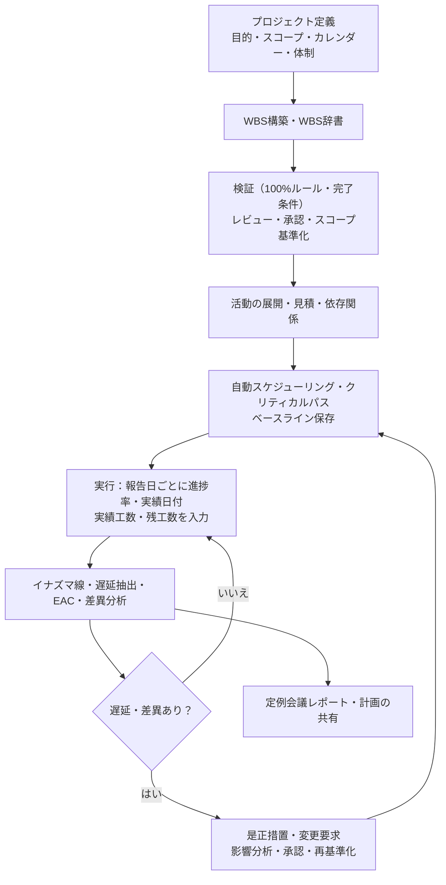

WBS・工数・進捗管理システム（PMT）要求仕様書

作成日：2026年11月10日　改訂日：2026年11月14日　版：1.1　状態：開発開始版（リリース1の要求を確定）

# 0. 本書について

## 0.1 目的

WBS・ガントチャート・イナズマ線・WBSによる工数管理を1つのシステムで実現する「WBS・工数・進捗管理システム」（以下 PMT）の要求を定める。
本書は設計書（`docs/pmt-design.md`）の上流であり、ksd-ls の ksdx が要求→設計の写像を検査する要求層の正である（`trace.toml`）。

## 0.2 入力資料

| 略号 | ファイル | 本書での使い方 |
|---|---|---|
| F | WBS管理システム_機能一覧.md | 機能ID・優先度・根拠の正。本書の要求IDは機能IDをそのまま使う |
| W | WBS.md | WBSの構造・100%ルール・WBS辞書・作成手順 |
| U | WBSユースケース.md | 工数管理（EAC、計画値と予測値の分離、差異分析） |
| G | ガントチャート.md | ガントの構成要素・ベースライン・更新の運用 |
| L | 稲妻チャート.txt | イナズマ線の計算式・特殊な描画ルール・スナップショット |
| C | ガントチャート・WBS・稲妻チャートの使い分け.txt | 3手法の関係・実務フロー・利用者 |

- 出所欄の「F:WBS-16」は機能一覧の機能ID、「L§7」は稲妻チャート.txt の7節を表す。
- 機能一覧が参照している製品の調査結果（F§5）は、実現方式の判断（本書1.3）にだけ使う。

## 0.3 要求IDの体系

| 種別 | 形式 | 例 | 正 |
|---|---|---|---|
| 機能要求 | `<大分類>-<2桁>`（機能一覧の機能ID） | `PRG-09` | 本書5章（R1）・6章（R2・R3） |
| 業務ルール | `BR-<2桁>` | `BR-07` | 本書7章 |
| 非機能要求 | `NFR-<2桁>` | `NFR-03` | 本書9章 |

- 機能IDは改番しない。機能一覧から削った機能が出た場合も欠番として残す。
- 要求→設計の対応は設計書11章の対応表が正である（本書には写さない）。

## 0.4 改訂履歴

| 版 | 日付 | 変更の内容 | 根拠 |
|---|---|---|---|
| 1.0 | 2026-11-10 | 初版（R1 の要求 64 件） | — |
| 1.1 | 2026-11-14 | 11 章の未確定事項 OQ-01〜05 を確定した扱いに揃えた（要求 ID の増減なし。5 章は変えていない） | `docs/instruction-change-requests.md` の CR-021（2026-11-14 に推奨案で承認） |

# 1. システムの目的と背景

## 1.1 目的

WBSで「何を作るか」を定義し、ガントチャートで「いつ実施するか」を計画し、イナズマ線と工数（EAC）で「計画に対してどこまで進んだか」を監視する（C§5）。
**WBS IDを共通キーにして、スコープ・日程・工数・変更を一貫して管理する**（W§12、F§1.1）。

## 1.2 解決したい課題

| 課題 | 出所 | PMTでの対策 |
|---|---|---|
| 作業漏れ・重複・粒度の不揃い | W§5、§10 | WBS辞書・完了条件の必須化・100%ルールの検査 |
| 進捗率が主観的で実態を表さない | L§9、§11 | 客観的な進捗率の算定方式を選べるようにする |
| 当初計画を上書きして遅延が見えなくなる | G§9、L§11 | ベースラインを複数保持し、上書きしない |
| 過去の報告と比べられない | L§8、§11 | 報告日ごとのスナップショットと過去のイナズマ線の重ね表示 |
| 予定対実績だけでは完了が読めない | U（公開事例） | 実績＋残工数によるEAC、計画値と予測値の分離 |

## 1.3 実現方式

機能一覧5.5の案E（自社開発）を採る。理由は次の3つである。

1. 本システムの中核（WBS辞書と検証、国土交通省の教材の方式のイナズマ線、報告日ごとのスナップショット）は、調査した製品の標準機能では実現できない（F§4.3）。
2. 他システムやAI基盤との連携を前提に長く運用する社内標準ツールとして位置づける（F§5.5の案Eの「向いている状況」）。
3. 開発は ksd-ls（kloop・ksdx）の実装ループで進め、設計IDの実装状況を機械で数えながら進める。

イナズマ線を描ける部品は商用（F§5.4）のため、ガントとイナズマ線は自前で描く。

# 2. 対象範囲とリリース計画

## 2.1 リリースの分け方

| リリース | 範囲 | 機能数 | 判断 |
|---|---|---:|---|
| R1（本書で確定） | 優先度「必須」の機能 | 64 | WBS→ガント→イナズマ線→工数→変更の1周を通す最小の範囲 |
| R2 | 優先度「推奨」の機能 | 47 | R1の運用開始後に要求を書き下ろす |
| R3 | 優先度「任意」の機能 | 23 | 導入規模・運用方針に応じて選ぶ |

- R2・R3の要求は6章に一覧として置き、受入基準はそのリリースの着手時に書き下ろす。着手したら5章へ移し、写像の分母を増やす（減らさない）。
- R1の範囲で、R2・R3の機能を前提にした作りにしない。ただしR2・R3を入れる余地（拡張点）は設計書15章に示す。

## 2.2 対象外

機能一覧4.2で対象外とした次のものは扱わない：アジャイル機能（スプリント、バックログ、カンバン）、Wiki・文書管理・チャット。

# 3. 利用者とロール

| ロール | コード | 主な利用場面 | 出所 |
|---|---|---|---|
| システム管理者 | `SYSTEM_ADMIN` | ユーザー・権限の管理 | F:CMN-01 |
| PM | `PM` | WBS・計画の承認、ベースライン化、変更承認、KPIの確認 | C§1 |
| 計画担当者 | `PLANNER` | WBS・WBS辞書の作成、見積、日程計画 | C§1 |
| 実行担当者 | `EXECUTOR` | 実績工数・進捗率・残工数の入力 | C§1 |
| 進捗管理担当者 | `PROGRESS_MANAGER` | 報告日の設定、イナズマ線・レポートの作成、遅延分析 | C§1 |
| 承認者（上長） | `APPROVER` | 変更要求の承認 | F§1.3 |
| 委託先 | `CONTRACTOR` | 自分に割り当てられた活動の工数・進捗の報告 | F§1.3 |
| 閲覧者 | `VIEWER` | 計画・進捗の閲覧のみ | F:RPT-03 |

- ロールはプロジェクトごとに割り当てる（1人が複数のロールを持てる）。`SYSTEM_ADMIN` だけはシステム全体のロールである。
- 委託先との契約形態別の管理（F:EFF-14）はR2である。R1の委託先は、権限が自分の割当に限られた実行担当者として扱う。

# 4. 業務フロー

| フェーズ | 手順（C§3） | 主な要求 |
|---|---|---|
| 計画 | 目的とスコープの定義 → WBS → 活動 → 見積 → 依存関係 → ガント → 基準計画の承認・保存 | PRJ、WBS、EST、SCH |
| 実行 | 実施 → 実績と進捗率の更新 → イナズマ線 → 遅延・前倒しの分析 → 重要タスクへの影響 → 是正 | PRG、EFF |
| 監視・変更管理 | 遅延理由の記録 → 影響範囲 → リカバリー計画 → 変更承認 → 基準計画と最新計画の両方を管理 | CHG、RPT |

# 5. 機能要求（R1）

R1で実現する64件である。**この章の表の1行が、要求層の1件である**（`trace.toml` の要求層はこの章だけを数える）。
受入基準は試験の観点であり、設計書12章の試験方針で試験に落とす。業務ルール（BR）は7章を参照する。

## 5.1 プロジェクト基盤（PRJ）

| 要求ID | 機能名 | 要求内容 | 受入基準 | 優先度 | 出所 |
|---|---|---|---|---|---|
| PRJ-01 | プロジェクト基本情報の登録 | 目的・要求事項・主要成果物・期間（開始日・終了予定日）・責任者を登録・更新できる | 必須項目（名称・開始日・責任者）が無いと登録できない。登録した値を一覧と詳細で表示できる | 必須 | W§6 Step1 |
| PRJ-02 | スコープ定義（対象内・対象外） | 対象内・対象外のスコープ項目を登録し、100%ルール検査の基準にする | スコープ項目に「対象内／対象外」の区分がある。WBS要素にスコープ項目を紐付けられ、BR-03の検査に使われる | 必須 | W§5.1、§6 Step1 |
| PRJ-04 | 稼働カレンダーの設定 | 非稼働の曜日・休日（日付）・1日の稼働時間を定義し、日程計算とイナズマ線の計算に使う | 既定は土日休み・1日8時間。休日を追加すると日程計算（BR-05）と進捗ポイント（BR-07）の結果が変わる | 必須 | G§3 Step4、L§5 |
| PRJ-06 | メンバー・ロールの管理 | プロジェクトのメンバーに3章のロールと所属を割り当てる | メンバーの追加・削除・ロール変更ができる。ロールに応じて操作の可否が変わる（CMN-01） | 必須 | C§1 |

## 5.2 WBS管理（WBS）

| 要求ID | 機能名 | 要求内容 | 受入基準 | 優先度 | 出所 |
|---|---|---|---|---|---|
| WBS-01 | 階層構造の作成・編集 | プロジェクト全体→主要成果物・管理領域→構成要素→ワークパッケージの階層を作り、追加・名称変更・移動・削除ができる。枝ごとに階層数が異なってよい | 任意の深さで子要素を作れる。移動で親を変えられる。子を持つ要素を削除するときは確認し、子ごと削除する | 必須 | W§3 |
| WBS-02 | 要素区分の設定 | 各要素に「成果物／管理領域／構成要素／ワークパッケージ」の区分を付ける | 区分は4値のいずれか。ワークパッケージは子を持てない（子を作るとエラー） | 必須 | W§3 |
| WBS-04 | ツリー図・アウトライン表示 | WBSを階層ツリー図とアウトライン（表形式）で表示・編集する | 同じWBSを2つの表示で切り替えられ、どちらからでも編集できる | 必須 | W§4 |
| WBS-05 | WBS IDの自動採番 | 階層を表すWBS IDを自動で付ける。区切り文字・桁数・接頭辞・第1階層の補完の採番規則を設定できる | 既定の規則で W§4 の例と同じID（1.0、1.1、2.0…）になる。規則を変えて改番すると新規則のIDになる（BR-01） | 必須 | W§6 Step5 |
| WBS-06 | WBS IDの維持・改番管理 | 移動・追加・削除でIDが勝手に変わらないようにし、改番は明示的な操作で行う。改番時は新旧IDの対応を残す | 要素を移動・削除しても他の要素のIDは変わらない。改番の操作でだけIDが変わり、新旧の対応を照会できる。旧IDで検索・取込しても現在の要素に解決される（BR-02） | 必須 | W§12 |
| WBS-07 | WBS IDの共通キー化 | WBS IDを日程・工数・課題（変更要求・是正措置）・報告の共通キーにし、相互に追跡できるようにする | WBS IDを1つ指定すると、その要素（配下を含む）の活動・見積・実績工数・EAC・変更要求・是正措置を1回の照会で返す | 必須 | W§12、G§9、U（サマリ） |
| WBS-08 | ワークパッケージの定義 | 最下位要素をワークパッケージ（WP）に指定し、見積・責任割当・進捗管理の単位にする | WPにだけ活動を展開できる（SCH-01）。WPの見積・進捗が上位へ集計される | 必須 | W§3 |
| WBS-10 | 責任者割当・責任分担表 | WPごとに責任者・担当チームを割り当て、WBS×担当の責任分担表を表示・出力する | WP×メンバーの表を画面に出し、CSVで出力できる。責任者の無いWPを一覧にできる | 必須 | W§2、§7 |
| WBS-11 | WBS辞書の作成・編集 | WBS ID・名称・成果物・作業範囲・責任者・完了条件・見積工数・前提条件を要素ごとに記録する | W§7の8項目を要素ごとに保存・表示できる。WBS IDと名称はWBS本体と同じ値を表示する | 必須 | W§7 |
| WBS-13 | 完了条件の必須化 | WPの成果物・完了条件（受入条件）を必須項目にし、未定義のWPを一覧にする | 成果物か完了条件が空のWPを一覧で返す。1件でもあるとWBSの承認申請ができない | 必須 | W§5.4、§5.5 |
| WBS-16 | 100%ルールチェック | 子要素の工数の合計と親要素を照合して差異を警告し、対象外の作業の混入と対象内の漏れを検出する | BR-03の3つの判定（合計の差異・対象外の混入・対象内の漏れ）を結果として返す。差異の許容幅をプロジェクトで設定できる | 必須 | W§5.1 |
| WBS-20 | WBSレビュー | レビュー依頼、指摘（漏れ・重複・曖昧・その他）の記録、対応状況の管理を行う | レビューを開始し、要素に紐付けた指摘を記録できる。指摘の状態（未対応・対応済み・却下）を更新できる。未対応の指摘があると承認申請できない | 必須 | W§6 Step7 |
| WBS-21 | WBS承認ワークフロー | WBSの承認申請・承認・差戻しを行い、承認記録を残す | 申請→承認／差戻しの状態遷移（設計書の状態遷移）に従う。承認者・日時・コメントが残る。申請者は自分の申請を承認できない | 必須 | W§6 Step8 |
| WBS-22 | スコープベースライン化 | 承認済みのWBSを版として固定し、スコープ管理の基準にする | 承認でスコープベースラインの版が作られ、その時点のWBSと辞書を後から変更されない形で照会できる。版は上書きされず増える | 必須 | W§6 Step8 |

## 5.3 見積管理（EST）

| 要求ID | 機能名 | 要求内容 | 受入基準 | 優先度 | 出所 |
|---|---|---|---|---|---|
| EST-01 | WP・活動単位の工数見積 | WP・活動ごとに見積工数（人時）を入力する。人日での入力は1日の稼働時間で人時へ換算する | 人時・人日のどちらでも入力でき、保存は人時で行う。負の値は入力できない | 必須 | W§7、U（調査レポート） |
| EST-02 | ボトムアップ集計 | 下位要素の見積を上位要素へ自動で積み上げる | 活動→WP→上位要素→プロジェクトの順に合計される。下位を変えると上位の値が変わる | 必須 | U（調査レポート） |
| EST-08 | 見積根拠の記録 | 見積手法（ボトムアップ・類推・三点・専門家判断・その他）・前提・参照資料を要素ごとに記録する | 見積値とあわせて手法・前提・参照資料を保存でき、見積値を変えた履歴が残る | 必須 | W§2、§9 |

## 5.4 スケジュール管理（SCH）

| 要求ID | 機能名 | 要求内容 | 受入基準 | 優先度 | 出所 |
|---|---|---|---|---|---|
| SCH-01 | WPからの活動展開 | WPの配下に活動（実行作業）を作成し、WBS IDとの紐付けを保つ | 活動は必ず1つのWPに属する。WPのWBS IDが改番されても紐付けは切れない | 必須 | W§4、§8、C§3 |
| SCH-02 | タスクリストの表示・編集 | 活動を一覧形式で表示し、日付・依存関係・担当をまとめて編集する | 複数の活動の日付・先行活動・担当を1回の保存で更新できる。1件でも不正なら全件を保存しない | 必須 | W§8 |
| SCH-03 | 開始日・終了日・期間の設定 | 活動ごとに予定開始日・予定終了日・期間（稼働日数）を設定する | 3つのうち2つを入れると残り1つがカレンダー（BR-04）で計算される | 必須 | G§2 |
| SCH-04 | 依存関係の設定 | 先行・後続の関係（終了→開始）を設定し、並行して進められる作業を識別する | 循環する依存は登録できない。先行の無い活動を並行可能として識別できる | 必須 | G§3 Step2 |
| SCH-06 | 自動スケジューリング | 依存関係とカレンダーから日程を計算し、先行作業の変更を後続作業へ自動で反映する | BR-05のとおり後続の日程が動く。計算はプロジェクトの全活動に対して決定的（同じ入力から同じ結果） | 必須 | G§3 Step4、§5 |
| SCH-09 | マイルストーンの設定 | 納期・承認・リリースなどの節目を期間0の活動として設定する | 期間0の活動はマイルストーンとして扱われ、ガントで菱形で表示される | 必須 | G§2、§5 |
| SCH-10 | クリティカルパスの算出・表示 | 最長経路と余裕日数（トータルフロート）を計算し、ガント上で強調する | BR-05の後退計算でフロートが求まり、フロート0以下の活動がクリティカルとして強調される | 必須 | G§7、L§11 |
| SCH-11 | ガントチャート表示 | 縦軸に活動、横軸に時間を置いて予定バーを描く。日・週・月の表示単位を切り替えられる | WBSの階層順に活動が並び、非稼働日が区別して表示される。表示単位を切り替えられる | 必須 | G§1、§3 Step5 |
| SCH-12 | 予定・実績・基準の重ね表示 | 予定バー・実績バー・ベースラインバーを並べて表示する | 選んだベースラインのバーと、実績開始〜実績終了（未完了なら報告日まで）のバーが同じ行に出る | 必須 | G§5、§9 |
| SCH-13 | 依存線・担当・進捗率の表示 | 依存関係の矢印、担当者、進捗率をバー上に表示する | 先行の終了から後続の開始へ矢印が描かれ、バーに担当者名と進捗率が出る | 必須 | G§2、§5 |
| SCH-16 | ベースラインの保存 | 承認済みの日程・工数をベースラインとして保存する | 保存時点の全活動の開始日・終了日・期間・見積工数が版として固定される | 必須 | G§3 Step6、C§3 |
| SCH-17 | 複数ベースラインの保持 | 再計画しても当初計画を消さずに複数の版を保持し、比較対象を選べる | 版は上書きされず増える。比較に使う版（既定は最新の承認版）を選べる | 必須 | G§9、L§11 |
| SCH-18 | 基準計画と最新計画の差異表示 | ベースラインと最新計画の日程・工数の差異（バリアンス）を表示する | 活動ごとに開始・終了の差（稼働日）と見積工数の差を出す。追加・削除された活動も区別して出す | 必須 | C§3、U（公開事例） |

## 5.5 進捗管理・イナズマ線（PRG）

| 要求ID | 機能名 | 要求内容 | 受入基準 | 優先度 | 出所 |
|---|---|---|---|---|---|
| PRG-01 | 報告日の設定 | 全活動に共通の報告日（ステータス日）を作り、その時点の値で進捗を評価する | 報告日ごとに進捗の入力枠ができ、イナズマ線・遅延判定はその報告日の値だけで計算される | 必須 | G§9、L§11 |
| PRG-02 | 進捗率・実績日付の入力 | 活動ごとに進捗率・実績開始日・実績終了日を入力する | 進捗率は0〜100。実績終了日を入れると進捗率は100になる。実績開始日より前の実績終了日は入力できない | 必須 | G§2、§3 Step7 |
| PRG-03 | 遅延理由・完了見込みの入力 | 遅延理由と完了見込み日を記録する | 報告日ごとに活動の遅延理由と完了見込み日を保存し、遅延一覧に表示される | 必須 | G§3 Step7、C§3 |
| PRG-05 | 進捗率の算定方式の設定 | 直接入力・成果物完了割合・承認済み作業割合・検証項目完了割合・重み付きマイルストーン・0/100法・50/50法から方式を選ぶ | プロジェクトの既定と活動ごとの方式を設定でき、BR-06のとおり進捗率が計算される | 必須 | L§11、F:PRG-05 |
| PRG-08 | 報告日線の描画 | ガント上に報告日を示す縦線（報告日線）を描く | 報告日の終業位置（BR-07）に縦線が出る | 必須 | L§4 Step2 |
| PRG-09 | 進捗ポイントの計算 | 「開始予定日＋予定期間×進捗率」で各活動の進捗位置を計算する | L§6の例の4行が、同じ判定（遅れ・前倒し・未着手予定内・完了）になる | 必須 | L§5 |
| PRG-10 | 稼働日ベースの計算 | 休日・非稼働日を除いた稼働日で進捗位置を計算する | 期間中に休日を足すと進捗ポイントの日付が休日を飛ばして後ろへずれる | 必須 | L§5 |
| PRG-11 | 特殊な描画ルール | 完了済みの活動と、報告日より後に開始予定の未着手の活動は、報告日線上に置く | BR-08の2つの場合で進捗ポイントが報告日線上になる | 必須 | L§7 |
| PRG-12 | イナズマ線の描画 | 進捗ポイントを上から順に折れ線で結ぶ | ガントの行の順に進捗ポイントを結んだ折れ線が報告日線とともに描かれる | 必須 | L§4 Step6 |
| PRG-13 | 遅れ・前倒しの判定 | 報告日線からのずれで「遅れ／予定どおり／前倒し」を判定し、色分け・一覧化する | BR-09の判定が活動ごとに付き、色分けされ、判定で絞り込める | 必須 | L§3、§6 |
| PRG-17 | 進捗スナップショットの保存 | 報告日ごとに全活動の進捗率・実績日付・残工数・計画日付を保存し、後で値を直しても過去の線を再現できるようにする | 報告日を確定するとスナップショットが作られ、その後に進捗や計画を直しても確定済みの線は変わらない（BR-13） | 必須 | L§8、§11 |
| PRG-18 | 過去のイナズマ線の重ね表示 | 複数の報告日のイナズマ線を重ねて表示し、遅延の拡大・改善の傾向を比べる | 確定済みの報告日を複数選ぶと、線の種類を変えて同じガントに重ねて描かれる | 必須 | L§8、§11 |
| PRG-19 | 遅延活動の抽出・影響確認 | 報告日線より大きく左にずれた活動を抽出し、後続の活動・クリティカルパス・マイルストーンへの影響を示す | 遅れの活動をずれの大きい順に返し、後続の活動・クリティカルパス上か・影響するマイルストーンとその見込みのずれ（稼働日）を示す | 必須 | L§4 Step7、C§3 |

## 5.6 工数・コスト管理（EFF）

| 要求ID | 機能名 | 要求内容 | 受入基準 | 優先度 | 出所 |
|---|---|---|---|---|---|
| EFF-01 | 担当者・工数の割当 | WP・活動に担当者と割当工数を設定する | 1つの活動に複数の担当者を割り当てられ、割当工数の合計を見積と比べて表示する | 必須 | U（調査レポート） |
| EFF-02 | 実績工数の入力 | 担当者が日別・活動別に実績工数を入力し、WBS ID単位で集計する | 自分の割当の活動に日別の工数を入力できる。1日の合計が24時間を超えるとエラー | 必須 | U（調査レポート） |
| EFF-06 | 残工数の入力・再見積 | 担当者が残工数（ETC）を入力して見積を更新する。未入力時は見積と進捗率から自動計算する | 入力したETCが優先される。未入力ならBR-10の式で自動計算され、自動か入力かが区別して表示される | 必須 | U（ツール・KPI、公開事例） |
| EFF-07 | 完了時総工数見込みの算出 | 実績工数＋残工数で、完了時の総工数見込み（EAC）を計算する | 活動ごとと上位要素ごとにEACが出て、上位は下位の合計になる | 必須 | U（公開事例） |
| EFF-08 | 計画値と予測値の分離 | ベースライン（計画値）と予測値（EAC・完了見込み日）を別の項目として保持する | 予測値を更新してもベースラインの値は変わらない。両方を並べて表示できる | 必須 | U（公開事例） |
| EFF-09 | 多軸集計 | 計画・ベースライン・実績・残・EACを、WBS階層・担当者・期間（週・月）・組織別に集計する | 4つの軸のいずれでも同じ合計（プロジェクト全体の値）になる | 必須 | U（サマリ）、W§2 |
| EFF-10 | 予定対実績の差異分析 | 計画とEACの差異を計算し、閾値を超えた要素を抽出する。差異理由と是正措置を記録する | BR-11の閾値を超えた要素が一覧に出る。差異理由を記録し、是正措置（CHG-06）へ紐付けられる | 必須 | U（調査レポート） |

## 5.7 変更・課題・リスク管理（CHG）

| 要求ID | 機能名 | 要求内容 | 受入基準 | 優先度 | 出所 |
|---|---|---|---|---|---|
| CHG-01 | 変更要求の登録 | スコープ・日程・工数の変更要求を、対象のWBS IDと理由と変更内容を付けて登録する | 変更要求に対象のWBS ID（複数可）・理由・変更内容（要素・活動・依存・見積の追加・変更・削除）を保存できる | 必須 | W§12、C§3 |
| CHG-02 | 変更の影響分析 | 変更がWBS・日程（クリティカルパス）・工数に与える影響を試算して示す | 変更内容を計画の写しに当てて再計算し、終了日・マイルストーン・クリティカルパス・総工数の差を返す。本計画は変わらない | 必須 | W§9、C§3 |
| CHG-03 | 変更承認ワークフロー | 変更要求の承認・却下を行い、承認履歴を残す | 提出→承認／却下の状態遷移に従い、判断者・日時・コメントが残る。提出者は自分の変更要求を承認できない | 必須 | C§3 |
| CHG-04 | 再基準化 | 承認された変更をWBS・計画に反映し、新しいベースラインを作る（旧版は保持する） | 反映すると計画が変わり、スコープとスケジュールの新しい版が作られ、旧版は照会できる | 必須 | W§12、C§3 |
| CHG-06 | 遅延原因・是正措置の管理 | 遅延原因・対策・担当・期限・効果を記録し、完了まで追跡する | 是正措置をWBS ID・報告日・活動に紐付けて登録し、状態（未着手・対応中・完了）と効果を更新できる。期限超過を絞り込める | 必須 | C§2、§3 |
| CHG-09 | 変更履歴の記録 | WBS・計画・実績の変更者・日時・変更内容を記録し、検索できるようにする | 書き込みの操作ごとに変更者・日時・対象・変更前後の値が残り、期間・変更者・対象・WBS IDで検索できる。履歴は画面から変更・削除できない | 必須 | G§9、L§11 |

## 5.8 レポート・共有（RPT）

| 要求ID | 機能名 | 要求内容 | 受入基準 | 優先度 | 出所 |
|---|---|---|---|---|---|
| RPT-01 | 定例会議用の進捗レポート | 報告日時点のガント＋イナズマ線、遅延一覧、マイルストーンの状況、主要KPIを1枚にまとめる | 報告日を選ぶと1画面にまとまり、ブラウザの印刷でA3横1枚に収まる | 必須 | L§8、C§4 |
| RPT-03 | 計画の共有 | 関係者が最新の計画・進捗を閲覧できるようにする（閲覧専用の権限、共有リンク） | 閲覧者ロールでは書き込みの操作ができない。有効期限付きの共有リンクでログインせずにガントとレポートを閲覧でき、失効後は閲覧できない | 必須 | G§1 |

## 5.9 外部連携（INT）

| 要求ID | 機能名 | 要求内容 | 受入基準 | 優先度 | 出所 |
|---|---|---|---|---|---|
| INT-01 | Excel・CSVの入出力 | WBS・活動（計画）・実績工数をExcel（.xlsx）・CSVで取り込み・出力する | 出力したファイルをそのまま取り込むと同じ内容になる（往復で一致）。取込は先に検査し、行ごとのエラーを返し、エラーが1件でもあれば何も書き込まない | 必須 | U（ツール・KPI） |

## 5.10 共通（CMN）

| 要求ID | 機能名 | 要求内容 | 受入基準 | 優先度 | 出所 |
|---|---|---|---|---|---|
| CMN-01 | ユーザー・権限の管理 | ロール別・プロジェクト別に、閲覧・編集・承認の権限を設定する | 設計書9章の権限表のとおりに操作が許可・拒否される。拒否は403で返る | 必須 | C§1 |

# 6. 機能要求（R2・R3）

R2・R3の機能は機能一覧の機能概要を要求内容とする。受入基準は各リリースの着手時に書き下ろし、5章へ移す。
この章は要求層の分母に数えない（`trace.toml`）。

| 機能ID | 機能名 | 優先度 | リリース | 備考 |
|---|---|---|---|---|
| PRJ-03 | プロジェクト属性の管理 | 推奨 | R2 | |
| PRJ-05 | 個人別カレンダー | 推奨 | R2 | |
| PRJ-07 | プロジェクト・WBSテンプレート | 推奨 | R2 | |
| PRJ-08 | プロジェクト横断管理 | 任意 | R3 | |
| WBS-03 | 分解軸の設定 | 推奨 | R2 | |
| WBS-09 | 管理作業の組込み | 推奨 | R2 | R1でも管理作業を要素として作ることはできる |
| WBS-12 | 辞書項目のカスタマイズ | 推奨 | R2 | |
| WBS-14 | 成果物ファイルの紐付け | 任意 | R3 | |
| WBS-15 | WBS辞書の帳票出力 | 推奨 | R2 | |
| WBS-17 | 重複チェック | 推奨 | R2 | |
| WBS-18 | 粒度チェック | 推奨 | R2 | |
| WBS-19 | 未記入・曖昧表現チェック | 任意 | R3 | |
| WBS-23 | WBSの版比較 | 推奨 | R2 | |
| EST-03 | トップダウン配分 | 推奨 | R2 | |
| EST-04 | 類推見積 | 推奨 | R2 | |
| EST-05 | 三点見積（PERT） | 推奨 | R2 | |
| EST-06 | モンテカルロシミュレーション | 任意 | R3 | |
| EST-07 | 見積の相互検証 | 任意 | R3 | |
| EST-09 | 担当者参加型の見積 | 任意 | R3 | |
| EST-10 | バッファの設定 | 推奨 | R2 | |
| EST-11 | CCPMバッファ管理 | 任意 | R3 | |
| EST-12 | 追加作業の見積計上 | 推奨 | R2 | |
| EST-13 | 所要期間の算出 | 推奨 | R2 | |
| SCH-05 | 依存タイプとラグ・リード | 推奨 | R2 | R1は終了→開始・ラグ0のみ |
| SCH-07 | 手動・自動スケジュールの切替 | 任意 | R3 | |
| SCH-08 | 日付制約・期限管理 | 任意 | R3 | |
| SCH-14 | 大規模表示の支援 | 推奨 | R2 | |
| SCH-15 | ネットワーク図（PERT図）表示 | 任意 | R3 | |
| PRG-04 | 進捗更新のリマインド | 推奨 | R2 | |
| PRG-06 | 上位要素への進捗集計 | 推奨 | R2 | |
| PRG-07 | 完了条件に基づく完了判定 | 推奨 | R2 | |
| PRG-14 | 比較基準の選択 | 推奨 | R2 | R1のイナズマ線は最新計画を基準に描く |
| PRG-15 | 計算モデルの選択 | 任意 | R3 | |
| PRG-16 | 重要活動の強調 | 推奨 | R2 | |
| PRG-20 | 期限・遅延のアラート | 推奨 | R2 | |
| EFF-03 | 入力手段の拡充 | 任意 | R3 | |
| EFF-04 | 工数の提出・承認・締め | 推奨 | R2 | |
| EFF-05 | 勤怠データとの突合 | 任意 | R3 | |
| EFF-11 | 単価設定・原価計算 | 推奨 | R2 | |
| EFF-12 | 予算管理 | 推奨 | R2 | |
| EFF-13 | CBSとの対応付け | 任意 | R3 | |
| EFF-14 | 契約形態・委託先別の管理 | 推奨 | R2 | |
| EFF-15 | 委託先報告の取込 | 任意 | R3 | |
| ANL-01 | EVM指標の算出 | 推奨 | R2 | |
| ANL-02 | EVMによる完了予測 | 推奨 | R2 | |
| ANL-03 | ワークバーンダウン | 推奨 | R2 | |
| ANL-04 | 見積精度の分析 | 推奨 | R2 | |
| ANL-05 | 稼働率の分析 | 推奨 | R2 | |
| ANL-06 | KPIダッシュボード | 推奨 | R2 | R1はRPT-01の主要KPIで代える |
| RES-01 | 稼働能力の設定 | 推奨 | R2 | |
| RES-02 | 負荷の可視化 | 推奨 | R2 | |
| RES-03 | 過負荷の検出・通知 | 推奨 | R2 | |
| RES-04 | リソースの平準化 | 任意 | R3 | |
| RES-05 | プロジェクト横断の要員計画 | 任意 | R3 | |
| CHG-05 | リカバリー計画の策定支援 | 推奨 | R2 | R1のCHG-02（計画の写しでの試算）を土台にする |
| CHG-07 | 課題管理 | 推奨 | R2 | |
| CHG-08 | リスク管理 | 推奨 | R2 | |
| RPT-02 | 定期レポートの自動作成 | 推奨 | R2 | |
| RPT-04 | PDF・画像・Excelへの出力 | 推奨 | R2 | R1はブラウザの印刷で代える |
| RPT-05 | Mermaid形式での出力 | 任意 | R3 | |
| INT-02 | MS Project連携 | 推奨 | R2 | |
| INT-03 | 課題管理ツール連携 | 推奨 | R2 | |
| INT-04 | 会計・ERP連携 | 任意 | R3 | |
| INT-05 | カレンダー連携 | 任意 | R3 | |
| INT-06 | API・Webhook | 推奨 | R2 | R1のREST APIは画面のためのもので、外部向けの保証はしない |
| INT-07 | AIエージェント連携（MCP） | 任意 | R3 | |
| CMN-02 | シングルサインオン | 推奨 | R2 | |
| CMN-03 | 通知 | 推奨 | R2 | R1の承認待ちは画面の一覧で知らせる |
| CMN-04 | タスク素案の生成 | 任意 | R3 | |
| CMN-05 | 状況報告の自動作成 | 任意 | R3 | |

件数：推奨47（R2）・任意23（R3）＝70。5章の64と合わせて機能一覧の134と一致する。

# 7. 業務ルール

機能要求の判定・計算の根拠となる規則である。設計書5章の計算・判定ルール（RULE）はこの章を実装の形に落としたものである。

## 7.1 BR-01 WBS IDの形式（既定の採番規則）

- ルート（プロジェクト全体）はIDを持たない。第1階層の要素は兄弟の中の順番で `1`、`2`… とし、**第1階層には `.0` を補う**（`1.0`、`2.0`。W§4の例）。
- 第2階層以下は親のIDの数字部分に `.<順番>` を足す（`1.1`、`1.2`、`1.1.1`）。第1階層の補完の `.0` は子のIDには入れない（`1.0` の子は `1.1`）。
- 採番規則として、区切り文字（既定 `.`）・各階層の最小桁数（既定 1。0詰め）・接頭辞（既定なし）・第1階層の補完（既定あり）を設定できる。

## 7.2 BR-02 WBS IDの維持と改番

- 新しい要素には、兄弟の中で**今まで使った最大の順番＋1**を振る（削除で空いた番号は再利用しない）。
- 移動・削除で他の要素のIDは変えない。移動した要素のIDは移動前のままとし、親のIDと形が合わない要素を「改番待ち」として示す。
- 改番は利用者の明示的な操作でだけ行い、兄弟の表示順に従って全要素のIDを振り直す。改番のたびに新旧IDの対応を記録する。
- 旧IDによる検索・取込は、記録した対応をたどって現在の要素に解決する。旧IDが別の要素の現在のIDと重なる場合は、現在のIDを優先する。

## 7.3 BR-03 100%ルールの判定

1. **合計の差異**：子を持つ要素に、子とは別に見積（トップダウンの値）が入っているとき、子の見積の合計との差の割合 `|子の合計−親の値| ÷ 親の値` が許容幅（既定 0%）を超えたら警告する。
2. **対象外の混入**：対象外のスコープ項目に紐付いた要素があればエラーとする。
3. **対象内の漏れ**：どの要素にも紐付いていない対象内のスコープ項目があれば警告する。

## 7.4 BR-04 稼働日と日付の数え方

- 稼働日は、非稼働の曜日でも休日でもない日である。
- 活動は開始日の始業から終了日の終業までを占める。期間 d（d≧1）の活動の終了日は、開始日から数えて d 番目の稼働日である。
- 期間0の活動はマイルストーンであり、日付は1つ（開始日＝終了日）である。
- 開始日・終了日が非稼働日になる入力は、開始日は次の稼働日へ、終了日は前の稼働日へ寄せる。

## 7.5 BR-05 日程計算

- 依存は終了→開始（FS）・ラグ0とする（R1）。後続の最早開始日は、全ての先行の終了日の次の稼働日のうち最も遅い日である。先行がマイルストーンのときは、マイルストーンの日付の次の稼働日である。後続がマイルストーンのときは、全ての先行の終了日のうち最も遅い日をマイルストーンの日付とする。
- 活動の開始日は、最早開始日と利用者が入れた開始日（希望開始日）の遅いほうとする。先行の無い活動は、希望開始日（無ければプロジェクトの開始日）に始まる。
- 後退計算はプロジェクトの最も遅い終了日から行い、トータルフロート＝最遅開始−最早開始（稼働日数）とする。フロートが0以下の活動をクリティカルとする。
- 依存の循環は計算の前に検出し、計算せずにエラーとする。

## 7.6 BR-06 進捗率の算定方式

| 方式 | コード | 進捗率 |
|---|---|---|
| 直接入力 | `DIRECT` | 入力した値 |
| 成果物完了割合 | `DELIVERABLE_RATIO` | 完了した成果物の項目数 ÷ 成果物の項目数 |
| 承認済み作業割合 | `APPROVED_WORK_RATIO` | 承認済みの作業項目数 ÷ 作業項目数 |
| 検証項目完了割合 | `CHECK_ITEM_RATIO` | 完了した検証項目数 ÷ 検証項目数 |
| 重み付きマイルストーン | `WEIGHTED_MILESTONE` | 達成したマイルストーン項目の重みの和 ÷ 重みの総和 |
| 0/100法 | `ZERO_HUNDRED` | 実績終了日があれば100、無ければ0 |
| 50/50法 | `FIFTY_FIFTY` | 実績終了日があれば100、実績開始日だけあれば50、どちらも無ければ0 |

- 項目を数える方式で、該当する項目が0件の活動は計算できないため、進捗率を「未算定」とし、入力を促す。
- 実績終了日があれば、方式によらず進捗率は100とする。

## 7.7 BR-07 進捗ポイントの計算

- 稼働日だけを並べた軸を使う。稼働日 i は軸上の区間 [i, i+1) を占める。開始日 s・期間 d の活動は [s, s+d) を占める。
- 進捗ポイント＝ s ＋ d × 進捗率（L§5の式を稼働日の軸で計算する）。
- 報告日線は報告日の終業の位置（報告日が非稼働日なら、その前の稼働日の終業）とする。
- 日付で示すときは、進捗ポイントを含む稼働日の日付とする（L§6の「頃」にあたる）。ポイントがちょうど稼働日の境目にあるときは、前の稼働日（その日の終業）の日付とする。例：報告日線上のポイントは報告日の日付になる。
- 計算の基準とする計画はR1では最新計画とする（ベースライン基準はR2のPRG-14）。

## 7.8 BR-08 特殊な描画ルール

1. 報告日以前に終了予定で、完了している活動の進捗ポイントは報告日線上に置く。
2. 報告日より後に開始予定で、着手していない（実績開始日が無く進捗率が0）活動の進捗ポイントは報告日線上に置く。
3. 上記以外は BR-07 の式で置く。報告日より後に終了予定で完了した活動は、式のとおり報告日線より右（前倒し）になる。

## 7.9 BR-09 遅れ・前倒しの判定

- ずれ＝進捗ポイント−報告日線（稼働日）。
- ずれ ＜ −許容幅 を「遅れ」、ずれ ＞ ＋許容幅 を「前倒し」、それ以外を「予定どおり」とする。許容幅の既定は 0.5 稼働日で、プロジェクトで設定できる。
- BR-08 の1は「完了」、2は「未着手（予定内）」として区別して表示する（判定の上では予定どおりに数える）。
- 「大きく左にずれた」（PRG-19）は、ずれ ≦ −遅延抽出の閾値（既定 2 稼働日）とする。

## 7.10 BR-10 残工数とEAC

- ETC（残工数）は担当者の入力値を優先する。入力が無ければ、ETC＝見積工数×（1−進捗率）とし、0未満にはしない。進捗率が未算定なら ETC＝max(見積工数−実績工数, 0) とする。
- 完了した活動の ETC は0とする。
- EAC＝実績工数＋ETC。上位要素の値は下位の合計とする。

## 7.11 BR-11 差異の判定

- 工数の差異＝EAC−ベースラインの見積工数。差異率＝差異÷ベースラインの見積工数。
- 差異率の閾値（既定 ±10%）と差異の絶対値の閾値（既定 8人時）の両方を超えた要素を抽出する。どちらの閾値もプロジェクトで設定できる。
- ベースラインに無い要素（追加された要素）は差異率を計算せず、「追加」として抽出する。

## 7.12 BR-12 ベースラインの保持

- スコープベースライン（WBSと辞書）とスケジュールベースライン（日程と見積）は、どちらも版として追加だけを行い、上書き・削除しない。
- 版には作成理由（初回承認・変更要求の反映など）と元になった承認の記録を持たせる。

## 7.13 BR-13 進捗スナップショット

- 報告日を確定すると、その時点の全活動の計画日付・期間・進捗率・実績日付・ETC・進捗ポイント・判定をスナップショットとして保存する。
- 確定した報告日の入力値は変更できない。直すときは新しい報告日を作る。
- 過去のイナズマ線はスナップショットだけから描く（現在の計画や進捗から計算し直さない）。

# 8. 外部インタフェース要求

| 対象 | 方向 | 形式 | 要求 |
|---|---|---|---|
| Excel・CSV | 入出力 | .xlsx・CSV（UTF-8 BOM付き） | INT-01。列の並びは設計書6章の入出力の定義に従う |
| ブラウザ | 利用者 | HTML | 最新の Chrome・Edge（NFR-07） |
| 印刷 | 出力 | ブラウザの印刷 | RPT-01（A3横） |

R1では外部システムとの自動連携は行わない（INT-02〜07はR2以降）。

# 9. 非機能要求

| 要求ID | 区分 | 要求 | 目標値・基準 |
|---|---|---|---|
| NFR-01 | 性能 | 日程計算（SCH-06・SCH-10）の応答 | 活動 2,000・依存 5,000 で 1 秒以内（サーバ側の計算） |
| NFR-02 | 性能 | ガント＋イナズマ線の表示 | 活動 2,000 で 3 秒以内に描画を終える |
| NFR-03 | 規模 | 同時利用者と保持量 | 同時利用 50 人、プロジェクト 100 件、報告日のスナップショット 1 プロジェクトあたり 260 件（週次で5年） |
| NFR-04 | セキュリティ | 認証と権限 | 全てのAPIは認証を要する（共有リンクの閲覧を除く）。パスワードは一方向ハッシュで保存する。権限は設計書9章の表のとおりサーバ側で判定する |
| NFR-05 | 監査 | 変更履歴の完全性 | 書き込みの操作は全て変更履歴に残る（CHG-09）。変更履歴は追記のみ |
| NFR-06 | 信頼性 | データの保全 | 本番のデータベースは日次でバックアップし、7世代を保持する |
| NFR-07 | 互換性 | 利用環境 | 最新の Chrome・Edge（デスクトップ）。画面幅 1280px 以上 |
| NFR-08 | 保守性 | 試験と再現性 | 計算・判定のルール（設計書5章）は全て自動試験を持つ。同じ入力から同じ計算結果になる（時刻・乱数に依存しない） |
| NFR-09 | 言語 | 表示 | 画面・帳票は日本語。日付は YYYY-MM-DD、時刻は日本時間 |
| NFR-10 | 運用 | 配置 | 社内のサーバに1台で配置できる（アプリと PostgreSQL）。開発・試験は SQLite で動く |

# 10. 制約・前提

- 開発は ksd-ls（kloop・ksdx）の実装ループで行う。設計書の設計IDを実装に宣言し（設計書2.3）、kloop の検証器で未実装数を数える。
- 部品は OSS のみを使う（商用のガント部品は使わない。1.3）。
- 単一の組織での利用を前提とする（マルチテナントにしない）。
- 入力資料の参照先「wbs_effort_usecases.md」はフォルダに無い（F§0.2）。その内容に依る要求は入れていない。

# 11. 未確定事項

2026-11-13 に、要求元が下の 5 件を全て確定した（推奨案で承認。CR-021 で本章に反映）。実装での扱いは `docs/open-questions.md`、設計への反映は設計書 1.3 による。

| No | 事項 | 確定した扱い | 確定の根拠 | 見直す時期 |
|---|---|---|---|---|
| OQ-01 | 本番の配置先（社内サーバかクラウドか） | Google Cloud（Cloud Run・Cloud SQL for PostgreSQL・Secret Manager。資源は Terraform で作る）。NFR-10 は変えない（アプリと PostgreSQL を1台にも置ける） | 2026-11-13・設計書 CR-020 | — |
| OQ-02 | 委託先の利用者を社内の認証に入れるか | R1はローカルアカウント。SSO（CMN-02）はR2 | 2026-11-13 | R2の着手時 |
| OQ-03 | イナズマ線の基準をベースラインにするか最新計画にするか | R1は最新計画（BR-07）。両方の選択はR2（PRG-14） | 2026-11-13 | R2の着手時 |
| OQ-04 | 依存の種類（SS・FF・SF）とラグ | R1はFSのみ（BR-05）。R2で SCH-05 | 2026-11-13 | R2の着手時 |
| OQ-05 | 遅延判定の許容幅と抽出の閾値の既定値 | 0.5 稼働日・2 稼働日（BR-09。プロジェクトで設定できる）。運用で見直す | 2026-11-13 | R1の試行運用の後 |

# 12. 用語

| 用語 | 意味 |
|---|---|
| WBS要素 | WBSの階層の1つの節。区分（成果物・管理領域・構成要素・ワークパッケージ）を持つ |
| ワークパッケージ（WP） | 最下位のWBS要素。見積・責任割当・進捗管理の単位 |
| 活動 | WPを実行するための作業。日程・依存・担当・進捗を持つ |
| 報告日 | 進捗を評価する基準日（ステータス日） |
| 報告日線 | ガント上で報告日の終業の位置に引く縦線 |
| 進捗ポイント | 活動の進捗率に対応するガント上の位置 |
| イナズマ線 | 進捗ポイントを上から順に結んだ折れ線 |
| ベースライン | 承認された計画の版。上書きしない |
| ETC | 残工数（Estimate to Complete） |
| EAC | 完了時総工数見込み（Estimate at Completion）＝実績＋ETC |
| スナップショット | 確定した報告日の、全活動の値の写し |
