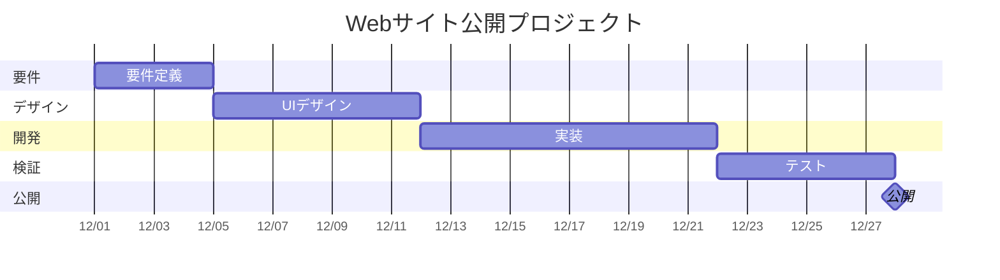

# ガントチャート（Gantt Chart）調査レポート

更新日：2026年11月10日

## 1. 概要

ガントチャートとは、プロジェクトの作業や工程を、時間軸上の横棒で表現するスケジュール管理手法である。

一般的に、縦軸にタスク、横軸に日付・週・月などの時間を配置し、各タスクの開始予定日、終了予定日、実績、進捗状況を可視化する。

### 主な目的

- プロジェクト全体のスケジュール把握
- タスクの開始・終了時期の明確化
- 作業間の依存関係の把握
- 進捗状況と遅延の確認
- 関係者間での計画共有
- リソース配分の検討

## 2. 主な構成要素

| 要素 | 内容 |
|---|---|
| タスク | 実施する作業 |
| 開始日 | 作業開始予定日 |
| 終了日 | 作業終了予定日 |
| 期間 | 作業に必要な日数 |
| 担当者 | 作業の責任者 |
| 進捗率 | 作業の完了割合 |
| 依存関係 | 作業の前後関係 |
| マイルストーン | 重要な節目や完了目標 |
| ベースライン | 承認された基準計画 |
| 実績 | 実際の着手日・完了日 |

## 3. 作成方法

### Step 1：作業を洗い出す

WBSなどを利用して、プロジェクトに必要な成果物と作業を整理する。

### Step 2：作業順序を決定する

先行作業、後続作業、並行可能な作業を特定する。

### Step 3：作業期間を見積もる

各作業に必要な工数、所要期間、担当者の稼働状況を考慮する。

### Step 4：開始日と終了日を設定する

依存関係や休日を考慮し、実行可能な日程を設定する。

### Step 5：ガントチャートを作成する

タスクを縦軸に配置し、横軸の時間に沿って予定期間を描画する。

### Step 6：基準計画を確定する

承認されたスケジュールをベースラインとして保存する。

### Step 7：定期的に更新する

実績、進捗率、遅延理由、完了見込みを更新する。

## 4. ガントチャートの具体例

例：Webサイト公開プロジェクト

| WBS ID | 作業 | 開始予定 | 終了予定 |
|---|---|---|---|
| 1.1 | 要件定義 | 12/01 | 12/04 |
| 2.1 | デザイン | 12/05 | 12/11 |
| 3.1 | 実装 | 12/12 | 12/21 |
| 4.1 | テスト | 12/22 | 12/27 |
| 4.2 | 公開 | 12/28 | 12/28 |

### Mermaidによる表現

※日付と期間は説明用の架空の計画であり、休日・非稼働日は考慮していない。

## 5. ガントチャートの読み方

### 横棒の位置

作業がいつ始まり、いつ終了する予定かを示す。

### 横棒の長さ

作業の予定期間を示す。

### 予定と実績の差

予定と実績を別々に表示することで、着手遅延や完了遅延を確認できる。

### 依存関係

先行作業が遅れると、後続作業にも影響する場合がある。

### マイルストーン

重要な納期、承認、リリースなどの節目を示す。

## 6. メリット

1. プロジェクト全体を視覚的に把握できる。
2. 作業の重複や空白期間を発見しやすい。
3. 担当者間のスケジュール共有に適している。
4. 遅延が発生した作業を特定しやすい。
5. マイルストーンを中心とした進捗確認ができる。
6. WBSと組み合わせて計画と実行を管理できる。

## 7. デメリット・限界

### 大規模化による複雑化

タスク数が増えると、全体像が把握しづらくなる。

### 更新負荷

作業予定や進捗率を適切に更新しないと、実態と乖離する。

### 進捗率の信頼性

進捗率の定義が曖昧だと、実際の完成度を正確に表せない。

### 依存関係の限界

単純な横棒だけでは、複雑な依存関係やクリティカルパスを十分に表現できない。

### リソース制約

スケジュールが成立していても、担当者の稼働能力を超える場合がある。

## 8. 活用場面

- システム開発
- Webサイト制作
- 建設工事
- 製造業の生産計画
- イベント運営
- 新製品開発
- 研究開発
- 社内業務改善

## 9. 運用上のポイント

### ベースラインを残す

計画を変更する場合でも、当初計画を消さずに履歴を残す。

### 進捗更新日を統一する

毎週金曜日など、報告日を固定すると比較しやすい。

### 作業粒度を統一する

細かすぎる作業と大きすぎる作業が混在しないようにする。

### 依存関係を明確にする

後続作業への影響が大きいタスクを優先的に管理する。

### WBSと連携する

WBS IDをガントチャートのタスクに紐付け、作業漏れを防ぐ。

## 10. 参考資料

1. 国土交通省『海洋開発ビジネス概論 改訂第2版』
   - 第II部 第6章「プロジェクトの実行と監視」
   - https://www.mlit.go.jp/common/001235501.pdf

2. 国土交通省「ガントチャートによる作業状況の可視化」
   - https://www.mlit.go.jp/common/001114029.pdf

## 11. まとめ

ガントチャートは、プロジェクトにおける「いつ、どの作業を実施するか」を可視化するための手法である。

作業範囲を整理するWBSと組み合わせることで、計画の網羅性とスケジュール管理の精度を高められる。

さらにイナズマ線を重ねることで、報告日時点の進捗状況を視覚的に把握できる。
